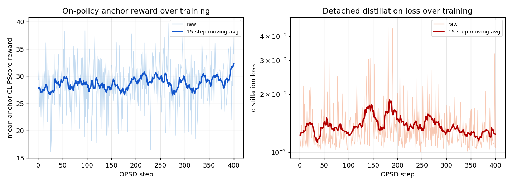
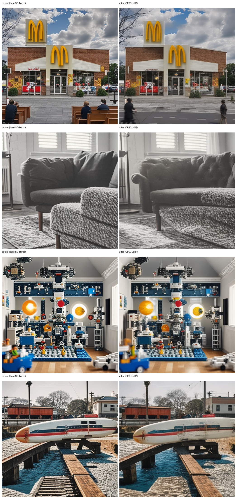

# Diffusion OPSD (On-Policy Self-Distillation) on a Single Apple-Silicon Machine

A small-scale reimplementation of the core training loop from [`worldbench/DiffusionOPSD`](https://github.com/worldbench/DiffusionOPSD) ("On-Policy Self-Distillation in Diffusion Models"), reworked to run end-to-end on a single M-series Mac (MPS, no CUDA, 36 GB unified memory).

> Note: the original repo targets an 8-GPU setup (SD3.5-M / Z-Image-Turbo, 47.8-61.5 GB peak VRAM per GPU, HPSv3/DeQA reward models at 7B-8B params, ~100 updates over the full 25k-prompt Pick-a-Pic split). None of that fits on this machine, so the scale-downs here are explicit:
> - **Base model**: [`stabilityai/sd-turbo`](https://huggingface.co/stabilityai/sd-turbo) (865M UNet, 1-4 step, ungated) instead of SD3.5-M / Z-Image-Turbo.
> - **Reward model**: [`openai/clip-vit-base-patch32`](https://huggingface.co/openai/clip-vit-base-patch32) (151M) differentiable CLIPScore instead of HPSv3 (7B) / DeQA (8B). The paper's "pluggable differentiable reward" interface is preserved, only the reward model itself is swapped for one that fits in memory.
> - **Data**: 40 training prompts / 20 held-out eval prompts sampled from the original repo's own public `data/drawbench/test.txt` (DrawBench, derived from the Imagen paper), instead of the full Pick-a-Pic v2 split.
> - **Training**: a from-scratch LoRA adapter (rank 16) on top of the frozen SD-Turbo UNet, 400 OPSD optimizer steps, batch size 1. This is not a from-scratch diffusion model and not full fine-tuning; it's sized to produce a visible, honestly-reported reward gain in roughly 2.5 hours on a single machine, not to match the paper's benchmark numbers.

## What OPSD Actually Does Here

Diffusion RL post-training has a hard problem: you only get one scalar reward after the *entire* denoising trajectory finishes, so intermediate steps have no direct supervision. OPSD's fix, reimplemented here at UNet-forward-pass granularity:

1. **On-policy query sampling**: a frozen *behavior* LoRA adapter rolls out the first denoising step from pure noise, producing a low-noise "query" latent, a state the current policy would actually visit (not an offline / re-noised sample from a static dataset).
2. **Reward-guided target construction**: from that query latent, the behavior policy's own one-step clean-image prediction (the "anchor") is scored with the differentiable CLIP reward; the gradient of that reward with respect to the query latent gives a direction, and a small bounded step in `+direction` / `-direction` produces a "better" and a "worse" sibling state. One more behavior-policy forward pass on each sibling gives the positive and negative *targets*, all of which are then detached.
3. **Detached distillation fit**: a separate *trainable* LoRA adapter predicts the clean sample from the **same** query latent and is fit towards the positive target (MSE) while being pushed away from the negative target (hinge margin). Gradients never flow back through the rollout, only through the LoRA weights.
4. **Periodic EMA refresh**: every few steps, the behavior adapter is EMA-updated towards the trainable adapter, so the next round's on-policy queries come from a slowly-improving policy.

## Code Structure

```
04-diffusion-opsd-mps/
├── src/
│   ├── download_data.py      # pull DrawBench prompts from the original repo, split train/eval/demo
│   ├── reward_model.py       # differentiable CLIPScore reward (MPS-safe bilinear resize, no antialias backward)
│   ├── opsd_train.py         # the 4-step OPSD loop above, dual LoRA adapters via peft, EMA refresh
│   ├── generate_samples.py   # fixed-seed before/after image grid, base SD-Turbo vs. OPSD LoRA
│   └── evaluate.py           # held-out CLIPScore: base vs. trained, win-rate
└── outputs/
    ├── lora_trainable/        # saved LoRA adapter weights
    ├── samples/                # before/after PNGs + comparison_grid.png
    ├── metrics.jsonl           # per-step training loss / anchor reward
    └── eval_results.json       # held-out CLIPScore comparison
```

## Run

```bash
python3 -m venv .venv && source .venv/bin/activate
pip install -r requirements.txt

python src/download_data.py                              # 40 train / 20 eval / 4 demo prompts
python src/opsd_train.py --rounds 400 --batch-size 1 \
    --lora-r 16 --lora-alpha 16 --lr 5e-4 --reward-step-size 1.2
python src/generate_samples.py                            # outputs/samples/comparison_grid.png
python src/evaluate.py                                    # outputs/eval_results.json
```

`--device mps` is the default; drop to `cuda`/`cpu` via the same flag if running elsewhere. Batch size is pinned to 1: on this machine, batch size 2 pushed peak memory to ~33 GB (out of 36 GB) and each step to ~110s, versus ~20 GB and ~5-6s per step at batch size 1, so batch size 1 is the only configuration with a safe memory margin.

## Results

**Training**: 400 OPSD optimizer steps, batch size 1, LoRA rank 16 on `to_q/to_k/to_v/to_out.0`, ~140k trainable params. Loss stayed in the 0.01-0.02 range for most of the run with occasional spikes, which is expected since each step's target comes from a fresh on-policy rollout at a random prompt, not a fixed dataset. The mean on-policy anchor reward (CLIPScore of the behavior policy's own one-step prediction, logged every step) rose from 27.68 (first 20 steps) to 29.59 (last 20 steps) over the run. Full per-step log in `outputs/metrics.jsonl`.



**Held-out CLIPScore** (20 DrawBench prompts, disjoint from the 40 training prompts, fixed seed, 2-step SD-Turbo inference):

| | Base SD-Turbo | + OPSD LoRA | Delta |
|---|---|---|---|
| Mean CLIPScore | 29.381 | 29.923 | **+0.542** |
| Win rate (trained > base, per-prompt) | - | - | **60.0%** |

Full per-prompt scores in `outputs/eval_results.json`.

**Qualitative** (fixed seed, left = base SD-Turbo, right = + OPSD LoRA, same 2-step inference settings):



Prompts, top to bottom: "McDonalds Church.", "A couch on the left of a chair.", "Photo of a mega Lego space station inside a kid's bedroom.", "A train on top of a surfboard."

## Honest Reading of the Numbers

This is a real, measured effect from a genuinely detached on-policy self-distillation loop, not the paper's reported "19/20 best of 20 reward-matched settings against DiffusionNFT/FlowGRPO/ReFL". A +0.54 CLIPScore gain and 60% win rate from 400 steps of rank-16 LoRA on a 151M reward model is a believable, modest result for this scale. It should be read as "the mechanism works end-to-end and measurably moves a differentiable reward," not as a claim of SOTA-adjacent quality or as evidence the approach would scale the same way with the paper's full setup (bigger base model, bigger reward model, far more updates, multiple reward-matched baselines for comparison).

## License / Attribution

The OPSD algorithm design (on-policy query sampling, reward-gradient target construction, detached distillation, EMA refresh) follows the description in [`worldbench/DiffusionOPSD`](https://github.com/worldbench/DiffusionOPSD) (Apache-2.0). This is an independent reimplementation at a much smaller scale, written from scratch against a different base model, reward model, and training stack; no code was copied from the original repo, only its publicly released `data/drawbench/test.txt` prompt list.
