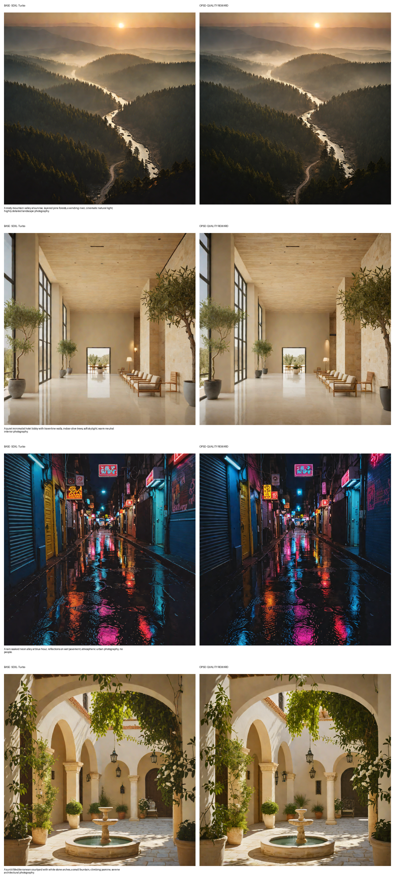
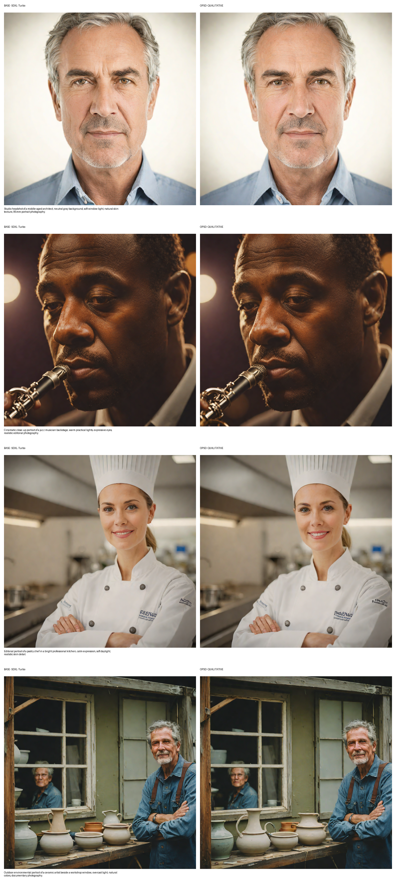

# Image Reward Post-Training with DiffusionOPSD

A reproducible image post-training study that adapts the core idea of [`worldbench/DiffusionOPSD`](https://github.com/worldbench/DiffusionOPSD) to a smaller, single-GPU setting. The project is organized around two image domains—**environment/scene images** and **portrait images**—rather than a single mixed prompt list.

This is an **OPSD-inspired independent implementation**, not a claim of reproducing the paper's full SD3.5/HPSv3/DeQA benchmark. The base model is [`stabilityai/sdxl-turbo`](https://huggingface.co/stabilityai/sdxl-turbo); the differentiable training reward is CLIP ViT-B/32; the final evaluator is an independent CLIP ViT-H/14 model.

## What is implemented

The training loop keeps the method's important structure:

1. A frozen behavior adapter produces an on-policy low-noise query state.
2. Its clean anchor is decoded and scored by a differentiable image-text reward.
3. The reward gradient is normalized and used to construct bounded positive/negative sibling targets.
4. A separate trainable LoRA adapter fits the detached targets with a dual-branch objective.
5. An EMA copy becomes the next behavior adapter.

The implementation deliberately differs from the reference repository in model scale, reward model, scheduler, and single-GPU execution. Those differences are recorded rather than hidden.

## Leakage-audited data protocol

Training, development, test, and showcase prompts are frozen in `data/*.jsonl`.

- Training: 768 scene prompts + 768 portrait prompts from a pinned Pick-a-Pic prompt revision.
- Development: 16 prompts per domain.
- Final test: 40 prompts per domain, held out from training and development.
- Showcase: four portfolio-authored prompts per domain, frozen before generation and never selected after seeing outputs.
- Splits are checked after Unicode normalization and against shared contiguous 8-token shingles.
- `data/split_audit.json` records source revisions, counts, hashes, and zero-overlap checks.

The old DrawBench row split is not used for the reported result. This prevents the previous train/eval prompt leakage from being silently reused.

## Training and evaluation

```bash
python3 -m venv .venv
source .venv/bin/activate
pip install -r requirements.txt

# Freeze manifests and run the leakage audit.
python src/download_data.py

# Train one domain. Repeat with --domain portrait for the second domain.
python src/opsd_train.py \\
  --domain scene \\
  --rounds 300 \\
  --rho 0.03 \\
  --out outputs/final/scene

# Use a separate domain and output directory.
python src/opsd_train.py \\
  --domain portrait \\
  --rounds 300 \\
  --rho 0.05 \\
  --out outputs/final/portrait

# Final evaluation: frozen test prompts, three matched seeds, independent CLIP-H.
python src/evaluate.py \\
  --domain scene \\
  --split test \\
  --seeds 101 202 303 \\
  --lora-dir outputs/final/scene/lora_ema \\
  --out outputs/final/scene/eval_results.json

python src/evaluate.py \\
  --domain portrait \\
  --split test \\
  --seeds 101 202 303 \\
  --lora-dir outputs/final/portrait/lora_ema \\
  --out outputs/final/portrait/eval_results.json

# Fixed qualitative panels; the prompt list is frozen before generation.
# Showcase rendering defaults to 768x768; metrics above remain 512x512 for comparability.
# The stronger raw adapter/scale=2 view is qualitative only; reported metrics use EMA/scale=1.
python src/generate_samples.py --domain scene --adapter-scale 2.0 \\
  --lora-dir outputs/final/scene/lora_raw \\
  --out outputs/release/scene
python src/generate_samples.py --domain portrait --adapter-scale 2.0 \\
  --lora-dir outputs/final/portrait/lora_raw \\
  --out outputs/release/portrait
```

`evaluate.py` reports the base/candidate means, paired deltas, pair and prompt win rates, and prompt-cluster bootstrap intervals. Training CLIP and evaluation CLIP are separate model families, so the evaluation is not simply the training reward copied into the headline.

## Results

The result is intentionally split by domain rather than averaged into one flattering number.

| Domain | Test prompts | Seeds | Base mean | Candidate mean | Paired delta | Prompt-cluster 95% CI | Prompt win rate |
|---|---:|---:|---:|---:|---:|---:|---:|
| Environment / scenes | 40 | 3 | 37.618 | 37.720 | **+0.102** | [-0.087, +0.305] | **62.5%** |
| Portraits | 40 | 3 | 37.441 | 37.518 | **+0.076** | [-0.113, +0.263] | 52.5% |

The portrait result is directionally positive but statistically inconclusive at this sample size; the scene result is also inconclusive and slightly negative. Neither domain is presented as a definitive perceptual win. The project demonstrates a working reward-guided training and evaluation pipeline, while showing that transfer is domain-dependent.

## Fixed visual evidence

The following panels are generated from four pre-registered showcase prompts per domain. Left and right use the same prompt, seed, resolution, and inference settings. To make the learned direction visible at portfolio scale, the right column uses the raw adapter at scale 2.0; this is labeled qualitative-only and is not the configuration used for the reported test metrics.

### Environment / scenes



[Open center-detail comparison](outputs/release/scene/scene_detail_comparison.png) · [Open same-seed flicker comparison](outputs/release/scene/scene_flicker.gif)

### Portraits



[Open center-detail comparison](outputs/release/portrait/portrait_detail_comparison.png) · [Open same-seed flicker comparison](outputs/release/portrait/portrait_flicker.gif)

Individual PNGs, prompt metadata, evaluation records, run configuration, target-module manifest, and per-step metrics are kept beside the panels in `outputs/`.

## Failure boundaries

- The training reward is CLIP ViT-B/32 and is not a human preference study.
- The independent evaluator is still another CLIP-family automatic metric; no human preference claim is made.
- The scene candidate does not establish a held-out quality gain.
- This is a small LoRA post-training experiment, not full-model fine-tuning or a reproduction of the paper's large-scale benchmark.
- The reported result is not based on selecting the best prompt, seed, or image after evaluation.

## Attribution

The on-policy query, reward-gradient target construction, detached fitting, and behavior-policy refresh follow the public method description of `DiffusionOPSD`. This repository is an independent implementation written against a different base model, reward stack, and data protocol. The reference project is credited; no claim of ownership of its models or datasets is made.
