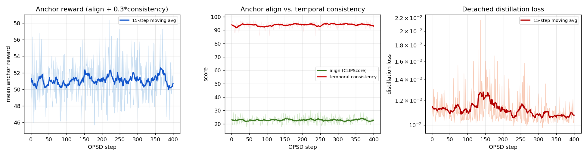
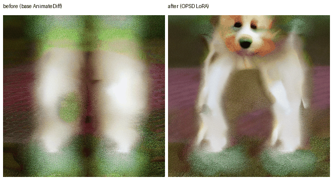
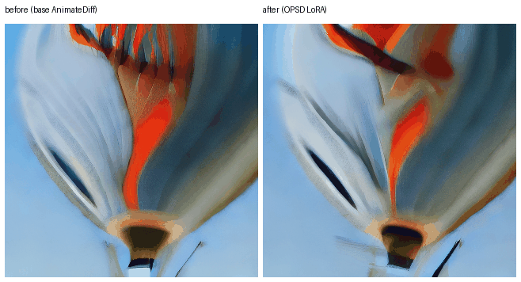
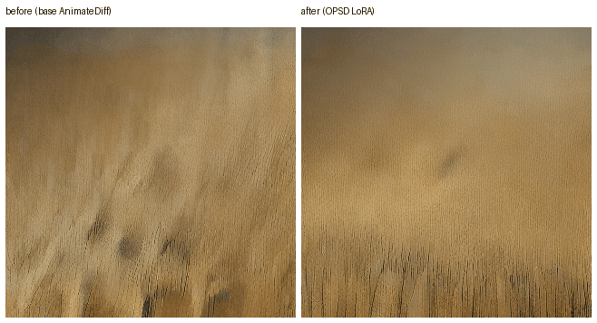
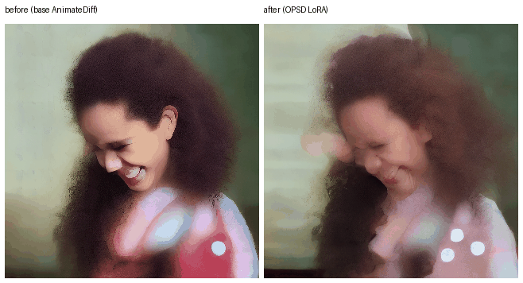
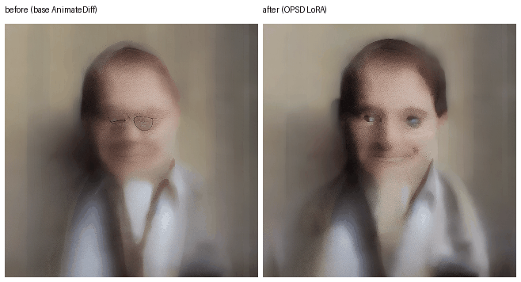
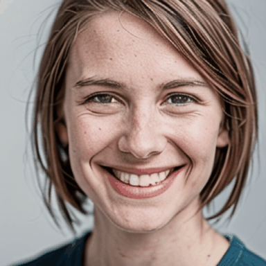
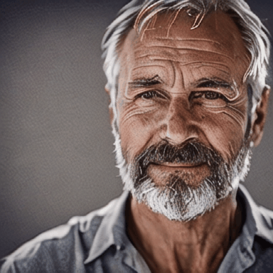

# Video OPSD: Extending On-Policy Self-Distillation to Text-to-Video

Extends [`04-diffusion-opsd-mps`](../04-diffusion-opsd-mps) (image OPSD) to **text-to-video**, replacing the single-frame SD-Turbo UNet with [AnimateDiff](https://arxiv.org/abs/2307.04725)'s frozen motion adapter stacked on an SD1.5 UNet, and a LoRA trained with the same OPSD loop drives it. Runs end-to-end on the same single M-series Mac (MPS, 36 GB unified memory).

> As with the image project, this is explicitly a small-scale demonstration, not a reproduction of any paper's video results. Scale-downs:
> - **Base model**: [`stable-diffusion-v1-5`](https://huggingface.co/stable-diffusion-v1-5/stable-diffusion-v1-5) UNet (860M, same size class as SD-Turbo) with the frozen [`guoyww/animatediff-motion-adapter-v1-5-2`](https://huggingface.co/guoyww/animatediff-motion-adapter-v1-5-2) stacked on top, instead of a purpose-built video diffusion model.
> - **Data**: DrawBench (used in the image project) describes static scenes and has nothing for a video model to animate, so this project uses a small hand-authored list of 30 prompts that each describe visible motion (water flowing, something spinning / falling / flying / rising, etc.), split 18 train / 9 eval / 3 demo. See `data/prompts_all.txt`.
> - **Training**: rank-16 LoRA on the UNet's spatial attention projections only (`to_q/to_k/to_v/to_out.0`, excluding the motion adapter's own temporal-attention layers, which stay frozen throughout), 400 OPSD steps, batch size 1, 6 frames per clip at 256x256. Took about 4 hours on this machine.

## What's Different From the Image Version

The 4-step OPSD mechanism itself (on-policy query sampling, reward-gradient-guided positive/negative target construction, detached distillation fit, EMA-refreshed behavior policy) is unchanged, now applied to a `(C, frames, H, W)` video latent instead of a single-frame `(C, H, W)` latent. Two things had to be extended:

1. **Reward model** (`reward_model.py`): CLIPScore only ever scores one still image, so a video needs something more. `ClipVideoRewardModel` averages CLIPScore over the sampled frames (text-alignment) and adds a *temporal consistency* term, the mean cosine similarity between consecutive frames' CLIP image embeddings (do the frames look like a continuous scene, not a slideshow). Both terms stay differentiable end-to-end, which OPSD's reward-gradient step needs. `reward = align + 0.3 * consistency`, neither the per-frame averaging nor the consistency term is from the original DiffusionOPSD paper, it is the minimum extension needed to score a video instead of an image.
2. **LoRA placement** (`opsd_train_video.py`): LoRA targets are filtered to exclude any module path containing `motion_modules`, so training only ever edits "what the model draws per frame," never "how it moves between frames" (the motion adapter is a separately pretrained, frozen module).

Everything else, batch size 1, dual LoRA adapters via `peft`, EMA refresh, the fixed `sigma0/sigma1/t0/t1` constants, carries over unchanged: SD1.5 and SD-Turbo share the exact same noise schedule (`beta_start=0.00085`, `beta_end=0.012`, scaled-linear), so the sigma values computed for the image project apply here too.

## Code Structure

```
05-video-opsd-mps/
├── src/
│   ├── prepare_data.py          # split the hand-authored motion-prompt list into train/eval/demo
│   ├── reward_model.py          # ClipVideoRewardModel: frame-averaged CLIPScore + temporal consistency
│   ├── opsd_train_video.py      # the same 4-step OPSD loop, adapted to video latents + AnimateDiff
│   ├── generate_samples_video.py# fixed-seed before/after GIFs, base AnimateDiff vs. OPSD LoRA
│   ├── evaluate_video.py        # held-out video reward: base vs. trained, win-rate
│   ├── generate_portrait_t2v.py # portrait before/after, same OPSD LoRA, text-to-video
│   └── generate_portrait_i2v.py # portrait image-to-video demo (SVD, not OPSD-trained, see below)
├── data/
│   ├── prompts_all.txt          # 30 hand-authored motion prompts
│   ├── train_prompts.txt        # 18
│   ├── eval_prompts.txt         # 9, disjoint from training
│   └── demo_prompts.txt         # 3, disjoint from both
└── outputs/
    ├── lora_trainable/           # saved LoRA adapter weights
    ├── samples/                  # before/after/comparison GIFs + training_curves.png
    ├── metrics.jsonl             # per-step training loss / anchor reward
    └── eval_results.json         # held-out reward comparison
```

## Run

```bash
python3 -m venv .venv && source .venv/bin/activate
pip install -r requirements.txt

python src/prepare_data.py                                   # 18 train / 9 eval / 3 demo prompts
python src/opsd_train_video.py --rounds 400 --batch-size 1 \
    --num-frames 6 --resolution 256 --lora-r 16 --lora-alpha 16 --lr 5e-4 --reward-step-size 1.2
python src/generate_samples_video.py                          # outputs/samples/comparison_*.gif
python src/evaluate_video.py                                  # outputs/eval_results.json
python src/generate_portrait_t2v.py                            # portrait_t2v_comparison_*.gif (same LoRA, text-to-video)
python src/generate_portrait_i2v.py                            # portrait_i2v_*.gif (SVD, image-to-video, not OPSD-trained)
```

`--device mps` is the default. 6 frames at 256x256 (batch size 1) peaks at about 30 GB on this 36 GB machine, roughly 15-20s/step; 8 frames at the same resolution pushed peak memory past 35 GB, too close to the limit to run safely alongside anything else on the machine, so 6 frames was the chosen training configuration.

## Results

**Training**: 400 OPSD optimizer steps, ~3.99 hours wall clock, batch size 1, LoRA rank 16 on the UNet's spatial `to_q/to_k/to_v/to_out.0` only. Unlike the image project, the per-step on-policy anchor reward stayed roughly flat over the run (mean 50.59 in the first 20 steps vs. 50.22 in the last 20), with high step-to-step variance since each step's anchor reward comes from a single random prompt and a single random noise draw at batch size 1. Temporal consistency alone is already high from the frozen motion adapter (~90-97 out of 100), leaving less headroom than the image project's CLIPScore-only reward, and most of the per-step variance is the align term swinging with how hard each random prompt happens to be, not a trend in either direction.



**Held-out video reward** (9 hand-authored motion prompts, disjoint from the 18 training prompts, fixed seed per prompt so base and trained only differ in the LoRA weights, 8 frames, 256x256, 6-step inference):

| | Base AnimateDiff | + OPSD LoRA | Delta |
|---|---|---|---|
| Mean reward (align + 0.3 x consistency) | 49.730 | 50.253 | **+0.523** |
| Mean align (CLIPScore) | 21.64 | 21.97 | +0.33 |
| Mean temporal consistency | 93.64 | 94.29 | +0.65 |
| Win rate (trained > base, per-prompt) | - | - | **77.8%** |

Full per-prompt scores in `outputs/eval_results.json`. This fixed-seed, same-noise comparison is a cleaner signal than the noisy per-step training curve above: it isolates the LoRA's effect from prompt/noise variance and shows a small but consistent gain in both text alignment and frame-to-frame consistency.

**Qualitative** (fixed seed, left = base AnimateDiff, right = + OPSD LoRA, same 6-step inference settings; images below are animated GIFs, open the README on GitHub to see them play):



*"a golden retriever puppy running across a grassy lawn"*, the base model's frame is a blurry, nearly symmetric smear with no recognizable dog; the OPSD LoRA frame renders a clearly identifiable puppy face and body.



*"a hot air balloon slowly rising into a blue sky"*, both are already recognizable, the trained version has sharper edges and less color bleed.



*"waves of golden wheat swaying in the wind"*, the trained version has a smoother, less streaky texture.

GIF playback is intentionally slow (16 frames at 4 fps, 4 seconds per loop) since AnimateDiff's native output cadence (originally exported at 8 fps) made the already-small 1-2 second motion hard to read; everything above and below uses the same 4 fps.

## Portrait Demos

The 400-step OPSD run above only trained on object/scene motion prompts (water, balloons, animals, vehicles), so these portrait clips are an out-of-distribution check: does the same LoRA still do something sensible on faces, and separately, does image-to-video work at all on this machine.

**Text-to-video, same OPSD LoRA** (`src/generate_portrait_t2v.py`, fixed seed, left = base, right = + OPSD LoRA):




Faces are a harder case for this base model at 320x320/6 steps than the object prompts above, most random seeds produce venetian-blind-style striping artifacts across the face (an AnimateDiff v1-5-2 + SD1.5 failure mode at this resolution/step count, unrelated to OPSD), so these two use seeds hand-picked for a recognizable result rather than `base_seed + index` like the other demos. Within that constraint the same qualitative direction holds: the trained version renders cleaner facial structure (visible eyes/mouth) where the base version is closer to a featureless smear.

**Image-to-video, portrait photo to clip** (`src/generate_portrait_i2v.py`): the AnimateDiff model this project trains has no image-conditioning input, so there is no OPSD-trained path for image-to-video, this part uses a separate frozen pretrained model, [Stable Video Diffusion (img2vid)](https://huggingface.co/stabilityai/stable-video-diffusion-img2vid), to answer the "does image-to-video work here" question on its own. No LoRA, no OPSD training involved. Source stills are synthesized with SD-Turbo (not photos of real people), then animated:




Ran at 384x384, 14 frames, 20 steps, peak memory about 25 GB, about 2.5 minutes per clip on this machine, comfortably within budget since inference needs no gradients.

## Honest Reading of the Numbers

The training-reward curve here does not show the clear upward trend seen in the image project; at this scale (400 steps, batch size 1, rank-16 LoRA, a much heavier video UNet than SD-Turbo) the per-step on-policy signal is too noisy to read a trend from directly. What is measurable is a small, consistent effect on a proper held-out comparison: +0.52 reward and a 77.8% per-prompt win rate on 9 prompts the model never trained on, with one qualitative example (the puppy clip) showing an obvious, visible quality jump and the other two showing smaller texture/edge improvements. This should be read as "the OPSD mechanism still produces a measurable, directionally consistent effect when extended to a heavier video model with a stricter LoRA scope," not as evidence this would scale to production video quality or that the training curve itself is a reliable step-to-step progress signal at this budget.

## License / Attribution

The OPSD algorithm follows [*On-Policy Self-Distillation in Diffusion Models*](https://arxiv.org/abs/2608.24646) (Zhou, Zhu, Kong, Chen, Zhang, Liang, Hou, Tian, Sun, Wang, Li, Wu, Qu, Li, Liu, McAuley, Chua et al.), with the reference implementation at [`worldbench/DiffusionOPSD`](https://github.com/worldbench/DiffusionOPSD) (Apache-2.0), same as `04-diffusion-opsd-mps`. Both projects here are original from-scratch implementations written against the paper's description (no code copied from the reference repo), so there is no attribution or licensing obligation beyond what's stated here, Apache-2.0 only restricts redistributing *their* code verbatim without notice, it does not restrict independently implementing the published method. The video-specific extensions (frame-averaged + temporal-consistency reward, motion-adapter-excluded LoRA scope, the 30-prompt motion dataset, the portrait demos) are original work for this project, not described in the original paper. AnimateDiff's motion adapter (`guoyww/animatediff-motion-adapter-v1-5-2`) and SD1.5 weights are used frozen under CreativeML OpenRAIL-M, which permits this kind of use. Stable Video Diffusion (`stable-video-diffusion-img2vid`, used only in the image-to-video portrait demo) is under Stability AI's Non-Commercial Research Community License, free for research/personal/portfolio use like this, but not for commercial use without a separate agreement with Stability AI.
