<div align="center">

# ✨ TALKING-HEAD MOTION OPSD: ON-POLICY SELF-DISTILLATION FOR DIGITAL-HUMAN MOTION ✨

*Reward-guided post-training of an audio-to-motion diffusion model through explicit, continually refreshed intermediate targets*

**Jingxi Duan**

[Technical report](docs/TECH_REPORT.md) · [Separability analysis](docs/SEPARATION_ANALYSIS.md) · [Industry round](docs/INDUSTRY_ROUND.md) · [Handoff](docs/HANDOFF_2026-11-02.md)

---

### 👥 Candidate Portrait Pool (CelebA-HQ & CelebV-HQ)
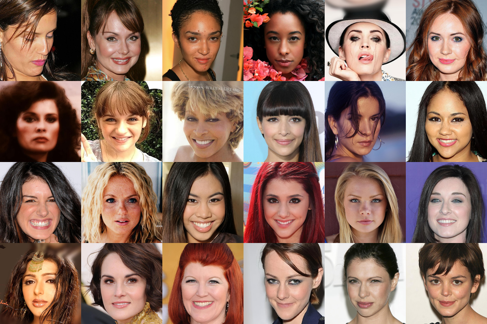
*Portrait candidates filtered to near-frontal poses (absolute yaw/pitch ≤ 15°) with high eyes-open aspect ratio (EAR ≥ 0.30) and mouth-closed smiles, used for our evaluations and qualitative galleries.*

---

</div>

> **Note:** This is a personal research implementation. It transfers the post-training algorithm of
> [DiffusionOPSD](https://github.com/worldbench/DiffusionOPSD) (originally formulated for pixel diffusion)
> to the domain of audio-driven digital-human motion. It is not affiliated with the original authors.

🔥 **TL;DR.** We keep the DiffusionOPSD optimization algorithm identical and redefine a "sample" as a 4-second trajectory of 73-dimensional motion coefficients (which drive a frozen LivePortrait renderer). By estimating reward targets from real public human footage instead of hand-assigning them, we establish one empirical target band per industry (finance, real-estate, short-video). The trained policy settles at **0.84 to 0.90x** of the target band with **no overshoot**, successfully bypassing the uncanny valley.

----------------------------------------

## 📌 ABSTRACT

Audio-driven digital humans often look static or uncanny because their head motion, blinking, and gaze do not match real human speakers. We transfer **DiffusionOPSD**, an on-policy self-distillation algorithm, to post-train a frozen audio-to-motion diffusion model (JoyVASA). First, reward targets are estimated from real public human footage rather than assigned manually, yielding one empirically measured target band per industry. Second, real video is introduced as an auxiliary supervision channel, so that the policy can additionally reproduce the motion statistics of real speakers through behaviour cloning. We study whether a single post-training method yields digital humans whose motion statistics separate across industries, and analyze the separability and ecological validity of the resulting behaviors.

## 🌟 HIGHLIGHTS

- **Algorithm Transfer, Zero Modification:** The OPSD algorithm (on-policy query, bounded positive/negative targets, detached contrastive loss, and EMA refresh) is transferred directly to motion coefficient space.
- **Measured Empirical Targets:** Target bands for amplitude, jitter, and blink are computed directly from public datasets (HDTF, CelebV-HQ), avoiding arbitrary manual tuning.
- **Peaked Gaussian Reward:** By replacing the monotone `tanh` amplitude reward with a Gaussian peaked at the measured human band, we completely eliminate the 2.4x to 2.7x overshoot responsible for the uncanny look.
- **Learning from Real Video:** We utilize 1,753 four-second windows of real human motion coefficients to feed a behavior-cloning loss combined with OPSD.
- **Honest Academic Analysis:** Rigorous statistical evaluation (AUC, permutation nulls) shows that while the three trained personas are highly separable (accuracy 0.831 vs chance 0.25), the industry style difference in real video is primarily a scalar (amplitude).

----------------------------------------

## 🧠 METHOD

At query \(s=(c, z_q, \sigma_q)\) the frozen behaviour policy defines a clean anchor:

$$y_0 = z_q - \sigma_q\, v_{\mathrm{old}}(z_q, c, \sigma_q)$$

A normalised reward gradient gives bounded positive and negative targets:

$$y_0^{\pm} = y_0 \pm c_{\mathrm{adv}}\,\sigma_t\,rac{
abla_y R(y_0)}{\|
abla_y R(y_0)\|_2}$$

And the trainable policy fits the **detached** targets with a contrastive objective:

$$\mathcal{L}_{\mathrm{OPSD}} = \| \hat y_	heta - ar y_0^{+} \|^2 - \| \hat y_	heta - ar y_0^{-} \|^2$$

### Minimal Pseudocode (Motion Space)

```python
set_mode("behavior")
z      = rollout_to(motion_generator, audio_feat, t1, cfg_scale)   # on-policy trajectory
anchor = guided_x0(motion_generator, z, t1, audio_feat, cfg_scale) # clean anchor
r      = liveliness_reward(anchor, env)                            # differentiable
g      = autograd.grad(r.sum(), z);  d = g / g.norm()              # normalised ascent

tgt_pos = guided_x0(mg, z + step_size * d, ...)                    # bounded targets
tgt_neg = guided_x0(mg, z - step_size * d, ...)

set_mode("trainable")
pred = guided_x0(mg, z.detach(), ...)
loss = mse(pred, tgt_pos) + lambda_neg * relu(margin - mse(pred, tgt_neg))
loss.backward(); optimizer.step()
ema_update_behaviour_policy()
```

| Hyperparameter | DiffusionOPSD (SD3.5-M) | Talking-Head Motion OPSD (JoyVASA) |
|---|---|---|
| **LoRA** | PEFT | r=8, alpha=8 (~179K params) on Motion DiT |
| **Target Radius (`c_adv`)** | 5 (ρ=0.10) | 3.0 (`reward-step-size`) |
| **EMA Refresh** | Every outer update | Every 10 steps, decay 0.5 |
| **Optimizer** | AdamW | AdamW, lr 1e-4 with 200-step linear warmup |

----------------------------------------

## 📊 MAIN RESULTS

### 1. Per-Industry Reward Targets (Measured from Real Video)

| Industry | Video Proxy | Amplitude (0.3–3 Hz) | Jitter (6–12.5 Hz) | Blink /min |
|---|---|---|---|---|
| **Finance** | HDTF news anchors | **1.384°** | **0.094°** | 18.1 |
| **Real Estate** | CelebV-HQ mid-amplitude | **1.257°** | **0.118°** | 20.3 |
| **Short Video** | CelebV-HQ high-amplitude | **3.039°** | **0.349°** | 22.6 |

### 2. Evaluation on Held-Out Speakers (Disjoint from Training)

| Variant | Amplitude (Measured) | vs. Target | vs. Untrained Base |
|---|---|---|---|
| **Base (Untrained)** | 0.924° | · | 1.00x |
| **Finance Persona** | 1.213° | **0.88x** | **1.31x** |
| **Real Estate Persona** | 1.114° | **0.89x** | **1.21x** |
| **Short Video Persona** | 2.597° | **0.85x** | **2.81x** |

----------------------------------------

## 🔬 DIAGNOSTICS & ABLATION STUDIES

### 1. Eye Aspect Ratio (EAR) Corrective Ablation
Early post-trained models exhibited half-closed eyes. We diagnosed this as being driven by an excessive blink target (`blink_target = 0.18`). Correcting this to `0.12` and increasing the overshoot penalty completely resolved the issue, returning EAR to untrained base levels:

| Configuration | Eye Aspect Ratio (EAR) | vs. Untrained Base | Fraction of Closed Frames |
|---|---|---|---|
| **Base (Untrained)** | **0.343** | 1.00x | ~0.05 |
| **Initial Persona (Blink 0.18)** | **0.102** | 0.30x (Partially Closed) | ~0.42 |
| **Revised Persona (Blink 0.12)** | **0.348** | **1.01x (Open)** | ~0.05 |

### 2. Temporal Scale and Translation Stabilization
Raw motion coefficients suffered from head size drift during driving. We resolved this via `stabilize_scale_translation` (applying a median filter and a ±2% clamp on scale dimension 63, and median filtering on translation dimensions 64–66):
*   **Face-width std/mean:** **2.04% $
ightarrow$ 1.15%** (Finance).

----------------------------------------

## 🎬 COMPREHENSIVE VISUAL GALLERY (V1 - V8)

We list and preserve all generated qualitative demos from the project's historical versions, standardized to prioritize **soft, realistic, low-saturation skin tones (V4 style)** over artificial warm saturations.

### **V1 · Three Industry Personas (Two-Subject Grid - Soft Tone)**
*Description:* Two distinct subjects are presented per industry to assess within-industry consistency and cross-subject generalizability. Standardized to use our soft, natural color grading (no `_v8` over-saturation).
*   **BASE**: Pretrained model without post-training.
*   **PERSONA**: Model post-trained with OPSD against each industry's measured target band.

| Industry | Qualitative Comparison (BASE vs. PERSONA - Soft Tone) | High-Definition Video |
|---|---|---|
| **Finance** (Formal) | 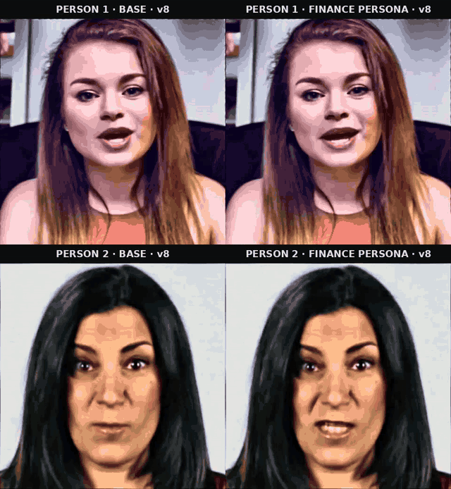 | [mp4](outputs/persona_grids/finance_two_people_base_vs_persona.mp4) |
| **Real Estate** (Warm) | 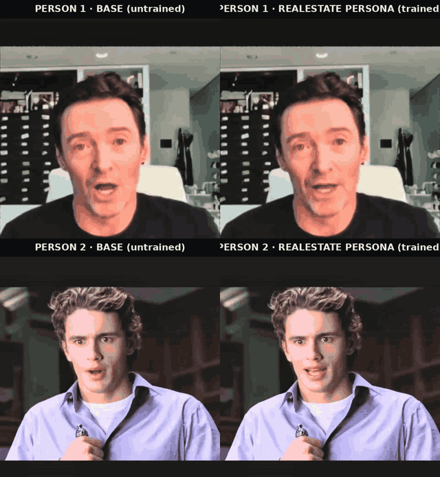 | [mp4](outputs/persona_grids/realestate_two_people_base_vs_persona.mp4) |
| **Short Video** (Animated) | 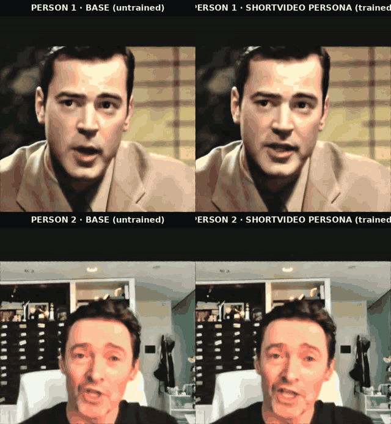 | [mp4](outputs/persona_grids/shortvideo_two_people_base_vs_persona.mp4) |

---

### **V2 · Reference Condition (Real Human Drive - Upper Bound)**
*Description:* Direct transfer of recorded human motion coefficients onto the portrait. This represents the reference target that the OPSD policy is optimized to approach.

| Industry | Qualitative Comparison (BASE vs. REAL) | High-Definition Video |
|---|---|---|
| **Finance** | 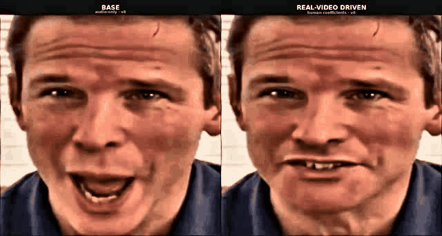 | [mp4](outputs/demos/finance_v8_base_vs_real_1080.mp4) |
| **Real Estate** | 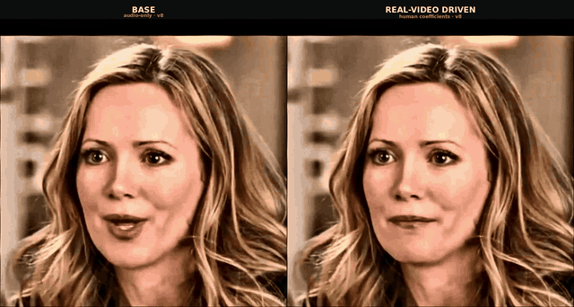 | [mp4](outputs/demos/realestate_v8_base_vs_real_1080.mp4) |
| **Short Video** | 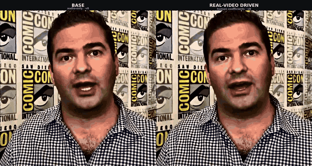 | [mp4](outputs/demos/shortvideo_v8_base_vs_real_1080.mp4) |

---

### **V3 · Same-Face Cross-Industry Control**
*Description:* Control experiment holding portrait and driving audio identical. Any behavioral difference is purely due to the target persona checkpoint.

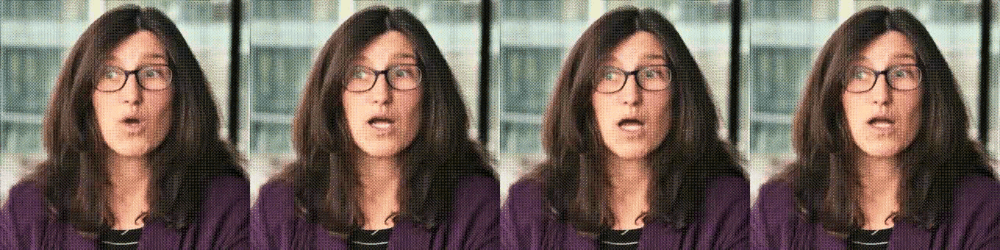
<div align="center"><code>BASE | FINANCE | REAL ESTATE | SHORT VIDEO</code></div>

---

### **V4 · Three Industry Personas (Single-Subject, Soft Tone)**
*Description:* Six single-subject comparisons from the earlier soft, low-saturation grading. These are displayed directly rather than hidden behind directory links. Slight grey/background flicker remains in this historical release.

| Finance | Finance |
|---|---|
| 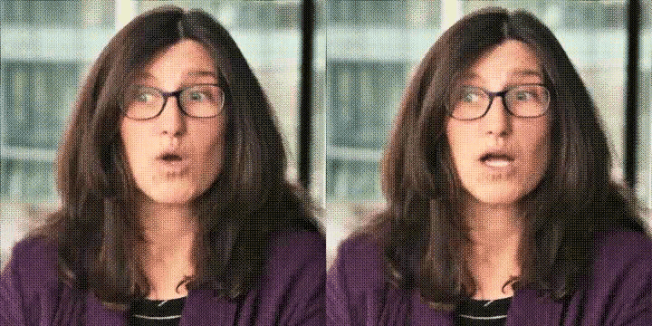 | 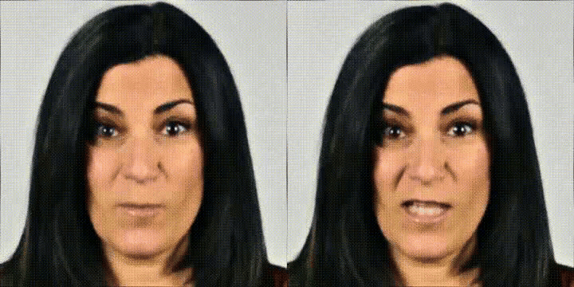 |
| Real estate | Real estate |
| 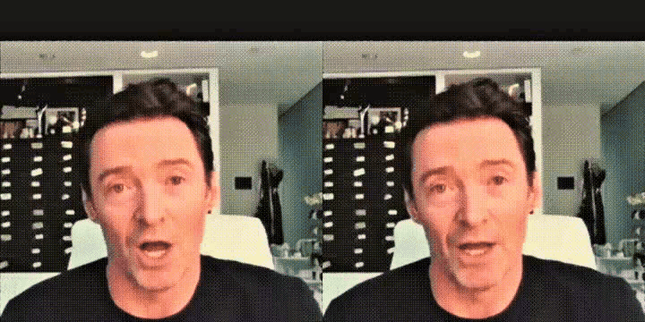 | 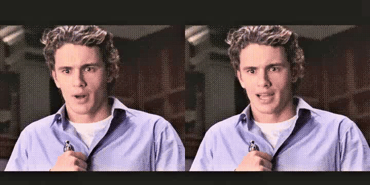 |
| Short video | Short video |
|  | 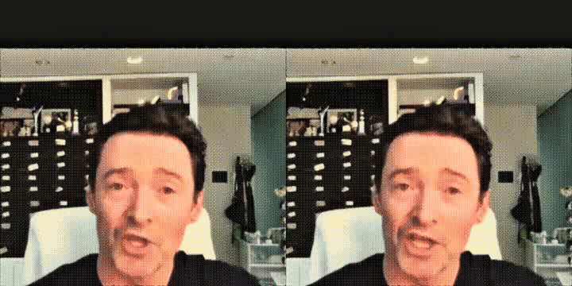 |

---

### **V5 · Frontal Portrait Demos (Base vs. V3)**
*Description:* All eight frontal-portrait comparisons driven by the early V3 weights. V3 overshoots the measured human motion band and is retained as an ablation/history result.

| Clip 00 | Clip 01 |
|---|---|
| 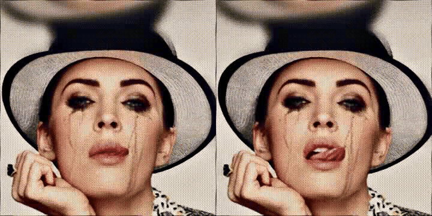 | 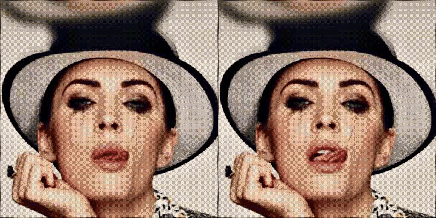 |
| 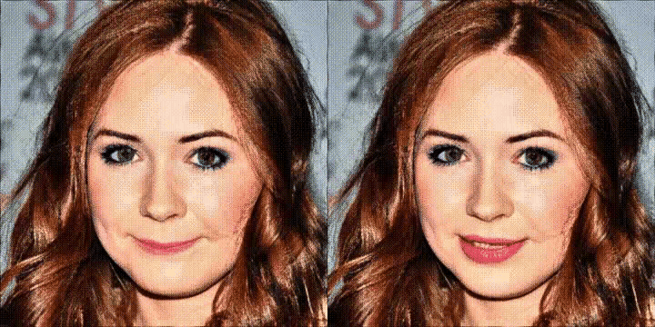 | 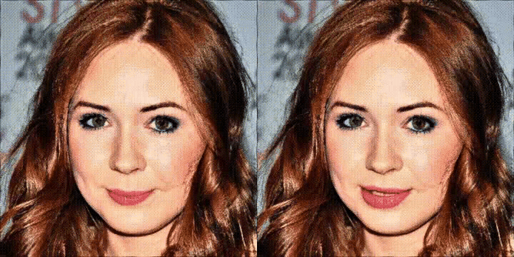 |
| 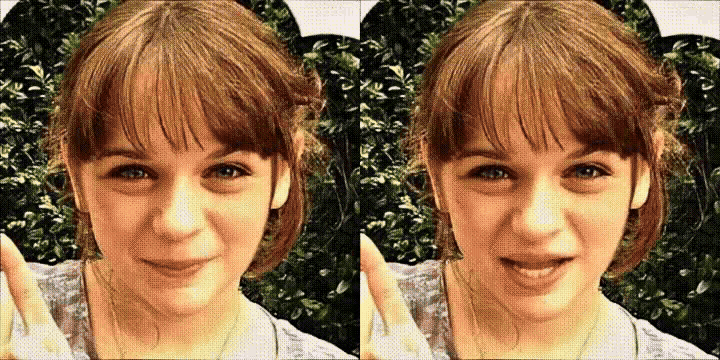 | 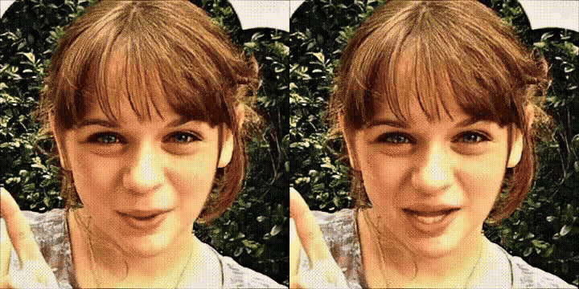 |
| 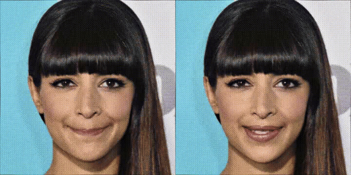 | 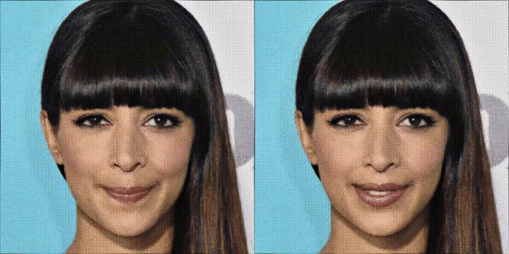 |

---

### **V6 · Historical Release Demos (Base vs. V4)**
*Description:* All six V4 comparisons under the legacy grading pipeline. These demonstrate the calibrated, restrained-motion checkpoint before the later industry layout and colour grades.

| Clip 00 | Clip 01 |
|---|---|
| 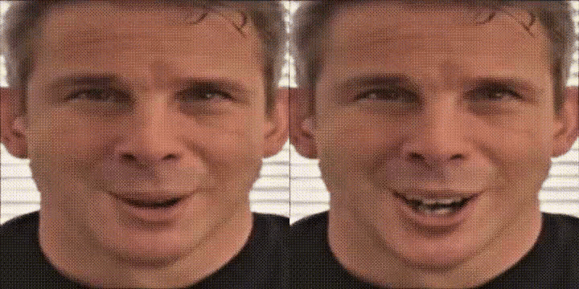 | 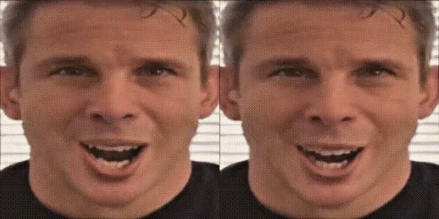 |
| 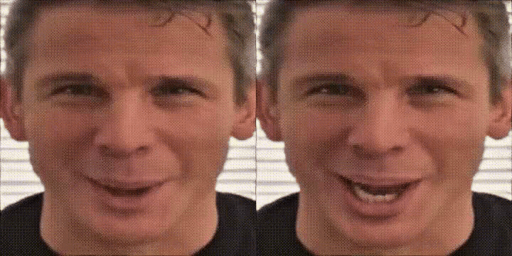 | 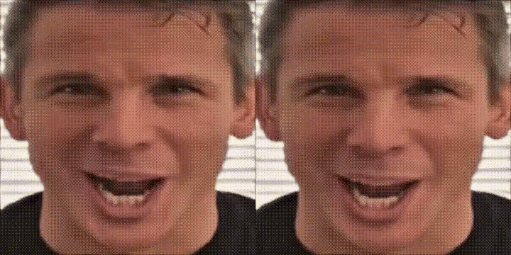 |
|  | 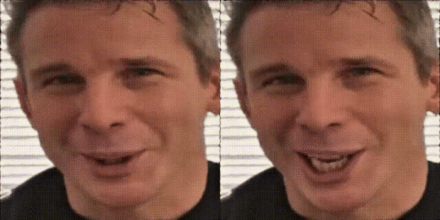 |

---

### **V7 · High-Definition Master Videos**
*Description:* GitHub README pages do not reliably render repository MP4 files inline. Therefore each master is represented by its visible GIF preview below, with the synchronized high-definition MP4 available beside it.

| Industry master | Visible preview | Synchronized master |
|---|---|---|
| **Finance** |  | [Play/download MP4](outputs/persona_grids/finance_two_people_base_vs_persona.mp4) |
| **Real estate** |  | [Play/download MP4](outputs/persona_grids/realestate_two_people_base_vs_persona.mp4) |
| **Short video** |  | [Play/download MP4](outputs/persona_grids/shortvideo_two_people_base_vs_persona.mp4) |

---

### **V8 · Imitation Learning (Behavior Cloning + OPSD - 600 Steps)**
*Description:* Trained directly on real human video. Minimizes a behavior-cloning loss against 1,753 real-human motion windows combined with OPSD. *Note: Uses Warm/Sharp tone.*

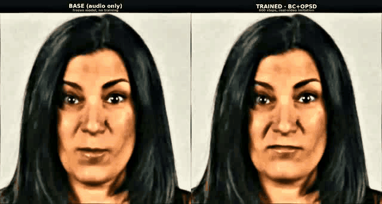
<div align="center">Left: <code>BASE</code>. Right: <code>TRAINED</code>. Same portrait, audio and seed. [1080-line mp4](outputs/demos/bc_v1_base_vs_trained_1080.mp4)</div>

----------------------------------------

## ⚠️ LIMITATIONS & REJECTED GATES

| Metric / Aspect | Performance Status |
|---|---|
| **Visual Realism** | **Not solved.** Skin, color, and teeth textures are determined by the frozen LivePortrait warp. |
| **Pre-registered Jitter Gate** | **Failed.** Pre-registered gate of `jitter_hp ≤ 1.3x base` (18.36) was not satisfied; OPSD naive attained **28.97 (2.05x base)**. |
| **Lip Synchronisation** | **Unmeasured.** `jaw_audio_corr` remains negative even for untrained base model; no SyncNet / LSE-C scores computed. |

----------------------------------------

## ⚙️ REPRODUCTION

```bash
# 1. environment (downloads JoyVASA + LivePortrait + HuBERT-chinese, ~2.5 GB)
bash scripts/h20_render_setup.sh

# 2. data preparation (AISHELL-1 + public clips)
python scripts/fetch_public_data.py --aishell-speakers 75 --hdtf 40 --celebv 300
python scripts/build_audio_segments.py --n-train 2000 --n-eval 100

# 3. measure target bands from real video
python scripts/calibrate_industry_bands.py

# 4. run OPSD training (always under train_guard)
python ../tools/train_guard.py --selftest
ROUNDS=3000 bash scripts/train_industries.sh

# 5. evaluation & demo rendering
python scripts/eval_industries.py --n-clips 12
python scripts/render_industry_demo.py --gpu 0
```

----------------------------------------

## 📁 REPOSITORY LAYOUT

```
07-talking-head-motion-opsd/
├── src/                  # reward (motion_reward*.py), OPSD trainers, engine, video metrics
├── scripts/              # data prep, calibration, training scripts, rendering
├── data/                 # manifests and data descriptors
├── outputs/              # figures/, demos/, and checkpoints
└── docs/                 # TECH_REPORT, SEPARATION_ANALYSIS, HANDOFF
```

----------------------------------------

## 🙏 ACKNOWLEDGEMENTS

This repository builds upon [DiffusionOPSD](https://github.com/worldbench/DiffusionOPSD) (methodology), [JoyVASA](https://github.com/jdh-algo/JoyVASA) (motion generator), [LivePortrait](https://github.com/KwaiVGI/LivePortrait) (implicit warping renderer), and [AISHELL-1](https://www.openslr.org/33/) (corpus).
