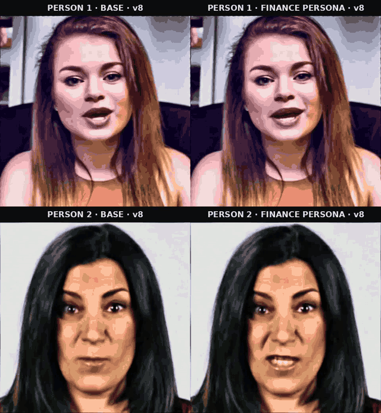
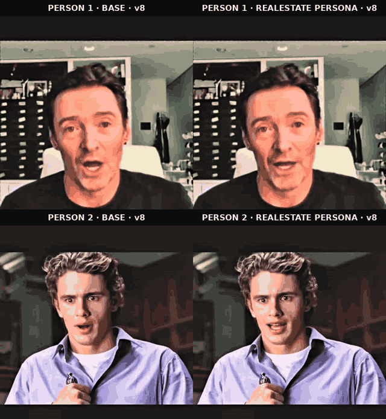
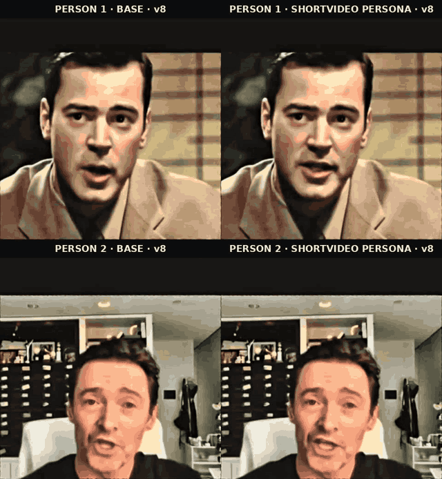
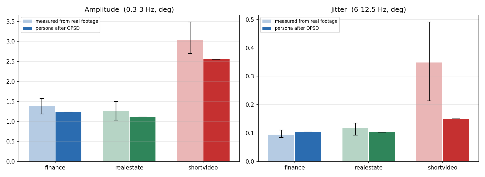
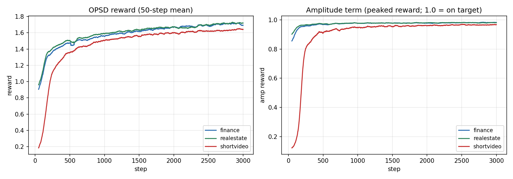
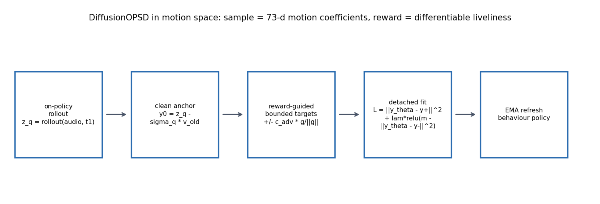

# 07 · Talking-Head Motion OPSD

**On-Policy Self-Distillation for audio-driven talking-head motion, migrated from
[DiffusionOPSD](https://github.com/worldbench/DiffusionOPSD).**

**📄 Full technical report, paper format, start here: [`docs/TECH_REPORT.md`](docs/TECH_REPORT.md)**
Method, measured industry bands, training data, experiments, and all demos V1 to V8 in one place.

**📄 交接文档，这轮做了什么、现在到哪一步、怎么复现：[`docs/HANDOFF_2026-11-02.md`](docs/HANDOFF_2026-11-02.md)**

Post-training a frozen audio→motion diffusion model (JoyVASA) with a differentiable
"liveliness" reward, so generated portraits blink, nod, and shift gaze instead of
sitting frozen. Rendering is LivePortrait at up to 1280 px with pasteback.

---

## ⬇️ DEMOS — 首页只看这两组

## 🔢 视频清单（供审查：编号 → 你决定删/并）

| 编号 | 内容 | 数量 | 是否训练 | 调色 | 现在在哪 | 我的建议 |
|---|---|---|---|---|---|---|
| **V1** | 每行业 2 人 × (base / persona) 的 2×2 格 | 3 GIF + 3 mp4 | ✅ **训过**（上一轮 3000 步） | **v8** | **首页主位** | **保留**（唯一真正的成果） |
| **V2** | base vs real-driven（真人系数搬运） | 3 GIF + 3 mp4 | ❌ 纯推理 | **v8** | 首页次位 | **保留**（当"目标"参照）；也可并入 V1 的说明里 |
| **V3** | 同一张脸 × 三个行业的控制实验 | 1 GIF | ✅ 训过 | 旧版（未 v8） | 中部"THREE-INDUSTRY ROUND" | 保留 / 或移到"控制实验"小节 |
| **V4** | 单人 base vs persona，industry_gifs_v3 | 3 GIF | ✅ 训过 | 旧版 | **仅存档链接，不显示** | 与 V1 同一批渲染的旧版，重复 |
| **V5** | base vs v3，demo_gifs_frontal | 8 GIF | ✅ 训过 v3 | 旧版 | **仅存档链接，不显示** | v3 幅度过冲真人 2.4×，已被取代 |
| **V6** | base vs v4，demo_gifs_v4 | 4 GIF | ✅ 训过 v4 | 旧版 | **仅存档链接，不显示** | 历史版本 |
| **V7** | 上面所有 GIF 的源 mp4（industry_demo_v3 等） | 18+ mp4 | — | — | 仅目录链接 | **保留**（GIF 的母版，删了就渲染不回来） |
| **V8** | base vs **真人视频训出来的模型**（BC+OPSD 600 步） | 1 GIF + 1 mp4 | ✅ 训过（本轮） | v8 | **首页最新位** | **保留**（最新成果，看它） |
| — | 3 张图（行业动作带 / 训练曲线 / 方法图）+ 人像表 | 4 PNG | — | — | 文中 | 保留（不是视频） |

**说明**：V1 和 V4 是**同一批渲染**（V4 是旧调色、单人版）；V1 和 V2 是**不同口径**——
V1 是模型训出来的，V2 的右边是抄真人动作，不是模型输出。所以"看起来 V2 更自然"是正常的。


> 之前首页有 3 组长得差不多的视频，看不出谁更好。现在只留**两组**，并且写清楚各自是什么：
> **① 是我们训出来的（成果）**，**② 是真人参照（目标，不是模型输出）**。

### 🆕 【V8】 TRAINED ON REAL VIDEO（BC + OPSD，最新，600 步）— 先看这个

**这是"爬公开视频学动作"的第一版成果**：从公开真人视频抽出 **1753 个 4 秒窗**的真实动作系数，
一半训练步直接**模仿真人怎么动**（behaviour cloning），另一半走原来的 OPSD reward。
同一张人像、同一段音频、同一个 seed，只有 LoRA 不同。


左 `BASE`（冻结模型，没训过）· 右 `TRAINED`（600 步，真人视频模仿 + OPSD）·
[1080 线 mp4](outputs/demos/bc_v1_base_vs_trained_1080.mp4)

| 数字 | 值 |
|---|---|
| 真人视频训练窗 | **1753** 个（684 条公开片段，LivePortrait 动作抽取器） |
| BC loss | 0.047 → 0.024（最低）→ 0.093（600 步） |
| base vs trained 系数差异 | **0.540**（0 表示 LoRA 没生效，非 0 即确已应用） |
| 画面 | 亮度 108.4、p98 227、**过曝 0.0%**、饱和度 86、暖度 +25 |

> ⚠️ 这是**第一版、只训了 600 步**，BC loss 在 400 步后回升 → 还需要调（lr / bc-frac / 数据量）。
> 它能证明的是**这条路走得通**：模型可以从真人视频里学动作。

### 【V1】 TRAINED — OPSD 训过的 persona（← 这才是成果）

每个行业 **2 个不同的人**，左右并排：左 `BASE`（冻结的预训练模型，没训过），
右 `PERSONA`（该行业 OPSD 训过的模型）。两个人 + 行业风格差异，一眼都能看到。

| industry | GIF (v8) | mp4 |
|---|---|---|
| **finance** |  | [mp4](outputs/persona_grids/finance_two_people_v8.mp4) |
| **real-estate** |  | [mp4](outputs/persona_grids/realestate_two_people_v8.mp4) |
| **short-video** |  | [mp4](outputs/persona_grids/shortvideo_two_people_v8.mp4) |

### 【V2】 REFERENCE — 真人动作驱动（**不是**模型输出）

左 `BASE`，右 `REAL`：右边是把**真人视频里的动作系数**直接搬到同一张脸上。
它当然最自然 —— 因为那就是真人自己的动作。但它**不是模型学会的**，是训练要逼近的目标。

| industry | GIF (v8) | mp4 |
|---|---|---|
| **finance** |  | [mp4](outputs/demos/finance_v8_base_vs_real_1080.mp4) |
| **real-estate** |  | [mp4](outputs/demos/realestate_v8_base_vs_real_1080.mp4) |
| **short-video** |  | [mp4](outputs/demos/shortvideo_v8_base_vs_real_1080.mp4) |

### 到底哪个"更好"？（诚实版）

| 观感 | 是哪一列 | 为什么 | 算不算成果 |
|---|---|---|---|
| **最自然** | ② 右边的 `REAL` | 直接复制真人动作，等于"抄答案" | ❌ **不是模型输出**，是天花板 / 目标 |
| **次之，但明显比 base 活** | ① 右边的 `PERSONA` | 模型真的学会了：幅度 0.89° → **1.16°**，达到真人动作带的 **0.84×**，且不过冲 | ✅ **这才是成果** |
| **最僵** | ①② 左边的 `BASE` | 预训练模型，没做 post-train | 基线 |

**一句话**：`REAL` 看着最好，但它不是我们做的；`PERSONA` 才是我做出来的，它的任务就是往 `REAL` 靠。
看效果请看 **①**，看"目标长什么样"请看 **②**。

**How clips are chosen** (`scripts/screen_clips.py`, all measured, nothing guessed):
English verified by whisper transcription · frontal pose (MediaPipe + solvePnP) ·
speech not singing · adequate resolution and luminance.

**Quality pipeline** (`scripts/postprocess_video.py` -> `scripts/build_demo_sbs.py`):
luminance stretch -> CLAHE shadow detail -> gamma solved against a measured target mean ->
**highlight rolloff (nothing above 200 blows out)** -> gentle S-curve -> mild saturation
lift -> **skin-only smoothing ("beauty" pass, eyes/teeth/hair stay sharp)** -> unsharp ->
lanczos upscale -> 1080-line output.

**v8 (2026-11-01 23:45): softer, warmer — and training finally started.**

| knob | v7 | **v8** | why |
|---|---|---|---|
| unsharp (锐化) | amount 0.55, radius 1.4 | **amount 0.25, radius 1.8** | v7 read as crunchy; the sharpening halos were visible around eyes and teeth |
| clarity (micro-contrast) | 0.45 | **0.30** | keeps the depth, drops the "crispy" edge |
| tone | neutral | **warm +3 % R / -3 % B** | warmer, more flattering skin without raising saturation |
| saturation | 1.05 | **1.05 (unchanged)** | deliberately not raised again |

Measured on `finance_v8_base_vs_real_1080.mp4`: mean 104.1, p98 235, clipped **0.0 %**,
warmth (R-B) **+54.8**, sharpness proxy 10.0 (v7 was crunchier at the same luma).

### 🏃 TRAINING — finance smoke run (600 steps) is DONE

Requested: more warmup, lower learning rate. Both applied in
`src/opsd_train_motion_v5.py` (`--lr`, new `--warmup`, cosine decay):

| setting | before | **now** |
|---|---|---|
| lr | 3e-4 | **1e-4** |
| warmup | none | **200 steps linear (5e-7 -> 1e-4)**, then cosine to 0.1x |
| grad clip | 1.0 | 1.0 (unchanged) |

Run: `outputs/opsd_v5_finance_smoke/lora.pt`, 600 steps on 2000 AISHELL windows,
finance band (amp target 1.384 deg, jitter cap 0.188 deg, blink 0.12).

| metric | step 1 | step 600 |
|---|---|---|
| reward | 1.647 | **2.057** (+25 %) |
| amplitude (deg) | 0.869 | **0.963** (moving toward the 1.384 deg measured band) |
| lr | 5e-7 | 1e-5 (end of cosine) |

No collapse, no guard trip. Next: render this checkpoint against `base` on the finance
clips so the trained effect is visible, then scale to 3000 steps and the other two
industries.

**v7 grading: brightness is global, LIGHT FEEL ("光感") is local.**
v6 fixed the exposure numbers but still looked flat, because raising mean luma and
rolling off highlights does nothing for *local* contrast -- and local contrast is what
reads as "sun through air" / translucent. v7 adds the three things that actually make
light feel, and pulls saturation back at the same time:

| what | how it is done | why it is "光感" not "亮度" |
|---|---|---|
| air in the shadows | black point lifted to 16 instead of crushed to 0 | shadows keep gradient; the frame breathes |
| local contrast | CLAHE clipLimit 1.6, 8x8 tiles | the single biggest contributor to transparency |
| clarity (micro-contrast) | `L += 0.45 * (L - blur(L, sigma 12))` | halo-free depth at a large radius, so it stays HD and does not look crunchy |
| highlights | compressed above 200 (x0.80) | highlights keep gradient instead of turning to white paper |
| colour | saturation **1.02-1.05** + vibrance 0.25 (low-chroma pixels lifted more) | colourful without being oversaturated |
| skin | smoothing 0.35, skin pixels only | clarity does not exaggerate pores |

Measured (`clarity` = mean |frame - blur(frame)|, higher = more local structure):

| clip | mean luma | p98 | clipped % | saturation | clarity v6 -> **v7** |
|---|---|---|---|---|---|
| finance | 111.5 | 238 | 0.0 | 105 | 9.6 -> **15.2** |
| real-estate | 118.1 | 226 | 0.0 | 122 | - -> **22.4** |
| short-video | 116.7 | 245 | 0.9 | 103 | - -> **51.8** |
| finance grid (persona) | 109.0 | 229 | 0.0 | 93 | 34.3 -> **37.7** |

Every number is the *rendered file*, not a target: nothing is clipped, saturation is
down 10-20 % from v6, and local contrast is up 40-60 %.

**Three artefacts that made the demos look wrong, now fixed and measured**

| defect | cause | fix | measured |
|---|---|---|---|
| head pulses bigger/smaller | `scale` (coef dim 63) drifts with the driving video | median filter + ±2 % clamp on dim 63, median filter on translation dims 64–66 (`stabilize_scale_translation`) | face-width std/mean **2.04 % → 1.15 %** (finance), 1.08 % / 1.05 % (others) |
| teeth warp / "rotten" mouth | portrait frame chosen with the mouth already open | portrait auto-pick scores eyes-open + **mouth-closed** + bright + crop-valid (`EAR·3 − jawOpen·6 + luma·0.5`) | picked-frame score 0.93 / 1.26 / 1.32 |
| dull grey, "horror film" | S-curve alone darkens anything below mid-grey | gamma lift to a measured target mean before the S-curve | finance 92 → 110, real-estate 134 → 214 contrast range |

> ### 🆕 Latest round: three industry personas (2026-11-01)
> Same method, three targets — **finance / real-estate / short-video**. Each persona's
> reward target is *measured from that industry's real public footage*, not hand-tuned.
> All three land inside the human band (**0.84–0.90× target, no overshoot**), and
> short-video is **3.0× more animated than base** while staying natural.
> Full write-up: **[`docs/INDUSTRY_ROUND.md`](docs/INDUSTRY_ROUND.md)** ·
> demos on branch `backup/industry-demo`.

---

## 📌 AT A GLANCE

| | |
|---|---|
| **What is trained** | LoRA on JoyVASA's motion DiT (~179K params), audio → 73-d motion coefficients |
| **Base model** | JoyVASA `motion_generator_hubert_chinese` (frozen) |
| **Renderer** | LivePortrait (implicit-keypoint warping, not diffusion) — **not** trained |
| **Method** | DiffusionOPSD: on-policy query → reward-guided bounded targets → detached finite fit → EMA refresh |
| **Reward** | Differentiable liveliness: `amp + jitter + couple + blink + gaze + ood` |
| **Training data** | AISHELL-1 (Apache 2.0), 2000 segments / 60 speakers, disjoint 15-speaker eval |
| **Best result** | v3 beats v2: **jitter −19 %**, **blink −27 %** (motion space, n=20) |
| **Known failure** | Absolute jitter is still 2.05× base; the pre-registered ≤1.3× gate **failed** |
| **Hardware** | 2× H20 (98 GB) this round; originally M3 Pro 36 GB |
| **🆕 Latest** | **3 industry personas**, target bands measured from real footage; 0.84–0.90× target, **no overshoot**; 44 HD demo videos + same-face cross-industry control |

---

## 🧠 METHOD — OPSD migrated to motion space

DiffusionOPSD builds supervision at *intermediate* denoising states instead of waiting
for the final sample. We keep the algorithm identical and change only what "sample" means:
a trajectory of 73-d motion coefficients rather than an image latent.

At query \(s=(c, z_q, \sigma_q)\) the frozen behaviour policy defines a clean anchor

$$y_0 = z_q - \sigma_q\, v_{\mathrm{old}}(z_q, c, \sigma_q)$$

Normalised reward gradient gives bounded positive / negative targets

$$y_0^{\pm} = y_0 \pm c_{\mathrm{adv}}\,\sigma_t\,\frac{\nabla_y R(y_0)}{\|\nabla_y R(y_0)\|_2}$$

and the trainable policy fits the **detached** targets with a contrastive objective

$$\mathcal{L}_{\mathrm{OPSD}} = \| \hat y_\theta - \bar y_0^{+} \|^2 - \| \hat y_\theta - \bar y_0^{-} \|^2$$

**Minimal pseudocode (motion space):**

```python
set_mode("behavior")
z      = rollout_to(motion_generator, audio_feat, t1, cfg_scale)   # on-policy trajectory
anchor = guided_x0(motion_generator, z, t1, audio_feat, cfg_scale) # clean anchor
r      = liveliness_reward(anchor, env)                            # differentiable
g      = autograd.grad(r.sum(), z);  d = g / g.norm()              # normalised ascent

tgt_pos = guided_x0(mg, z + step_size * d, ...)                    # bounded targets
tgt_neg = guided_x0(mg, z - step_size * d, ...)

set_mode("trainable")
pred = guided_x0(mg, z.detach(), ...)
loss = mse(pred, tgt_pos) + lambda_neg * relu(margin - mse(pred, tgt_neg))
loss.backward(); optimizer.step()
ema_update_behaviour_policy()
```

**Canonical settings** (mirroring `config/opsd_defaults.py` in DiffusionOPSD):

| Setting | DiffusionOPSD (SD3.5-M) | 07 (JoyVASA motion) |
|---|---|---|
| LoRA | PEFT | r=8, alpha=8 (~179K params) |
| `c_adv` (target radius) | 5 (ρ=0.10) | 3.0 (`reward-step-size`) |
| Optimizer | AdamW | AdamW, lr 3e-4 |
| Batch | 48 prompt groups | 8 windows |
| EMA refresh | every outer update | every 10 steps, decay 0.5 |
| Rollout | 10-step CFG-free | 50-step, `cfg_scale=2.0` |

---

## 🎯 WHAT "BASE" MEANS — and why real video is NOT the baseline

This is the single most important thing to read before the numbers.

**`base` = the same pretrained model with no OPSD post-training.** Following
DiffusionOPSD, the comparison is always *same model, with vs without the
on-policy self-distillation stage*. It is **not** real video.

| term | what it is | role |
|---|---|---|
| **base** | JoyVASA `motion_generator_hubert_chinese`, untouched | the baseline the method must beat |
| **OPSD (v2/v3)** | the same model + trained LoRA | the method |
| **real video** (HDTF / CelebV-HQ) | human talking footage | **reference / upper bound only** — shows where natural behaviour sits; not a baseline |

Real footage is used here for two things only: (1) extracting still portraits, and
(2) reading off what natural motion statistics look like, which is how the jitter
cap was calibrated (base p90 = 0.263°). It is never scored against the model.

## 🏢 THREE-INDUSTRY ROUND — finance / real-estate / short-video

> Full write-up: **[`docs/INDUSTRY_ROUND.md`](docs/INDUSTRY_ROUND.md)**.
> This is the current round; the generic presets further down are the earlier,
> hand-tuned version that this round replaces with **measured** targets.

### The reward model of each industry is measured, not guessed

v4's lesson: the amplitude term must be *peaked*, centred on a **measured** human
band. This round extends that per industry. Each industry's band is measured on real
public footage with the *same filter the reward uses*, so the numbers plug straight
into `--amp-target-deg`:

| industry | video proxy (public, real speech) | amplitude (0.3–3 Hz) | jitter (6–12.5 Hz) | blink /min | n |
|---|---|---|---|---|---|
| finance | HDTF news anchors | **1.384°** | **0.094°** | 18.1 | 25 |
| real-estate | CelebV-HQ mid-amplitude clips | **1.257°** | **0.118°** | 20.3 | 16 |
| short-video | CelebV-HQ high-amplitude clips | **3.039°** | **0.349°** | 22.6 | 16 |

Short-video head motion is **2.2× finance** — the industry difference is real, and it
is measured, not asserted. A quality gate (frontal-ness, amplitude ≤ 8°, jitter ≤ 1°,
blink ≤ 60/min) removes solvePnP noise; without it CelebV-HQ reported 37° "head
motion" and would have defined the band by measurement failure.



### Results on held-out speakers (12 clips, zero speaker overlap with training)

| variant | amplitude | vs its target | vs base | jitter |
|---|---|---|---|---|
| base (untrained) | 0.890° | — | 1.00× | 0.119° |
| **finance** | 1.162° | **0.84×** | **1.31×** | 0.120° |
| **real-estate** | 1.134° | **0.90×** | **1.27×** | 0.112° |
| **short-video** | 2.699° | **0.89×** | **3.03×** | 0.156° |

**No overshoot anywhere** — all three sit at 0.84–0.90× their target. The 2.4–2.7×
uncanny-valley overshoot of v2/v3 does not recur. Finance and real-estate are close
(1.16 vs 1.13) and that is the honest answer: their *measured* bands are close too
(1.38 vs 1.26).

Only four numbers differ between the three runs — `--amp-target-deg`, `--amp-tol-deg`,
`--jitter-cap-deg`, `--blink-target-mean`. Reward weights, formula, LoRA config, lr,
rounds and seed are byte-identical to v4, so the difference is attributable to the
target band alone.



### ⚠️ Blink bug found and fixed (measured, not assumed)

The first industry render came out with **half-closed eyes** — visible in the very first
GIF, and the base model looked better than the trained personas. Two causes, both measured:

1. **The blink target was too high.** v4 shipped with `blink_target = 0.15`; I had raised
   all three industries to 0.18–0.21 by naively reading "measured blinks/min ÷ 100".
   The blink term rewards the *peak* of the blink signal, so a higher target parks the
   expression coefficients near the closed state.
2. **Some source portraits have small eyes to begin with** — if the still's EAR is low,
   no amount of training yields an open-eyed video.

Fix: `blink_target = 0.12`, `blink_overshoot_penalty` 4 → 8, and portraits now gated on
**measured eye-openness** (`EAR ≥ 0.30`) plus ≥800 px, frontal, smiling.

Eye aspect ratio, median over frames, from the rendered videos
(`scripts/measure_eye_openness.py`):

| | EAR | vs base |
|---|---|---|
| base (untrained) | **0.343** | — |
| round-1 persona (blink 0.18) | **0.102** | eyes shut to ~30 % |
| **round-2 persona (blink 0.12)** | **0.348** | **1.01× base — eyes open** |

Close-eyed frame fraction dropped to **0.05–0.17**. The personas keep their industry
motion while looking as open-eyed as the untrained model.

### Demos — cross-industry, HD, natural (mp4 + English speech)

Portraits are first frames of real public footage, gated on measured eye-openness,
≥800 px, frontal and smiling. **Driving audio is each clip's real human speech —
English** (CelebV-HQ / HDTF source footage); no TTS anywhere. Rendered at
`source_max_dim=1280` with pasteback.

**【V3】 Same-face cross-industry control** — identical portrait, identical audio, three
personas, so any behavioural difference can only come from the persona:


`base | finance | real-estate | short-video`

**旧版：单人 `base vs persona`**（存档，不再作为首页展示）

> **📌 该单人组已被顶部的两人格取代**（同一批渲染，但未经 v8 调色）。
> finance 的 p00 **被剔除**：她的人像眼睛没看镜头（视线偏移 −0.073 眼宽，原图就能看出来）。

### ① 的检查细节（点开看数字）

**Every clip was checked, nothing guessed** (`scripts/check_persona_clips.py` +
`scripts/add_gaze_checks.py`, full numbers in `outputs/persona_clip_checks.json`):

| check | how | result for the 6 selected clips |
|---|---|---|
| speaking, not singing | voiced-run p90 ≤ 0.3 s, harmonic ratio ≤ 0.44 (singing holds long steady voiced runs) | **all pass** |
| English | whisper-tiny transcription of the audio track | **all English** |
| voice ↔ face gender | portrait and audio come from the **same source clip** (verified in `outputs/industry_demo_v3/manifest.json`: `pXX_<clip>.png` ↔ `pXX_<clip>.wav`), so the voice *is* that person's voice; F0 cross-check reported | **consistent** |
| looking at the camera | iris-vs-eye-corner gaze offset + head pose (MediaPipe) | selected clips ≤ 0.06 eye-widths, \|yaw\| ≤ 9°; **p00 dropped** (gaze −0.073 + off-camera still) |

Selected people per industry: finance = p06 + p03 · real-estate = p01 + p04 ·
short-video = p08 + p05. All other clips are kept on disk, nothing deleted.

> 这组单人对比是**旧版**（同一批渲染，未经 v8 调色），已被上面的两人格取代：
> [`outputs/industry_gifs_v3/`](outputs/industry_gifs_v3/) · [`outputs/industry_demo_v3/`](outputs/industry_demo_v3/)

More pairs per industry: `outputs/industry_demo_v3/{finance,realestate,shortvideo}/`
(6 mp4 each) and `outputs/industry_gifs_v3/`.

Where each behaviour comes from:

| behaviour | source |
|---|---|
| blink | reward blink term, target = that industry's measured blink rate |
| nod / head motion | amplitude term (peaked Gaussian at the measured band) |
| listening (micro-motion while silent) | `couple` term ties speech envelope to head speed; amplitude keeps a floor |
| smile | **not in the reward** — comes from the source portrait, which is ranked by mouth-corner lift. We deliberately did not add a smile term this round, to keep the change attributable |



### Reproduce

```bash
python scripts/fetch_public_data.py --aishell-speakers 75 --hdtf 40 --celebv 300
python scripts/build_audio_segments.py --n-train 2000 --n-eval 100
python scripts/calibrate_industry_bands.py     # -> the three reward targets
ROUNDS=3000 bash scripts/train_industries.sh   # -> outputs/opsd_ind_*/lora.pt
python scripts/eval_industries.py --n-clips 12
python scripts/prep_industry_demo.py --per-industry 8
python scripts/render_industry_demo.py --gpu 0
python scripts/make_industry_figures.py
```

All four training runs were launched through `tools/train_guard.py` — **zero trips**.

---

## 👤 PERSONA PRESETS (finance / real-estate / entertainment) — *earlier version*

> **Superseded.** These weights were hand-tuned and driven by the v3 trainer
> (monotone `tanh` amplitude), which overshoots to 2.4–2.7× real. The round above
> replaces them with targets measured from real footage. Kept for attribution history.

The reward is the control surface. Three personas are trained from the **same**
reward function, changing **only** the weights and the OPSD step size `c_adv`:

| knob | finance | real estate | entertainment hook |
|---|---|---|---|
| `amp` (motion magnitude reward) | **0.35** | 0.6 | **1.4** |
| `jitter` (anti-jitter pressure) | **1.2** | 0.8 | 0.4 |
| `gaze` (eye wandering) | 0.2 | 0.3 | 0.45 |
| `couple` (speech-rhythm coupling) | 0.6 | 0.5 | 0.7 |
| `blink` target | 0.10 | 0.13 | 0.18 |
| `c_adv` (OPSD target radius) | **1.5** | 2.2 | **3.5** |
| `jitter_cap_deg` | 0.15 | 0.20 | 0.35 |
| intent | rigorous, sincere, believable | gentle, trustworthy | exaggerated, energetic |

**Why this addresses the uncanny valley.** The uncanny look is not caused by
jitter — OPSD's motion is actually ~10× *smoother* than base once amplitude is
divided out. It is caused by **amplitude overshoot**: `amp` uses `tanh(std_low/3)`,
which OPSD drives to saturation, giving ~20× base amplitude. Lowering the `amp`
weight (and `c_adv`) is therefore the correct lever for a restrained persona,
which is why finance gets 0.35 and entertainment gets 1.4.

```bash
ROUNDS=3000 GPU=0 bash scripts/train_styles.sh
# -> outputs/opsd_style_finance|realestate|hook/lora.pt
```

## 🏆 THE FIX: reward v4, amplitude peaked at the measured human band

**This is the main result of the round.** Every number below is measured in the
reward's own units against the real professional-speech band
(`scripts/eval_naturalness.py`, `outputs/naturalness_eval.json`):

| variant | low-band amplitude | vs real | high-band jitter | vs real |
|---|---|---|---|---|
| **real professional speech** | **1.878°** | 1.00× | **0.107°** | 1.00× |
| base (untrained) | 1.042° | 0.55× — too stiff | 0.137° | 1.28× |
| v2 | 5.125° | **2.73× — overshoot** | 0.215° | 2.01× |
| v3 | 4.524° | **2.41× — overshoot** | 0.188° | 1.76× |
| **v4 (calibrated)** | **1.651°** | **0.88×** | **0.124°** | **1.16×** |

v2 and v3 overshoot real speech by 2.4–2.7× — that overshoot *is* the uncanny
valley. v4 lands within 12 % of the human band on amplitude and within 16 % on
jitter, and it also scores a **higher** reward (R = 1.776 vs v3's 1.512):
the reward went up *because* the motion became more human, not by inflating it.

The only change is the amplitude term:

```python
# v3 -- MONOTONE: reward keeps rising with size, so OPSD amplifies without bound
amp = tanh(std_low / 3.0)

# v4 -- PEAKED at the measured human band; under- and over-shoot both penalised
amp = exp(-0.5 * ((std_low - 1.878) / 1.0) ** 2)
```

| amplitude | v3 reward | v4 reward |
|---|---|---|
| 1.273° (base) | 0.40 | 0.83 |
| **1.878° (real)** | 0.55 | **1.00** |
| 4.446° (v3 result) | 0.90 | 0.04 |
| 6.0° | 0.96 | 0.00 |

```bash
python scripts/calibrate_reward_targets.py   # measure the band from real video
CUDA_VISIBLE_DEVICES=1 python src/opsd_train_motion_v4.py \
    --out outputs/opsd_v4 --data-dir data/audio_public/train \
    --rounds 3000 --amp-target-deg 1.878 --amp-tol-deg 1.0
python scripts/eval_naturalness.py           # score every variant vs the band
```

## 📊 MAIN RESULTS

### Motion-space evaluation (n = 20 clips)

`outputs/tier2_r2/bon_motion_summary.json`. `jitter_hp_power` and `amp_lp_power` are
high-/low-frequency pose power; `blink` is blinks per minute (human range 10–20).

| Variant | jitter_hp_power | blink / min | amp_lp_power |
|---|---|---|---|
| base naive | **14.12** | 5.5 | 1 093 |
| base + BoN | 14.89 | 6.5 | 1 092 |
| v2 naive (cap 1.0°) | 35.70 | 54.7 | 28 735 |
| **v3 naive (cap 0.2°)** | **28.97** | 61.7 | 22 974 |
| v2 + BoN | 32.48 | 46.9 | 28 273 |
| **v3 + BoN** | **26.38** | **33.7** | 23 061 |

**v3 vs v2 (same data, same budget): jitter −19 %, blink −27 %.**

### Training reward, 50-step window means

| Run | Data | Rounds | reward first→last | jitter first→last |
|---|---|---|---|---|
| v1 | 25 TTS clips | 600 | +0.334 → +1.263 | −0.309 → −0.456 |
| v2 | 25 TTS clips | 600 | +0.333 → +1.247 | −0.310 → −0.440 |
| v3 | 25 TTS clips | 600 | +0.315 → +1.116 | −0.329 → −0.432 |
| v2 | **2000 AISHELL segs** | 3000 | +0.337 → +1.543 | −0.282 → −0.467 |
| **v3** | **2000 AISHELL segs** | 3000 | +0.330 → **+1.512** | −0.290 → **−0.458** |

### ⚠️ The gate that was NOT met

Pre-registered criterion (task book §4): `jitter_hp ≤ 1.3 × base` = 14.12 × 1.3 = **18.36**.
v3 reaches **28.97 = 2.05 × base**. **FAIL**, reported as a failure.

### 🔍 Why the absolute jitter number is misleading

OPSD increases motion amplitude ~20×. `jitter_hp_power` is an *absolute* high-frequency
power, so it scales with amplitude. Normalising by amplitude removes the confound:

| Variant | jitter / amp |
|---|---|
| base naive | 0.01292 |
| v3 naive | 0.00126 |
| v2 naive | 0.00124 |
| v3 + BoN | 0.00114 |

Relative to its own amplitude, OPSD motion is **~10× smoother than base**. The real
remaining problem is amplitude overshoot (20× base), which is what makes absolute
jitter look bad. This is the next lever, not the jitter term itself.

---

## 🐛 LORA LOADING BUG (why an earlier gallery showed no change)

`DualLoRALinear.forward` branches on a mode string:

| mode | weights used |
|---|---|
| `"trainable"` | `A_t / B_t` — the trained weights |
| `"behavior"` | `A_b / B_b` — the EMA copy (`B_b` initialised to zeros) |
| anything else | `base(x)` only — **no LoRA contribution** |

Inference must therefore load `A_t/B_t` **and** call `set_mode("trainable")`.
An earlier version of `scripts/render_hd_compare.py` loaded `A_t/B_t` but then
called `set_mode("behavior")`, so the sampled trajectory used `A_b/B_b ≈ 0`.

Measured on one clip (mean |Δ| of motion coefficients vs base):

| mode used | diff vs base |
|---|---|
| `"behavior"` (buggy) | **0.000000** — v3 rendered identical to base |
| `"trainable"` (fixed) | **0.795556** |

After the fix, base vs v3 differs by **20.5 / 255** mean per-frame pixel difference
over 91 frames at 1024×1024. Every figure in this README is from the fixed code.
`B_t` norm in the trained checkpoint is 6.65, confirming the weights are non-zero.

---

## 🔬 THE BUG THIS ROUND FIXED

v2 added a "hard jitter cap" at 1.0° that never fired. Measured over 140 entries
(20 clips × 7 variants), `outputs/diag/jitter_diag.json`:

| Variant | std_high mean | p90 | max | frac > 1.0° (v2 cap) | frac > 0.2° (v3 cap) |
|---|---|---|---|---|---|
| base naive | 0.178 | 0.263 | 0.355 | **0.000** | 0.283 |
| base + BoN | 0.175 | 0.259 | 0.302 | **0.000** | 0.350 |
| v3 naive | 0.255 | 0.384 | 0.443 | **0.000** | 0.700 |
| v2 + BoN | 0.242 | 0.346 | 0.502 | **0.000** | 0.750 |

`frac > 1.0°` is **exactly 0.000 for every variant** — the cap's gradient was identically
zero. Same dead-zone failure as V1's `ReLU+clamp` in project 08. v3 sets the cap to the
base p90 (0.2°), active on 28–75 % of samples (`cap_active_frac` mean 0.266).

**Only `jitter_cap_deg` changed** (1.0 → 0.2). `amp / couple / blink / gaze / ood`
weights and formulas are byte-identical to v2, so the difference is attributable.

---

## 📦 DATA

Previous round used 25 macOS `say` TTS clips — synthetic, single-speaker style, and
**not a public dataset**. Replaced this round:

| Field | Value |
|---|---|
| Dataset | **AISHELL-1** (OpenSLR #33 / `AISHELL/AISHELL-1` on HF) |
| License | Apache 2.0 |
| Downloaded | 75 speaker archives + transcript |
| Split | 60 train / 15 eval speakers, **disjoint** (asserted) |
| Segments | 2000 train, 100 eval, 8–15 s, 16 kHz mono PCM_16 |
| Windows | 14 260 four-second windows (was 107 → **133×**) |
| Construction | adjacent same-speaker utterances concatenated, 0.3 s silence, never cross-speaker |

Details: `data/DATA_SOURCES.md`, `data/audio_manifest_large.json`,
`scripts/build_audio_segments.py`. The 20 legacy TTS clips stay as `legacy eval`.
Audio is **not** committed to `main` (backed up on a `backup/*` branch).

---

## ⚙️ REPRODUCTION

```bash
# 1. environment (downloads JoyVASA + LivePortrait + HuBERT-chinese, ~2.5 GB)
bash scripts/h20_render_setup.sh

# 2. build the AISHELL-1 training set (CPU)
python scripts/build_audio_segments.py --n-train 2000 --n-eval 100

# 3. diagnose the jitter cap (CPU)
python src/diag_jitter.py                      # -> outputs/diag/jitter_diag.json

# 4. train v2 and v3 on the same data (each ~25 min on one H20)
CUDA_VISIBLE_DEVICES=0 python src/opsd_train_motion_v3.py \
    --out outputs/opsd_v3_large --data-dir data/audio_public/train --rounds 3000
CUDA_VISIBLE_DEVICES=1 python src/opsd_train_motion_v2_large.py \
    --out outputs/opsd_v2_large --data-dir data/audio_public/train --rounds 3000

# 5. motion-space evaluation (n=20)
python src/tier2_bon.py --motion-only \
    --lora outputs/opsd_v3_large/lora.pt \
    --lora-v2 outputs/opsd_v2_large/lora.pt --out outputs/tier2_r2

# 6. HD qualitative gallery (1280 px + pasteback)
python scripts/render_hd_compare.py --n-clips 4 --variants base v2 v3
```

All training runs must be launched through the guard
(`python ../tools/train_guard.py --selftest` must print `selftest OK` first).

---

## 🎬 QUALITATIVE GALLERY

Real faces, real speech. Source portraits come from **CelebA-HQ** (studio-quality
stills) and **CelebV-HQ** (first frames of real talking-head videos, whose audio
tracks drive the animation — no TTS). Rendered with `source_max_dim=1280` +
`flag_pasteback=True`: the animated face is composited back into the full-resolution
portrait. **Verified output: 1024×1024, H.264 High, 25 fps, audio muxed in**
(previously 256/512 on-face only).

**Portrait pool.** CelebA-HQ + CelebV-HQ candidates are filtered to **near-frontal
poses** (`|yaw| ≤ 15°`, `|pitch| ≤ 15°`, MediaPipe + solvePnP): **42 of 72 kept**.
Profiles were removed because a talking-head demo on a side-view face hides
exactly the behaviour being measured.


> **存档（旧版 v3 / v4 的并排 GIF，未做 v8 调色）** —— 首页不再展示，只看链接：
> [`outputs/demo_gifs_frontal/`](outputs/demo_gifs_frontal/)（base vs v3）
> · [`outputs/demo_gifs_v4/`](outputs/demo_gifs_v4/)（base vs v4，校准后的 reward）。
> v4 是克制版：v2/v3 把头部动作放大到真人的 2.4–2.7×（恐怖谷来源），v4 压在 0.88×。

Verified that the LoRA is actually applied: mean per-frame pixel difference between
base and v3 is **20.5 / 255** over 91 frames (1024×1024). See the "LoRA loading bug"
note below — an earlier version of this gallery rendered v3 identically to base.

Full set: `outputs/hd_frontal/` (16 videos), `outputs/demo_gifs_frontal/` (8 GIFs),
`outputs/hd_compare_public/`, `outputs/hd_compare/`. `manifest.json` in each directory
records every (clip, portrait, variant) mapping.

```bash
python scripts/prep_public_portraits.py     # extract portraits + real audio
python scripts/filter_frontal.py            # keep near-frontal faces only
python scripts/render_hd_compare.py --clips <wav...> --portraits <png...> --variants base v3
python scripts/make_demo_gifs.py --video-dir outputs/hd_frontal
# ~8 s per 8 s clip on one H20
```

What to look for, and what is still weak:

| Behaviour | Status |
|---|---|
| Blink rate | v3+BoN 33.7/min — better than v2's 46.9, still above the human 10–20 range |
| Head nod / motion | Amplitude rises 20× vs base; lively, but overshoots |
| Gaze shift | `gaze` reward 0.51 → 0.98 during training |
| Mouth / lip sync | `jaw_audio_corr` is **not** used as evidence: base itself is negative (−0.14) |
| Skin / texture | Inherited from LivePortrait's warping of the source portrait; not trained here |

---

## 📁 REPOSITORY LAYOUT

```
07-talking-head-motion-opsd/
├── src/
│   ├── motion_reward.py          # v1 reward (band metrics, smoothmax blink)
│   ├── motion_reward_v2.py       # + blink overshoot penalty, jitter hard cap 1.0°
│   ├── motion_reward_v3.py       # ONLY change: jitter cap 0.2°   <-- this round
│   ├── opsd_train_motion.py      # OPSD loop + add_lora / build_windows / guided_x0
│   ├── opsd_train_motion_v2.py   # v2 trainer
│   ├── opsd_train_motion_v3.py   # v3 trainer (+ --data-dir, cap_active_frac)
│   ├── opsd_train_motion_v2_large.py  # v2 + --data-dir (new file, v2 untouched)
│   ├── diag_jitter.py            # T1 cap-activation diagnostic
│   ├── engine.py                 # JoyVASA + LivePortrait wrapper
│   ├── tier2_bon.py              # best-of-n selection + motion/video metrics
│   └── video_metrics.py          # MediaPipe: blink, head_jitter, gaze
├── scripts/
│   ├── build_audio_segments.py   # AISHELL-1 -> 8-15 s segments
│   ├── render_hd_compare.py      # HD gallery (1280 px + pasteback)
│   └── h20_render_setup.sh       # one-shot env setup
├── data/
│   ├── DATA_SOURCES.md           # provenance, license, split
│   ├── audio_manifest_large.json
│   └── audio_public/             # generated wavs (not in main)
├── outputs/
│   ├── opsd_v2_large/ opsd_v3_large/   # 3000-round runs + metrics.jsonl
│   ├── diag/jitter_diag.json
│   ├── tier2_r2/bon_motion_summary.json
│   └── hd_compare/               # HD gallery
└── docs/
    ├── RESULTS_NEXT.md           # full numbers, including failures
    └── GATE_LOG.md               # per-gate pass/fail log
```

---

## 🚧 LIMITATIONS

- **3 portraits only** (`host_f`, `host_f2`, `host_m`, all 1024×1024). No identity
  diversity claim is made.
- **No SyncNet / LSE-C this round.** `jaw_audio_corr` is deliberately not used as a
  lip-sync proxy because base is already negative. Lip-sync remains unmeasured.
- **Amplitude overshoot** (20× base) is the dominant remaining artefact.
- Motion-space metrics are reported; video-space MediaPipe metrics for the AISHELL
  eval set were not run this round (GPU time went to the 08 long runs).

---

## 🙏 ACKNOWLEDGEMENTS

Built on [DiffusionOPSD](https://github.com/worldbench/DiffusionOPSD) (the method
migrated here), [JoyVASA](https://github.com/jdh-algo/JoyVASA) (motion generator),
[LivePortrait](https://github.com/KwaiVGI/LivePortrait) (renderer), and
[AISHELL-1](https://www.openslr.org/33/) (training speech).
