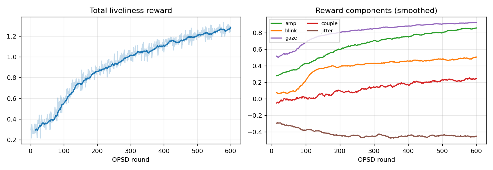
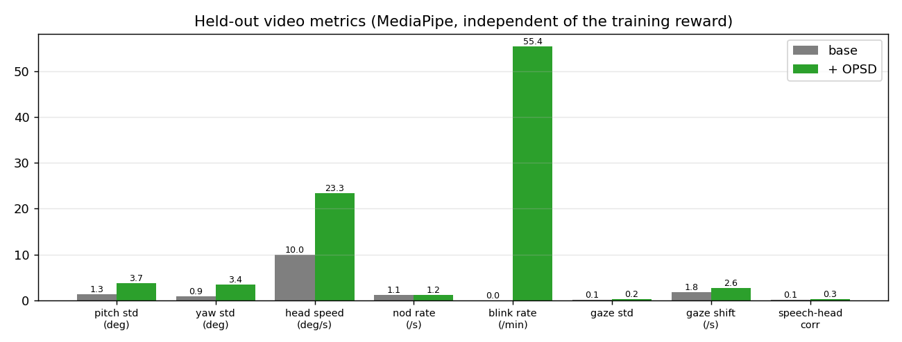
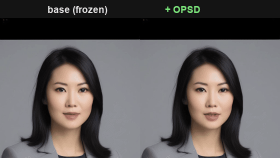
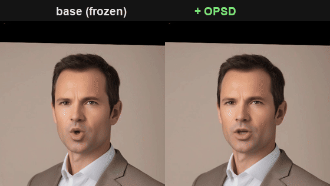
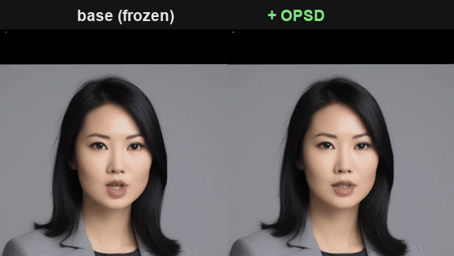
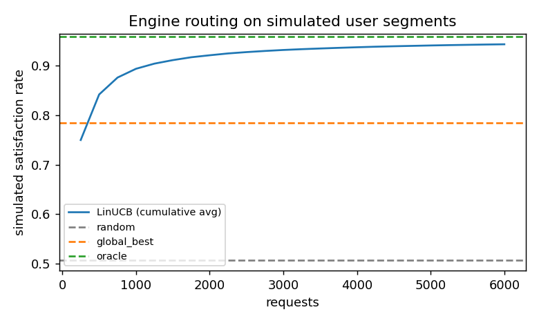

# 07 · Talking-Head Motion OPSD (head/eye liveliness, on a Mac)

Audio-driven talking-head portraits that **don't look frozen**: the head moves while
speaking, it nods, the eyes blink and shift gaze. This is the third OPSD project in the
portfolio (after `04` image and `05` video), applied to the **motion-generation** stage of a
talking-head stack instead of to a pixel diffusion model.

Two things are built here, from the **same** set of motion metrics:

1. **OPSD post-training** of a frozen audio→motion diffusion model, with a differentiable
   "liveliness" reward, so the generated head/eye motion stops being stiff.
2. **An engine feature-profiling + routing prototype**: the same metrics describe any
   engine/config as a stable feature vector, and a contextual bandit learns which engine a
   (simulated) user segment prefers. This is the recommendation-system angle the metrics
   unlock once they are stable.

> Honest framing up front: this is **not** a cinematic real-human digital-human. Rendering is
> 512-on-face via LivePortrait on a MacBook. The point is the *method*, measure "liveliness",
> turn it into a reward, post-train on it, and reuse the same measurements for routing, not
> production video quality.

---

## The stack

```
audio ──► HuBERT ──► JoyVASA motion DiT ──► 73-d motion coeffs/frame ──► LivePortrait ──► 512 video
                     (diffusion, 50 steps)   (expr 63 + scale + t + pitch/yaw/roll)   (warping, no diffusion)
                     └──────── OPSD trains HERE (LoRA) ────────┘
```

- **JoyVASA** (JD Health, MIT), the motion generator is a small diffusion transformer
  (~8.6M params in the denoiser, `feature_dim=256`, 50 diffusion steps) that maps audio
  features to a 100-frame window of 73-d motion coefficients. This is a *real multi-step
  diffusion sampler*, which is exactly what OPSD needs (OPSD builds reward-guided targets along
  the denoising trajectory). It is also tiny, so training on a Mac is cheap.
- **LivePortrait** (Kuaishou), renders the motion onto a still portrait. It is **not** a
  diffusion model (implicit-keypoint warping), so OPSD is applied to JoyVASA, not here.
- Runs on **MPS (M3 Pro, 36 GB)**. Full render of a ~13 s clip: ~210 s, peak ~4.6 GB.
  Motion-only generation (no render): ~1.8 s. OPSD training (600 rounds): ~11 min.

Why this base and not Diff2Lip / AniPortrait (the earlier candidates): Diff2Lip only repaints
the mouth at 128×128 (still "stiff" everywhere else); AniPortrait runs two full SD1.5 UNets
(risky in 36 GB). JoyVASA's decoupled motion/render split is the one that both fits the machine
and gives head + eyes + lips in a single light diffusion model.

---

## Part 1, Liveliness as a differentiable reward, then OPSD

### The reward (`src/motion_reward.py`)

Computed **directly on the 73-d motion coefficients** (so it is differentiable w.r.t. the
diffusion output, which OPSD's reward-gradient step requires). All terms are bounded, so the
policy can't win by shaking the head to infinity:

| term | what it measures |
|---|---|
| `amp` | low-frequency (0.3-3 Hz) head-rotation amplitude, saturating at a few degrees (pitch weighted up, nods) |
| `jitter` | high-frequency (>6 Hz) head-rotation energy, **penalized** |
| `couple` | correlation between speech loudness and low-passed head speed (head moves *when talking*) |
| `blink` | one blink per ~2 s window, without keeping the eyes half-closed |
| `gaze` | some gaze variation, without drifting off-camera |
| `ood` | keep coefficients inside the pretrained model's training range |

Head pose is read straight from the coefficients. Blink/gaze are **not** in the motion params
directly (the model emits implicit-keypoint expression offsets), so they go through a learned
**eye probe**.

### The eye probe (`src/eye_probe.py`)

A small MLP: `expression offset (63-d) → (blink, gaze_h, gaze_v)`. Trained by rendering ~900
single frames for random expression offsets (around the generator's own distribution plus
wider pushes so closed eyes / gaze shifts actually appear), labelling each with MediaPipe
blendshapes, and fitting. Held-out-face correlation: blink r≈0.70, gaze_v r≈0.72, gaze_h
r≈0.66. Good enough to serve as a differentiable eye-state signal inside the reward.

### OPSD (`src/opsd_train_motion.py`)

Same 4-step On-Policy Self-Distillation as `04`/`05`, on a motion sequence instead of a latent:

1. **On-policy query**, the frozen *behavior* adapter runs JoyVASA's own DDPM+CFG sampler
   from noise down to an intermediate step, giving a query state.
2. **Reward-guided targets**, score the behavior policy's clean prediction with the reward,
   follow the reward gradient (lip-keypoint dims masked out so lip-sync is left alone) to build
   a positive and a negative target.
3. **Detached distillation**, a *trainable* LoRA adapter is pulled toward the positive target
   and pushed (with a margin) from the negative one. Gradients never flow through the rollout.
4. **EMA refresh** of the behavior adapter toward the trainable one.

Two LoRA adapters (behavior / trainable) share the frozen base; LoRA (rank 8) is on the
denoising transformer's FFN + motion projections, **179 K** trainable params over an 8.6 M
frozen denoiser. The audio encoder (HuBERT) stays frozen.

### Training curve



Total reward climbs 0.3 → 1.3 over 600 rounds. Per-component: `amp`, `blink`, `gaze`, `couple`
all rise; `jitter` (penalty) stays controlled. The lip keypoints are never in the reward and
their gradient is masked, so this is added head/eye motion *on top of* the pretrained lip-sync,
not a trade against it.

---

## Results (held-out audio, before vs after)

### Motion-space (8 held-out clips × 5 seeds, scored by the training reward)

| | reward | amp | jitter | couple | blink | gaze |
|---|---|---|---|---|---|---|
| base | 0.35 | 0.34 | −0.37 | −0.04 | 0.06 | 0.60 |
| + OPSD | **1.16** | 0.83 | −0.55 | 0.15 | 0.50 | 0.92 |

Per-clip/-seed **win rate: 100%** (OPSD ≥ base on every paired sample).

### Video-space (held-out, MediaPipe, *independent of the training reward*)

This is the honest test: render both models and measure the videos with MediaPipe
FaceLandmarker, which never saw the reward or the eye probe.



| metric | base | + OPSD | reading |
|---|---|---|---|
| head pitch std (deg) | 1.3 | **3.7** | head actually moves |
| head yaw std (deg) | 0.9 | **3.4** | |
| head speed (deg/s) | 10.0 | **23.3** | |
| speech-head corr | 0.14 | **0.26** | moves more *while speaking* |
| still-ratio (speaking) | 0.06 | **0.02** | less "frozen" time |
| blink rate (/min) | **0.0** | 55.4 | base never blinks; OPSD does, *overshoots* |
| gaze std | 0.07 | **0.24** | eyes no longer locked |
| gaze shift (/s) | 1.8 | **2.6** | |

### Qualitative (same audio, same face, same noise seed, left base, right OPSD)





Portraits are **synthesized with SDXL** (`src/make_portraits.py`), fictional people, not
photos of anyone real. Audio is macOS TTS (`src/make_audio.py`), digital-human-style口播
scripts (ecommerce / training / news / customer-service / explainer), split into
train/eval/demo. No copyrighted media.

### Honest caveats

- **Blink overshoots** (~55/min vs a human ~15-20). The Tier-1 reward asks for "at least one
  blink per window" and the policy over-satisfies it. It reads as "alive" rather than natural.
- **Head jitter rises** (118 → 248 in the MediaPipe acc metric). More motion ⇒ more
  acceleration; the Tier-1 reward's `jitter` penalty is bounded and keeps shrinking.
- **Not cinematic.** 512-on-face, warping-based render on a Mac. Face super-resolution
  (GFPGAN/CodeFormer) would improve looks but is cosmetic, not the point.

### Tier-2 · the next lap, iterating on the reward design

Tier-1 showed the OPSD mechanism works in motion space. The honest caveats
above are symptomatic of two **reward-design choices** the Tier-1 reward
made (unbounded soft-max blink target, bounded jitter penalty). The natural
follow-up is to iterate on the reward.

Three levers at three points in the stack, all converge to roughly the same
end-state (blink ≈ 24 /min, motion-space n=20) — see
[`docs/TIER2_NOTE.md`](docs/TIER2_NOTE.md) for the full argument and figures:

| lever | where | compute cost |
|---|---|---|
| **1 · BoN** (`src/tier2_bon.py`) | inference-time rejection sampling with anti-overshoot scorer | zero training |
| **2 · blink thinning** (`blink_thin` in same file) | post-process on the structured 73-d motion (lip-sync preserved) | zero training |
| **3 · reward v2** (`motion_reward_v2.py`, `opsd_train_motion_v2.py`) | retrain OPSD with gaussian blink target + hard jitter cap | ~11 min on M3 Pro |

That three *independent* paths (two post-hoc, one retrained-from-scratch)
reach the same equilibrium is the point: in OPSD, **the reward is where the
design work lives**, and the method extends naturally to a second iteration.

---

## Part 2, Engine feature profiles + routing (`src/engine_profiles.py`, `src/route_engines.py`)

The same metrics that served as a *reward* also serve as an engine *feature vector*. An
"engine" here = a concrete runnable config: `{motion model: base/OPSD} × cfg-scale × pose
smoothing × driving amplitude` (12 configs). Each is profiled by rendering a fixed probe set
(3 faces × 1 audio) and summarizing the engine-agnostic MediaPipe metrics.

**Stability check** (does an engine's profile mean something, or is it noise?): per feature we
report between-engine spread vs within-engine spread (across faces), and a split-half rank
correlation across faces. Features that separate engines stably (speed, blink, gaze, still-
ratio) are the ones used for routing; unstable ones are dropped.

**Routing**: context = user-segment × engine-profile, policy = **LinUCB** contextual bandit.
Three **simulated** user segments (ecommerce-live wants big lively motion; news-corporate wants
composed/low-jitter; explainer wants speech-synced + lively eyes) each have a hidden linear
utility over engine features plus logistic choice noise.

> User preferences here are **simulated**, there is no real user data in this repo. The point
> is to show the pipeline *works* (measurable engine features → contextual bandit → personalized
> routing) and how fast it learns, not to claim what real users like. Real deployment would
> swap the simulator for logged behavior (watch-through, regenerate, keep/pay), with a small
> human-rated set to calibrate which metrics track perceived naturalness.

Engine profiles are **stable**: split-half rank correlation across faces is ≈0.97 for head-
motion features, with between-engine spread ~6× the within-engine (across-face) spread, i.e.
an engine's profile is a real fingerprint, not noise.



| policy | mean simulated satisfaction |
|---|---|
| random | 0.51 |
| single best global engine | 0.79 |
| **LinUCB (learned routing)** | **0.94** |
| per-segment oracle (upper bound) | 0.96 |

LinUCB recovers the correct best engine for **all three** segments. The telling detail:
`news_corporate` prefers a **base** (non-OPSD, low-smoothing) engine, while `ecommerce_live`
and `knowledge` prefer **OPSD** variants, so the OPSD model is *not* universally best, and the
personalization gain over "just ship the single best engine" (0.94 vs 0.79) is real, not an
artifact of one engine dominating.

---

## Why this is the right story for a digital-human company

- It answers their actual questions: **how do you measure "natural"**, **how do you push a model
  toward it without re-collecting labeled pairs for every tweak**, and **how do you pick the
  right engine per user**.
- The reward/metric layer is **engine-agnostic**, it scores any mp4, so it drops onto a
  third-party or in-house engine unchanged.
- It connects a generative-model RL method (OPSD) to a recommendation/bandit method on the
  same measurements, which is exactly the ads-recommendation ↔ generative-media bridge.

What it deliberately does **not** claim: beating their production render quality, or that
"no human annotation is needed" (annotation is how you *calibrate* whether these metrics match
human perception, that step is real and kept in the story).

---

## Repro

```bash
python3 -m venv .venv && source .venv/bin/activate
pip install torch torchvision torchaudio "numpy<2" opencv-python librosa pyyaml tyro rich \
  imageio imageio-ffmpeg scikit-image onnxruntime onnx "transformers<4.46" pykalman \
  matplotlib scipy tqdm huggingface_hub mediapipe soundfile diffusers
# clone JoyVASA into third_party/JoyVASA, then apply the MPS fixes:
python src/patch_joyvasa.py
# weights: KwaiVGI/LivePortrait (human), jdh-algo/JoyVASA, TencentGameMate/chinese-hubert-base
#          + MediaPipe face_landmarker.task  (see src/*.py paths)

python src/make_portraits.py          # SDXL fictional portraits
python src/make_audio.py              # macOS TTS speech set
python src/eye_probe.py               # train the differentiable eye probe (~8 min)
python src/opsd_train_motion.py --rounds 600          # OPSD post-training (~11 min)
python src/evaluate_motion.py         # held-out motion + video metrics, base vs OPSD
python src/engine_profiles.py --seconds 4             # engine feature profiles
python src/route_engines.py           # LinUCB routing on simulated segments
python src/make_plots.py              # README figures
```

## License / attribution

- OPSD algorithm: follows *On-Policy Self-Distillation in Diffusion Models* (reference impl
  `worldbench/DiffusionOPSD`, Apache-2.0). Original from-scratch implementation here; the
  motion-space reward (head/eye liveliness via a learned eye probe), the LoRA scope, and the
  engine-profiling/routing layer are original to this project.
- JoyVASA: **MIT**. LivePortrait: **MIT**. HuBERT-chinese: research use.
- **InsightFace** `buffalo_l` (used by LivePortrait's cropper for face detection) is under a
  **non-commercial research** license, fine for this portfolio/research demo, would need a
  separate arrangement for commercial use.
- Portraits are SDXL-synthesized fictional people; audio is macOS TTS. No real-person likeness,
  no copyrighted media.
