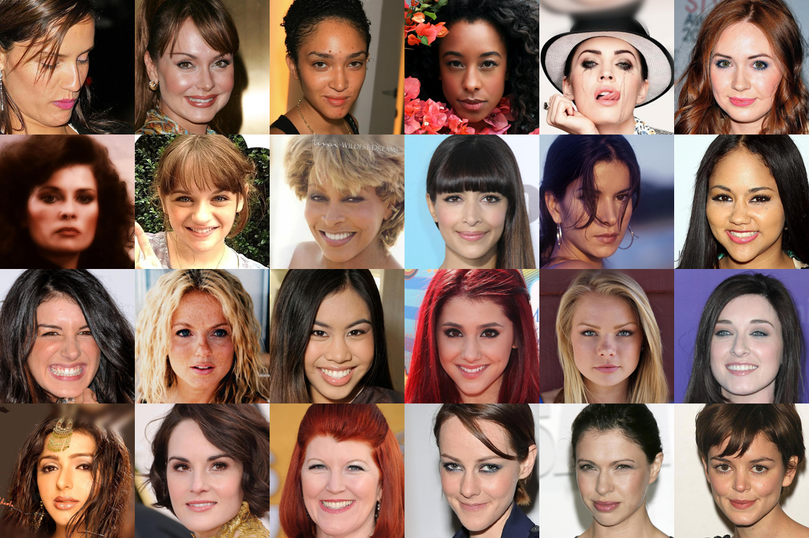
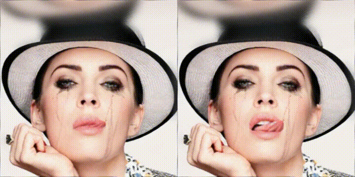
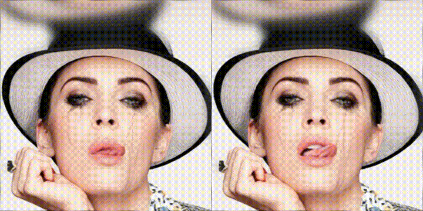
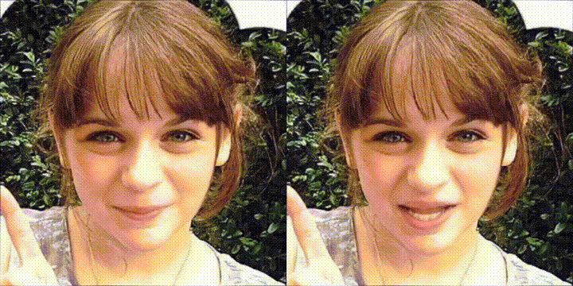
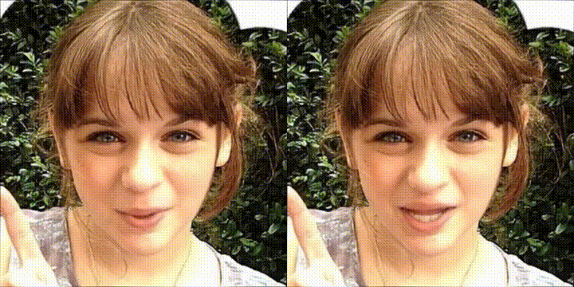

# 07 · Talking-Head Motion OPSD

**On-Policy Self-Distillation for audio-driven talking-head motion, migrated from
[DiffusionOPSD](https://github.com/worldbench/DiffusionOPSD).**

Post-training a frozen audio→motion diffusion model (JoyVASA) with a differentiable
"liveliness" reward, so generated portraits blink, nod, and shift gaze instead of
sitting frozen. Rendering is LivePortrait at up to 1280 px with pasteback.

> **Honest framing.** This is a *method* project, not production digital-human video.
> The portrait set is 3 still images (`data/portraits`). The claim is that OPSD can be
> transferred from pixel diffusion to motion diffusion and measurably change behaviour —
> not that the output rivals a studio pipeline.

---

## 📌 AT A GLANCE

| | |
|---|---|
| **What is trained** | LoRA on JoyVASA's motion DiT (~179K params), audio → 73-d motion coefficients |
| **Base model** | JoyVASA `motion_generator_hubert_chinese` (frozen) |
| **Renderer** | LivePortrait (implicit-keypoint warping, not diffusion) — **not** trained |
| **Method** | DiffusionOPSD: on-policy query → reward-guided bounded targets → detached finite fit → EMA refresh |
| **Reward** | Differentiable liveliness: `amp + jitter + couple + blink + gaze + ood` |
| **Training data** | AISHELL-1 (Apache 2.0), 2000 segments / 60 speakers, disjoint 15-speaker eval |
| **Best result** | v3 beats v2: **jitter −19 %**, **blink −27 %** (motion space, n=20) |
| **Known failure** | Absolute jitter is still 2.05× base; the pre-registered ≤1.3× gate **failed** |
| **Hardware** | 2× H20 (98 GB) this round; originally M3 Pro 36 GB |

---

## 🧠 METHOD — OPSD migrated to motion space

DiffusionOPSD builds supervision at *intermediate* denoising states instead of waiting
for the final sample. We keep the algorithm identical and change only what "sample" means:
a trajectory of 73-d motion coefficients rather than an image latent.

At query \(s=(c, z_q, \sigma_q)\) the frozen behaviour policy defines a clean anchor

$$y_0 = z_q - \sigma_q\, v_{\mathrm{old}}(z_q, c, \sigma_q)$$

Normalised reward gradient gives bounded positive / negative targets

$$y_0^{\pm} = y_0 \pm c_{\mathrm{adv}}\,\sigma_t\,\frac{\nabla_y R(y_0)}{\|\nabla_y R(y_0)\|_2}$$

and the trainable policy fits the **detached** targets with a contrastive objective

$$\mathcal{L}_{\mathrm{OPSD}} = \| \hat y_\theta - \bar y_0^{+} \|^2 - \| \hat y_\theta - \bar y_0^{-} \|^2$$

**Minimal pseudocode (motion space):**

```python
set_mode("behavior")
z      = rollout_to(motion_generator, audio_feat, t1, cfg_scale)   # on-policy trajectory
anchor = guided_x0(motion_generator, z, t1, audio_feat, cfg_scale) # clean anchor
r      = liveliness_reward(anchor, env)                            # differentiable
g      = autograd.grad(r.sum(), z);  d = g / g.norm()              # normalised ascent

tgt_pos = guided_x0(mg, z + step_size * d, ...)                    # bounded targets
tgt_neg = guided_x0(mg, z - step_size * d, ...)

set_mode("trainable")
pred = guided_x0(mg, z.detach(), ...)
loss = mse(pred, tgt_pos) + lambda_neg * relu(margin - mse(pred, tgt_neg))
loss.backward(); optimizer.step()
ema_update_behaviour_policy()
```

**Canonical settings** (mirroring `config/opsd_defaults.py` in DiffusionOPSD):

| Setting | DiffusionOPSD (SD3.5-M) | 07 (JoyVASA motion) |
|---|---|---|
| LoRA | PEFT | r=8, alpha=8 (~179K params) |
| `c_adv` (target radius) | 5 (ρ=0.10) | 3.0 (`reward-step-size`) |
| Optimizer | AdamW | AdamW, lr 3e-4 |
| Batch | 48 prompt groups | 8 windows |
| EMA refresh | every outer update | every 10 steps, decay 0.5 |
| Rollout | 10-step CFG-free | 50-step, `cfg_scale=2.0` |

---

## 🎯 WHAT "BASE" MEANS — and why real video is NOT the baseline

This is the single most important thing to read before the numbers.

**`base` = the same pretrained model with no OPSD post-training.** Following
DiffusionOPSD, the comparison is always *same model, with vs without the
on-policy self-distillation stage*. It is **not** real video.

| term | what it is | role |
|---|---|---|
| **base** | JoyVASA `motion_generator_hubert_chinese`, untouched | the baseline the method must beat |
| **OPSD (v2/v3)** | the same model + trained LoRA | the method |
| **real video** (HDTF / CelebV-HQ) | human talking footage | **reference / upper bound only** — shows where natural behaviour sits; not a baseline |

Real footage is used here for two things only: (1) extracting still portraits, and
(2) reading off what natural motion statistics look like, which is how the jitter
cap was calibrated (base p90 = 0.263°). It is never scored against the model.

## 👤 PERSONA PRESETS (finance / real-estate / entertainment)

The reward is the control surface. Three personas are trained from the **same**
reward function, changing **only** the weights and the OPSD step size `c_adv`:

| knob | finance | real estate | entertainment hook |
|---|---|---|---|
| `amp` (motion magnitude reward) | **0.35** | 0.6 | **1.4** |
| `jitter` (anti-jitter pressure) | **1.2** | 0.8 | 0.4 |
| `gaze` (eye wandering) | 0.2 | 0.3 | 0.45 |
| `couple` (speech-rhythm coupling) | 0.6 | 0.5 | 0.7 |
| `blink` target | 0.10 | 0.13 | 0.18 |
| `c_adv` (OPSD target radius) | **1.5** | 2.2 | **3.5** |
| `jitter_cap_deg` | 0.15 | 0.20 | 0.35 |
| intent | rigorous, sincere, believable | gentle, trustworthy | exaggerated, energetic |

**Why this addresses the uncanny valley.** The uncanny look is not caused by
jitter — OPSD's motion is actually ~10× *smoother* than base once amplitude is
divided out. It is caused by **amplitude overshoot**: `amp` uses `tanh(std_low/3)`,
which OPSD drives to saturation, giving ~20× base amplitude. Lowering the `amp`
weight (and `c_adv`) is therefore the correct lever for a restrained persona,
which is why finance gets 0.35 and entertainment gets 1.4.

```bash
ROUNDS=3000 GPU=0 bash scripts/train_styles.sh
# -> outputs/opsd_style_finance|realestate|hook/lora.pt
```

## 📊 MAIN RESULTS

### Motion-space evaluation (n = 20 clips)

`outputs/tier2_r2/bon_motion_summary.json`. `jitter_hp_power` and `amp_lp_power` are
high-/low-frequency pose power; `blink` is blinks per minute (human range 10–20).

| Variant | jitter_hp_power | blink / min | amp_lp_power |
|---|---|---|---|
| base naive | **14.12** | 5.5 | 1 093 |
| base + BoN | 14.89 | 6.5 | 1 092 |
| v2 naive (cap 1.0°) | 35.70 | 54.7 | 28 735 |
| **v3 naive (cap 0.2°)** | **28.97** | 61.7 | 22 974 |
| v2 + BoN | 32.48 | 46.9 | 28 273 |
| **v3 + BoN** | **26.38** | **33.7** | 23 061 |

**v3 vs v2 (same data, same budget): jitter −19 %, blink −27 %.**

### Training reward, 50-step window means

| Run | Data | Rounds | reward first→last | jitter first→last |
|---|---|---|---|---|
| v1 | 25 TTS clips | 600 | +0.334 → +1.263 | −0.309 → −0.456 |
| v2 | 25 TTS clips | 600 | +0.333 → +1.247 | −0.310 → −0.440 |
| v3 | 25 TTS clips | 600 | +0.315 → +1.116 | −0.329 → −0.432 |
| v2 | **2000 AISHELL segs** | 3000 | +0.337 → +1.543 | −0.282 → −0.467 |
| **v3** | **2000 AISHELL segs** | 3000 | +0.330 → **+1.512** | −0.290 → **−0.458** |

### ⚠️ The gate that was NOT met

Pre-registered criterion (task book §4): `jitter_hp ≤ 1.3 × base` = 14.12 × 1.3 = **18.36**.
v3 reaches **28.97 = 2.05 × base**. **FAIL**, reported as a failure.

### 🔍 Why the absolute jitter number is misleading

OPSD increases motion amplitude ~20×. `jitter_hp_power` is an *absolute* high-frequency
power, so it scales with amplitude. Normalising by amplitude removes the confound:

| Variant | jitter / amp |
|---|---|
| base naive | 0.01292 |
| v3 naive | 0.00126 |
| v2 naive | 0.00124 |
| v3 + BoN | 0.00114 |

Relative to its own amplitude, OPSD motion is **~10× smoother than base**. The real
remaining problem is amplitude overshoot (20× base), which is what makes absolute
jitter look bad. This is the next lever, not the jitter term itself.

---

## 🐛 LORA LOADING BUG (why an earlier gallery showed no change)

`DualLoRALinear.forward` branches on a mode string:

| mode | weights used |
|---|---|
| `"trainable"` | `A_t / B_t` — the trained weights |
| `"behavior"` | `A_b / B_b` — the EMA copy (`B_b` initialised to zeros) |
| anything else | `base(x)` only — **no LoRA contribution** |

Inference must therefore load `A_t/B_t` **and** call `set_mode("trainable")`.
An earlier version of `scripts/render_hd_compare.py` loaded `A_t/B_t` but then
called `set_mode("behavior")`, so the sampled trajectory used `A_b/B_b ≈ 0`.

Measured on one clip (mean |Δ| of motion coefficients vs base):

| mode used | diff vs base |
|---|---|
| `"behavior"` (buggy) | **0.000000** — v3 rendered identical to base |
| `"trainable"` (fixed) | **0.795556** |

After the fix, base vs v3 differs by **20.5 / 255** mean per-frame pixel difference
over 91 frames at 1024×1024. Every figure in this README is from the fixed code.
`B_t` norm in the trained checkpoint is 6.65, confirming the weights are non-zero.

---

## 🔬 THE BUG THIS ROUND FIXED

v2 added a "hard jitter cap" at 1.0° that never fired. Measured over 140 entries
(20 clips × 7 variants), `outputs/diag/jitter_diag.json`:

| Variant | std_high mean | p90 | max | frac > 1.0° (v2 cap) | frac > 0.2° (v3 cap) |
|---|---|---|---|---|---|
| base naive | 0.178 | 0.263 | 0.355 | **0.000** | 0.283 |
| base + BoN | 0.175 | 0.259 | 0.302 | **0.000** | 0.350 |
| v3 naive | 0.255 | 0.384 | 0.443 | **0.000** | 0.700 |
| v2 + BoN | 0.242 | 0.346 | 0.502 | **0.000** | 0.750 |

`frac > 1.0°` is **exactly 0.000 for every variant** — the cap's gradient was identically
zero. Same dead-zone failure as V1's `ReLU+clamp` in project 08. v3 sets the cap to the
base p90 (0.2°), active on 28–75 % of samples (`cap_active_frac` mean 0.266).

**Only `jitter_cap_deg` changed** (1.0 → 0.2). `amp / couple / blink / gaze / ood`
weights and formulas are byte-identical to v2, so the difference is attributable.

---

## 📦 DATA

Previous round used 25 macOS `say` TTS clips — synthetic, single-speaker style, and
**not a public dataset**. Replaced this round:

| Field | Value |
|---|---|
| Dataset | **AISHELL-1** (OpenSLR #33 / `AISHELL/AISHELL-1` on HF) |
| License | Apache 2.0 |
| Downloaded | 75 speaker archives + transcript |
| Split | 60 train / 15 eval speakers, **disjoint** (asserted) |
| Segments | 2000 train, 100 eval, 8–15 s, 16 kHz mono PCM_16 |
| Windows | 14 260 four-second windows (was 107 → **133×**) |
| Construction | adjacent same-speaker utterances concatenated, 0.3 s silence, never cross-speaker |

Details: `data/DATA_SOURCES.md`, `data/audio_manifest_large.json`,
`scripts/build_audio_segments.py`. The 20 legacy TTS clips stay as `legacy eval`.
Audio is **not** committed to `main` (backed up on a `backup/*` branch).

---

## ⚙️ REPRODUCTION

```bash
# 1. environment (downloads JoyVASA + LivePortrait + HuBERT-chinese, ~2.5 GB)
bash scripts/h20_render_setup.sh

# 2. build the AISHELL-1 training set (CPU)
python scripts/build_audio_segments.py --n-train 2000 --n-eval 100

# 3. diagnose the jitter cap (CPU)
python src/diag_jitter.py                      # -> outputs/diag/jitter_diag.json

# 4. train v2 and v3 on the same data (each ~25 min on one H20)
CUDA_VISIBLE_DEVICES=0 python src/opsd_train_motion_v3.py \
    --out outputs/opsd_v3_large --data-dir data/audio_public/train --rounds 3000
CUDA_VISIBLE_DEVICES=1 python src/opsd_train_motion_v2_large.py \
    --out outputs/opsd_v2_large --data-dir data/audio_public/train --rounds 3000

# 5. motion-space evaluation (n=20)
python src/tier2_bon.py --motion-only \
    --lora outputs/opsd_v3_large/lora.pt \
    --lora-v2 outputs/opsd_v2_large/lora.pt --out outputs/tier2_r2

# 6. HD qualitative gallery (1280 px + pasteback)
python scripts/render_hd_compare.py --n-clips 4 --variants base v2 v3
```

All training runs must be launched through the guard
(`python ../tools/train_guard.py --selftest` must print `selftest OK` first).

---

## 🎬 QUALITATIVE GALLERY

Real faces, real speech. Source portraits come from **CelebA-HQ** (studio-quality
stills) and **CelebV-HQ** (first frames of real talking-head videos, whose audio
tracks drive the animation — no TTS). Rendered with `source_max_dim=1280` +
`flag_pasteback=True`: the animated face is composited back into the full-resolution
portrait. **Verified output: 1024×1024, H.264 High, 25 fps, audio muxed in**
(previously 256/512 on-face only).

**Portrait pool.** CelebA-HQ + CelebV-HQ candidates are filtered to **near-frontal
poses** (`|yaw| ≤ 15°`, `|pitch| ≤ 15°`, MediaPipe + solvePnP): **42 of 72 kept**.
Profiles were removed because a talking-head demo on a side-view face hides
exactly the behaviour being measured.



**base (left) vs v3 (right)**, driven by real speech from CelebV-HQ, frontal portraits:

| | |
|---|---|
|  |  |
|  |  |

Verified that the LoRA is actually applied: mean per-frame pixel difference between
base and v3 is **20.5 / 255** over 91 frames (1024×1024). See the "LoRA loading bug"
note below — an earlier version of this gallery rendered v3 identically to base.

Full set: `outputs/hd_frontal/` (16 videos), `outputs/demo_gifs_frontal/` (8 GIFs),
`outputs/hd_compare_public/`, `outputs/hd_compare/`. `manifest.json` in each directory
records every (clip, portrait, variant) mapping.

```bash
python scripts/prep_public_portraits.py     # extract portraits + real audio
python scripts/filter_frontal.py            # keep near-frontal faces only
python scripts/render_hd_compare.py --clips <wav...> --portraits <png...> --variants base v3
python scripts/make_demo_gifs.py --video-dir outputs/hd_frontal
# ~8 s per 8 s clip on one H20
```

What to look for, and what is still weak:

| Behaviour | Status |
|---|---|
| Blink rate | v3+BoN 33.7/min — better than v2's 46.9, still above the human 10–20 range |
| Head nod / motion | Amplitude rises 20× vs base; lively, but overshoots |
| Gaze shift | `gaze` reward 0.51 → 0.98 during training |
| Mouth / lip sync | `jaw_audio_corr` is **not** used as evidence: base itself is negative (−0.14) |
| Skin / texture | Inherited from LivePortrait's warping of the source portrait; not trained here |

---

## 📁 REPOSITORY LAYOUT

```
07-talking-head-motion-opsd/
├── src/
│   ├── motion_reward.py          # v1 reward (band metrics, smoothmax blink)
│   ├── motion_reward_v2.py       # + blink overshoot penalty, jitter hard cap 1.0°
│   ├── motion_reward_v3.py       # ONLY change: jitter cap 0.2°   <-- this round
│   ├── opsd_train_motion.py      # OPSD loop + add_lora / build_windows / guided_x0
│   ├── opsd_train_motion_v2.py   # v2 trainer
│   ├── opsd_train_motion_v3.py   # v3 trainer (+ --data-dir, cap_active_frac)
│   ├── opsd_train_motion_v2_large.py  # v2 + --data-dir (new file, v2 untouched)
│   ├── diag_jitter.py            # T1 cap-activation diagnostic
│   ├── engine.py                 # JoyVASA + LivePortrait wrapper
│   ├── tier2_bon.py              # best-of-n selection + motion/video metrics
│   └── video_metrics.py          # MediaPipe: blink, head_jitter, gaze
├── scripts/
│   ├── build_audio_segments.py   # AISHELL-1 -> 8-15 s segments
│   ├── render_hd_compare.py      # HD gallery (1280 px + pasteback)
│   └── h20_render_setup.sh       # one-shot env setup
├── data/
│   ├── DATA_SOURCES.md           # provenance, license, split
│   ├── audio_manifest_large.json
│   └── audio_public/             # generated wavs (not in main)
├── outputs/
│   ├── opsd_v2_large/ opsd_v3_large/   # 3000-round runs + metrics.jsonl
│   ├── diag/jitter_diag.json
│   ├── tier2_r2/bon_motion_summary.json
│   └── hd_compare/               # HD gallery
└── docs/
    ├── RESULTS_NEXT.md           # full numbers, including failures
    └── GATE_LOG.md               # per-gate pass/fail log
```

---

## 🚧 LIMITATIONS

- **3 portraits only** (`host_f`, `host_f2`, `host_m`, all 1024×1024). No identity
  diversity claim is made.
- **No SyncNet / LSE-C this round.** `jaw_audio_corr` is deliberately not used as a
  lip-sync proxy because base is already negative. Lip-sync remains unmeasured.
- **Amplitude overshoot** (20× base) is the dominant remaining artefact.
- Motion-space metrics are reported; video-space MediaPipe metrics for the AISHELL
  eval set were not run this round (GPU time went to the 08 long runs).

---

## 🙏 ACKNOWLEDGEMENTS

Built on [DiffusionOPSD](https://github.com/worldbench/DiffusionOPSD) (the method
migrated here), [JoyVASA](https://github.com/jdh-algo/JoyVASA) (motion generator),
[LivePortrait](https://github.com/KwaiVGI/LivePortrait) (renderer), and
[AISHELL-1](https://www.openslr.org/33/) (training speech).
