<div align="center">

# Talking-Head Motion Post-Training

**Reward-guided adaptation of an audio-to-motion diffusion model, with measured human targets and explicit failure gates**

**Jingxi Duan**

[Technical notes](docs/TECH_REPORT.md) · [Separability analysis](docs/SEPARATION_ANALYSIS.md) · [Current results](docs/RESULTS_R3.md)

</div>

<p align="center">
  
</p>

*Evaluation portraits were filtered for near-frontal pose, open eyes, and closed-mouth source frames to reduce renderer confounds.*

---

## Overview

This project adapts OPSD-style reward-guided training to JoyVASA's audio-to-motion representation, rendered by frozen LivePortrait. The parts built here are the motion-space reward, bounded targets, LoRA training, failure diagnosis, and held-out evaluation. DiffusionOPSD, JoyVASA, and LivePortrait are upstream open-source work.

## Abstract

DiffusionOPSD optimizes a single scalar image-preference reward. This project applies the same reward-guided fine-tuning mechanism to human motion, using statistics measured from real speakers and evaluating against pre-registered failure gates.

Here the reward target is a measured motion band instead of a visual preference score. DiffusionOPSD's query/target/EMA optimization structure is applied to a 73-coefficient audio-to-motion trajectory space produced by JoyVASA and rendered by frozen LivePortrait:

1. **New measured reward targets:** per-industry amplitude, jitter, and blink bands estimated from real speaker footage (HDTF news anchors, CelebV-HQ) replace a single hand-tuned visual-preference reward.
2. **A bounded motion reward:** a peaked Gaussian target around the measured band replaces monotone amplitude maximization, removing the earlier **2.4–2.7×** overshoot it caused.
3. **Diagnosed and fixed a blink-target bug:** an excessive blink target drove the eyes toward half-closed; retuning it restored eye-aspect-ratio to untrained-base levels.
4. **A real-video behavior-cloning path:** 1,753 aligned motion windows from real footage supplement the reward signal through an auxiliary supervised objective.
5. **Pre-registered failure gates:** jitter, lip-sync, and ecological-separability gates are reported alongside the headline result.

Three trained policies reach **0.85–0.89×** of their measured amplitude targets on held-out speakers, and the calibrated expression policy reduces mean held-out target error from **0.1202** to **0.0229–0.0238** across three seeds (n=40 paired clips; all three 95% bootstrap intervals exclude zero).

## Run the demo first

The complete demo path is documented in [`docs/DEMO.md`](docs/DEMO.md). It includes a dependency-free CPU mock, a GPU render command, pre-generated held-out comparisons, weight download instructions, and failure diagnosis.

```bash
# CPU-only mock: no model weights, no CUDA
python3 scripts/demo.py --mode mock

# Real GPU render: Base + three calibrated adapters, matched inputs
bash scripts/h20_render_setup.sh
python3 scripts/demo.py --mode gpu --seconds 4 --seed 0 --out outputs/demo/gpu_r3
```

The checked-in visual comparison is [female Base vs calibrated GIF](outputs/new_face_demo_r3/female/female_new_face_base_vs_r3.gif) and [male Base vs calibrated GIF](outputs/new_face_demo_r3/male/male_new_face_base_vs_r3.gif). The mock is a pipeline/UI smoke test; only the GPU path loads the model.

## Highlights

### What this project built

- **Domain transfer of OPSD to motion space.** Retained DiffusionOPSD's query/target/EMA structure and retargeted it from pixel latents to a 73-coefficient audio-conditioned motion trajectory.
- **Measured, not hand-tuned, reward targets.** Amplitude, jitter, and blink targets are estimated from public human footage per industry, instead of being selected only by visual preference.
- **Fixed two concrete reward-design bugs.** The monotone amplitude reward caused 2.4–2.7× overshoot; replacing it with a peaked Gaussian target fixed it. An excessive blink target caused half-closed eyes; retuning it restored normal eye-aspect-ratio.
- **Added a real-video supervision path.** 1,753 aligned real-motion windows support an auxiliary behavior-cloning objective alongside the reward.
- **Pre-registered evaluation.** Jitter, lip-sync non-inferiority, and ecological-separability gates are reported with the main results.

## New licensed hold-out face demos

<table>
<tr><td align="center" width="50%">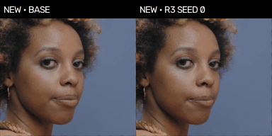<br><sub>Pexels face A Base versus calibrated policy · <a href="outputs/new_face_demo_r3/female/expression_r3__base.mp4">Base MP4</a> · <a href="outputs/new_face_demo_r3/female/expression_r3__seed0.mp4">Calibrated policy MP4</a></sub></td><td align="center" width="50%">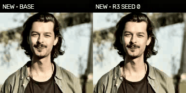<br><sub>Pexels face B Base versus calibrated policy · <a href="outputs/new_face_demo_r3/male/expression_r3__base.mp4">Base MP4</a> · <a href="outputs/new_face_demo_r3/male/expression_r3__seed0.mp4">Calibrated policy MP4</a></sub></td></tr>
</table>

Both 1024×1024 inputs come from previously unused 4K Pexels License videos and were not used in training, calibration, or model selection. Base and the calibrated policy use the same portrait, held-out audio, generation seed, and frozen LivePortrait renderer, so the comparison isolates motion. [Source URLs, authors, timestamps, license and checksums](data/portraits_new_licensed/SOURCES.json).

----------------------------------------

## Method

At query state $s=(c,z_q,\sigma_q)$, the frozen behavior policy defines a clean anchor:

$$
y_0 = z_q - \sigma_q v_{\mathrm{old}}(z_q,c,\sigma_q).
$$

A normalized reward gradient defines bounded positive and negative query states:

$$
d = \frac{\nabla_{z_q} R(y_0)}{\lVert\nabla_{z_q} R(y_0)\rVert_2 + \varepsilon},
\qquad z_q^{\pm}=z_q\pm c_{\mathrm{adv}}d.
$$

The behavior policy maps these perturbed states to detached targets, and the trainable LoRA policy fits the positive target while enforcing a margin from the negative target:

$$
\mathcal{L}_{\mathrm{OPSD}}
= \lVert\hat y_\theta-\mathrm{sg}(y_0^+)\rVert_2^2
+\lambda_-\max\!\left(0,m-\lVert\hat y_\theta-\mathrm{sg}(y_0^-)\rVert_2^2\right).
$$

### Minimal pseudocode (motion space)

```python
set_mode("behavior")
z      = rollout_to(motion_generator, audio_feat, t1, cfg_scale)   # on-policy trajectory
anchor = guided_x0(motion_generator, z, t1, audio_feat, cfg_scale) # clean anchor
r      = liveliness_reward(anchor, env)                            # differentiable
g      = autograd.grad(r.sum(), z);  d = g / g.norm()              # normalised ascent

tgt_pos = guided_x0(mg, z + step_size * d, ...)                    # bounded targets
tgt_neg = guided_x0(mg, z - step_size * d, ...)

set_mode("trainable")
pred = guided_x0(mg, z.detach(), ...)
loss = mse(pred, tgt_pos) + lambda_neg * relu(margin - mse(pred, tgt_neg))
loss.backward(); optimizer.step()
ema_update_behaviour_policy()
```

<div align="center">
<table>
<tr><th align="center">Hyperparameter</th><th align="center">DiffusionOPSD (SD3.5-M)</th><th align="center">Talking-Head Motion OPSD (JoyVASA)</th></tr>
<tr><td align="center"><strong>LoRA</strong></td><td align="center">PEFT</td><td align="center">r=8, alpha=8 (~179K params) on Motion DiT</td></tr>
<tr><td align="center"><strong>Target Radius (<code>c_adv</code>)</strong></td><td align="center">5 (ρ=0.10)</td><td align="center">3.0 (<code>reward-step-size</code>)</td></tr>
<tr><td align="center"><strong>EMA Refresh</strong></td><td align="center">Every outer update</td><td align="center">Every 10 steps, decay 0.5</td></tr>
<tr><td align="center"><strong>Optimizer</strong></td><td align="center">AdamW</td><td align="center">AdamW, lr 1e-4 with 200-step linear warmup</td></tr>
</table>
</div>

----------------------------------------

## Main results

### 1. Per-industry reward targets (measured from real video)

<div align="center">
<table>
<tr><th align="center">Industry</th><th align="center">Video Proxy</th><th align="center">Amplitude (0.3–3 Hz)</th><th align="center">Jitter (6–12.5 Hz)</th><th align="center">Blink /min</th></tr>
<tr><td align="center"><strong>Finance</strong></td><td align="center">HDTF news anchors</td><td align="center"><strong>1.384°</strong></td><td align="center"><strong>0.094°</strong></td><td align="center">18.1</td></tr>
<tr><td align="center"><strong>Real Estate</strong></td><td align="center">CelebV-HQ mid-amplitude</td><td align="center"><strong>1.257°</strong></td><td align="center"><strong>0.118°</strong></td><td align="center">20.3</td></tr>
<tr><td align="center"><strong>Short Video</strong></td><td align="center">CelebV-HQ high-amplitude</td><td align="center"><strong>3.039°</strong></td><td align="center"><strong>0.349°</strong></td><td align="center">22.6</td></tr>
</table>
</div>

### 2. Evaluation on held-out speakers (disjoint from training)

<div align="center">
<table>
<tr><th align="center">Variant</th><th align="center">Amplitude (Measured)</th><th align="center">vs. Target</th><th align="center">vs. Untrained Base</th></tr>
<tr><td align="center"><strong>Base (Untrained)</strong></td><td align="center">0.924°</td><td align="center">·</td><td align="center">1.00x</td></tr>
<tr><td align="center"><strong>Finance Persona</strong></td><td align="center">1.213°</td><td align="center"><strong>0.88x</strong></td><td align="center"><strong>1.31x</strong></td></tr>
<tr><td align="center"><strong>Real Estate Persona</strong></td><td align="center">1.114°</td><td align="center"><strong>0.89x</strong></td><td align="center"><strong>1.21x</strong></td></tr>
<tr><td align="center"><strong>Short Video Persona</strong></td><td align="center">2.597°</td><td align="center"><strong>0.85x</strong></td><td align="center"><strong>2.81x</strong></td></tr>
</table>
</div>

### 3. Calibrated expression dynamics (n=40 paired clips)

<div align="center">
<table>
<tr><th align="center">Variant</th><th align="center">Expression RMS</th><th align="center">Mean Target Error</th><th align="center">Pose High-Frequency RMS</th><th align="center">Gate</th></tr>
<tr><td align="center"><strong>Base</strong></td><td align="center">0.2727</td><td align="center">0.1202</td><td align="center">0.2406°</td><td align="center">Reference</td></tr>
<tr><td align="center"><strong>Seed 0</strong></td><td align="center">0.3872</td><td align="center"><strong>0.0229</strong></td><td align="center"><strong>0.1801°</strong></td><td align="center">Pass</td></tr>
<tr><td align="center"><strong>Seed 1</strong></td><td align="center">0.3849</td><td align="center"><strong>0.0238</strong></td><td align="center"><strong>0.1822°</strong></td><td align="center">Pass</td></tr>
<tr><td align="center"><strong>Seed 2</strong></td><td align="center">0.3860</td><td align="center"><strong>0.0234</strong></td><td align="center"><strong>0.1848°</strong></td><td align="center">Pass</td></tr>
</table>
</div>

All three paired bootstrap intervals for target-error improvement exclude zero. See [`docs/RESULTS_R3.md`](docs/RESULTS_R3.md) for the complete protocol. The matched four-way render is shown in the [visual evidence gallery](#calibrated-expression-policy-four-way-matched-render).

### 4. Training curves and industry diagnostics

Per-industry reward/amplitude trajectories, measured motion bands, the cross-checkpoint comparison, the motion-space method schematic, the early / v1-vs-v2 reward curves, before/after metrics, and the tier-2 three-panel summary. See [`docs/INDUSTRY_ROUND.md`](docs/INDUSTRY_ROUND.md), [`docs/TECH_REPORT.md`](docs/TECH_REPORT.md) and [`docs/TIER2_NOTE.md`](docs/TIER2_NOTE.md) for the full discussion.

<table>
<tr><td align="center" width="100%"><br><sub>per-industry reward and amplitude vs step</sub></td></tr>
<tr><td align="center" width="100%"><br><sub>measured bands vs persona landing</sub></td></tr>
<tr><td align="center" width="100%">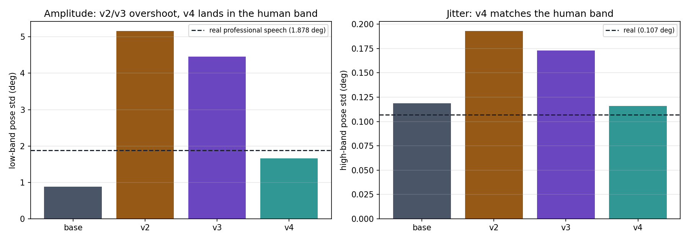<br><sub>base / v2 / v3 / v4 vs real speech</sub></td></tr>
<tr><td align="center" width="100%"><br><sub>OPSD in motion space (schematic)</sub></td></tr>
<tr><td align="center" width="100%">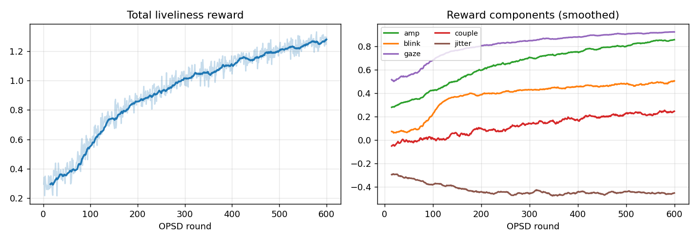<br><sub>early training curves (loss / reward)</sub></td></tr>
<tr><td align="center" width="100%">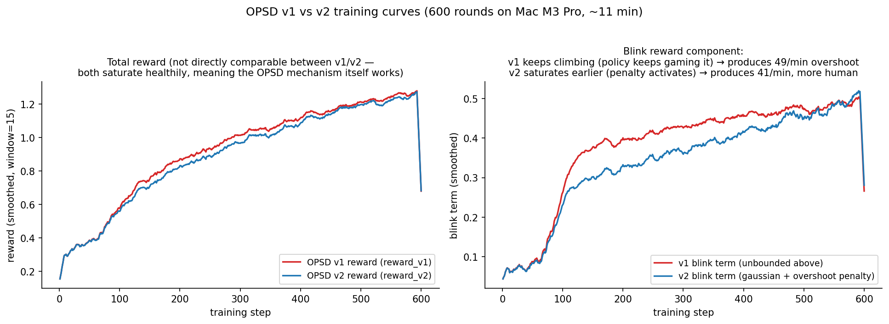<br><sub>v1 vs v2 reward curves</sub></td></tr>
<tr><td align="center" width="100%">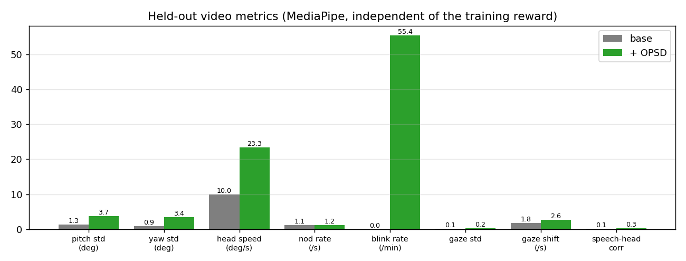<br><sub>before / after metrics</sub></td></tr>
<tr><td align="center" width="100%">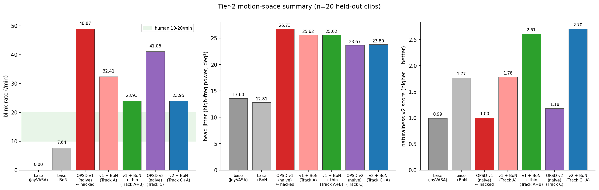<br><sub>tier-2 three-panel summary</sub></td></tr>
</table>

----------------------------------------

## Diagnostics and ablation studies

### 1. Eye aspect ratio (EAR) corrective ablation
Early post-trained models had half-closed eyes. The cause was an excessive blink target (`blink_target = 0.18`). Setting it to `0.12` and increasing the overshoot penalty returned EAR to untrained base levels:

<div align="center">
<table>
<tr><th align="center">Configuration</th><th align="center">Eye Aspect Ratio (EAR)</th><th align="center">vs. Untrained Base</th><th align="center">Fraction of Closed Frames</th></tr>
<tr><td align="center"><strong>Base (Untrained)</strong></td><td align="center"><strong>0.343</strong></td><td align="center">1.00x</td><td align="center">~0.05</td></tr>
<tr><td align="center"><strong>Initial Persona (Blink 0.18)</strong></td><td align="center"><strong>0.102</strong></td><td align="center">0.30x (Partially Closed)</td><td align="center">~0.42</td></tr>
<tr><td align="center"><strong>Revised Persona (Blink 0.12)</strong></td><td align="center"><strong>0.348</strong></td><td align="center"><strong>1.01x (Open)</strong></td><td align="center">~0.05</td></tr>
</table>
</div>

### 2. Temporal scale and translation stabilization
Raw motion coefficients caused head size drift during driving. `stabilize_scale_translation` applies a median filter and a ±2% clamp on scale dimension 63, plus median filtering on translation dimensions 64–66:
- **Face-width std/mean:** **2.04% → 1.15%** (Finance).

----------------------------------------

## Visual evidence gallery

The gallery groups comparisons by control type, using soft, low-saturation skin tones where comparable renders are available.

### Multi-subject persona generalization

Each industry has two subjects, covering within-industry consistency and cross-subject generalization. The renders use soft, natural color grading without artificial warm saturation.
*   **BASE**: Pretrained model without post-training.
*   **PERSONA**: Model post-trained with OPSD against each industry's measured target band.

<table>
<tr><td align="left" width="33%"><br><sub>finance · <a href="outputs/persona_grids/finance_two_people_base_vs_persona.mp4">mp4</a></sub></td><td align="center" width="33%"><br><sub>realestate · <a href="outputs/persona_grids/realestate_two_people_base_vs_persona.mp4">mp4</a></sub></td><td align="right" width="33%"><br><sub>shortvideo · <a href="outputs/persona_grids/shortvideo_two_people_base_vs_persona.mp4">mp4</a></sub></td></tr>
</table>

---

### Real-motion reference condition (upper bound)

Direct transfer of recorded human motion coefficients onto the portrait. This is the reference target that the OPSD policy is optimized to approach.

<table>
<tr><td align="left" width="33%"><br><sub>finance_real · <a href="outputs/demos/finance_v8_base_vs_real_1080.mp4">mp4</a></sub></td><td align="center" width="33%"><br><sub>realestate_real · <a href="outputs/demos/realestate_v8_base_vs_real_1080.mp4">mp4</a></sub></td><td align="right" width="33%"><br><sub>shortvideo_real · <a href="outputs/demos/shortvideo_v8_base_vs_real_1080.mp4">mp4</a></sub></td></tr>
</table>

---

### Same-face cross-industry control

The portrait and driving audio are identical across all three; only the persona checkpoint changes.

<table>
<tr><td align="center"><br><sub>same face, three industries · BASE | FINANCE | REAL ESTATE | SHORT VIDEO</sub></td></tr>
</table>

---

### Single-subject persona comparisons (soft tone)

Six single-subject comparisons using soft, low-saturation grading. Slight grey/background flicker remains in these renders.

<table>
<tr><td align="center" width="50%"><br><sub>finance p00</sub></td><td align="center" width="50%"><br><sub>finance p03</sub></td></tr>
<tr><td align="center" width="50%"><br><sub>real estate p01</sub></td><td align="center" width="50%"><br><sub>real estate p04</sub></td></tr>
<tr><td align="center" width="50%"><br><sub>short video p02</sub></td><td align="center" width="50%"><br><sub>short video p05</sub></td></tr>
</table>

---

### High-amplitude frontal-portrait ablation

Four frontal-portrait base clips from the high-amplitude ablation. This checkpoint overshoots the measured human motion band and is retained as an ablation result.

<table>
<tr><td align="center" width="50%">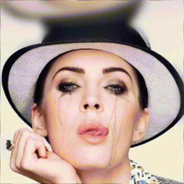<br><sub>Clip 01, CelebA-HQ 004</sub></td><td align="center" width="50%">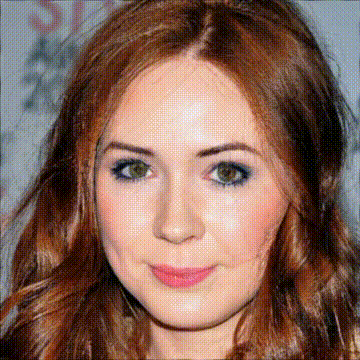<br><sub>Clip 01, CelebA-HQ 005</sub></td></tr>
<tr><td align="center" width="50%">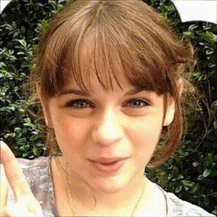<br><sub>Clip 01, CelebA-HQ 007</sub></td><td align="center" width="50%">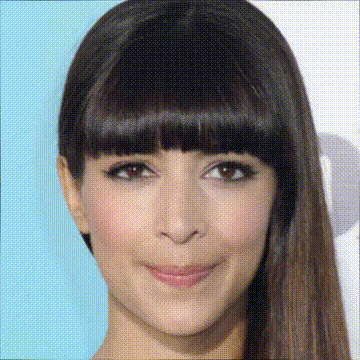<br><sub>Clip 01, CelebA-HQ 009</sub></td></tr>
</table>

---

### Calibrated restrained-motion comparisons

Six comparisons of the calibrated, restrained-motion checkpoint on held-out clips, using the soft-tone grading pipeline.

<table>
<tr><td align="center" width="50%"><br><sub>c00 HDTF 001</sub></td><td align="center" width="50%"><br><sub>c01 HDTF 001</sub></td></tr>
<tr><td align="center" width="50%"><br><sub>c00 HDTF 002</sub></td><td align="center" width="50%"><br><sub>c01 HDTF 002</sub></td></tr>
<tr><td align="center" width="50%"><br><sub>c00 HDTF 003</sub></td><td align="center" width="50%"><br><sub>c00 HDTF 004</sub></td></tr>
</table>

---

### Real-video behavior-cloning + OPSD prototype (600 steps)

Alternates OPSD updates with supervised fitting to 1,753 extracted real-video motion windows. Rendering note: this sample uses the warm/sharp tone.

<table>
<tr><td align="left" width="50%"><br><sub>BASE vs TRAINED · <a href="outputs/demos/bc_v1_base_vs_trained_1080.mp4">1080-line mp4</a></sub></td><td align="left" width="50%">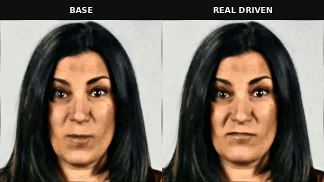<br><sub>BASE vs REAL (reference) · <a href="outputs/demos/bc_v1_base_vs_real_1080.mp4">1080-line mp4</a></sub></td></tr>
</table>

Both comparisons use the same portrait, audio and seed; only the driving motion differs. Full-length single-view renders: [BASE](outputs/bc_demo/bc1__base_hq.mp4) · [TRAINED · BC+OPSD](outputs/bc_demo/bc1__trained_hq.mp4).

---

### Calibrated expression policy (four-way matched render)

The four variants share the same portrait, audio and seed; only the checkpoint changes. Single-view renders: [Base](outputs/expression_render_set_r3/clip000__base.mp4) · [Seed 0](outputs/expression_render_set_r3/clip000__seed0.mp4) · [Seed 1](outputs/expression_render_set_r3/clip000__seed1.mp4) · [Seed 2](outputs/expression_render_set_r3/clip000__seed2.mp4).

<table>
<tr><td align="center">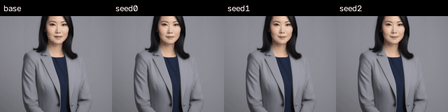<br><sub>Calibrated expression policy: strict four-second matched render</sub></td></tr>
</table>

----------------------------------------

## Limitations and rejected gates

| Metric / Aspect | Performance Status |
|---|---|
| **Visual Realism** | **Not solved.** Skin, color, and teeth textures are determined by the frozen LivePortrait warp. |
| **Pre-registered Jitter Gate** | **Failed.** Pre-registered gate of `jitter_hp ≤ 1.3x base` (18.36) was not satisfied; OPSD naive attained **28.97 (2.05x base)**. |
| **Lip Synchronisation** | **Relative gate passed, absolute quality unresolved.** Three seeds pass the frozen paired SyncNet non-inferiority margin, but all variants have low confidence and 7.7–8.8-frame mean offsets. |
| **Expression dynamics** | **Coefficient and lip-preservation gates passed.** Three calibrated seeds and n=40 paired evaluations are complete, but expression RMS is also the optimized statistic, so this establishes coefficient control rather than an independent perceptual-quality claim. |
| **Ecological separability** | Four classes (base + 3 amplitude policies) are separable at **0.831** accuracy, but most of that separation is explained by amplitude alone; the real reference data do not support a general claim that finance and real-estate speakers have distinct motion styles. |
| **Behavior cloning** | Uses 1,753 real-video motion windows, but its perceptual gain has not been established by real participants. |
| **Human preference** | **Not run.** Gallery clips are diagnostic artifacts, not blinded perceptual evidence. A randomized, balanced 40-pair expression study is executable from [`../human-study`](../human-study). |

See [`docs/RESULTS_R3.md`](docs/RESULTS_R3.md) for the evaluation protocol and gate outcomes.

----------------------------------------

## Reproduction

```bash
# 1. environment (downloads JoyVASA + LivePortrait + HuBERT-chinese, ~2.5 GB)
bash scripts/h20_render_setup.sh

# 2. data preparation (AISHELL-1 + public clips)
python scripts/fetch_public_data.py --aishell-speakers 75 --hdtf 40 --celebv 300
python scripts/build_audio_segments.py --n-train 2000 --n-eval 100

# 3. measure pose/industry targets and non-lip expression targets
python scripts/calibrate_industry_bands.py
python scripts/calibrate_behaviour_bands.py

# 4. run training only after freezing a config and gate record
python ../tools/train_guard.py --selftest
ROUNDS=3000 bash scripts/train_industries.sh

# Calibrated expression runs use the target/tolerance written above and unique output dirs;
# the exact command and outcome must be appended to docs/RESULTS_R3.md.

# 5. held-out evaluation and matched demo rendering
python scripts/eval_industries.py --n-clips 12
python scripts/render_industry_demo.py --gpu 0
```

----------------------------------------

## Repository layout

```
07-talking-head-motion-opsd/
├── src/                  # reward (motion_reward*.py), OPSD trainers, engine, video metrics
├── scripts/              # data prep, calibration, training scripts, rendering
├── data/                 # manifests and data descriptors
├── outputs/              # figures/, demos/, and checkpoints
└── docs/                 # TECH_REPORT, SEPARATION_ANALYSIS, HANDOFF
```

----------------------------------------

## Acknowledgements

This repository builds upon [DiffusionOPSD](https://github.com/worldbench/DiffusionOPSD) (methodology), [JoyVASA](https://github.com/jdh-algo/JoyVASA) (motion generator), [LivePortrait](https://github.com/KwaiVGI/LivePortrait) (implicit warping renderer), and [AISHELL-1](https://www.openslr.org/33/) (corpus).
