# On-Policy Self-Distillation for Talking-Head Motion

A technical report on migrating DiffusionOPSD from pixel diffusion to audio driven
digital human motion, and on the question that motivates the whole project:
can one method produce digital humans that differ measurably by industry.

Repository: jingxiduan/ml-portfolio, project folder 07-talking-head-motion-opsd.

---

## Abstract

DiffusionOPSD post-trains a diffusion model with on-policy self-distillation:
query the current policy, build bounded positive and negative targets from a
reward gradient, fit those targets with a detached distillation loss, then refresh
the behaviour policy by EMA. We keep the algorithm unchanged and change only what a
sample means. A sample is no longer an image latent. It is a trajectory of 73
dimensional motion coefficients that drives a frozen LivePortrait renderer.

Three things are new relative to a straight port.

1. The reward operates on motion statistics, not pixels, and every reward target is
   measured from real public human footage rather than hand tuned.
2. Each industry gets its own measured target band, so finance, real estate and short
   video are trained from the same reward function with four numbers changed.
3. Real video is used as a second supervision channel. Coefficients extracted from
   public talking head clips give paired audio and real human motion windows, so the
   model can imitate how real people moved instead of only chasing a reward.

The claim under test is narrow and falsifiable: post-training changes measurable
behaviour, and industry specific targets produce behaviour that differs by industry
in the same direction and roughly the same ratio as the real footage they came from.
It is not a claim about photorealism. The face pixels come from the source portrait
and are never generated by the model.

Headline numbers, all measured on rendered output or held out windows:

| result | value |
|---|---|
| short video amplitude versus base | 3.03 times, real footage ratio 2.2 times |
| persona amplitude versus its own measured target | 0.84 to 0.90 times, no overshoot |
| earlier v2 and v3 overshoot | 2.4 to 2.7 times real, the uncanny valley source |
| real video behaviour cloning windows | 1753 extracted, 684 public clips |
| base versus trained coefficient difference | 0.540, confirming the LoRA is applied |

---

## 1. Scope and non-goals

It is a method project. A frozen audio to motion diffusion model, JoyVASA, is
post-trained with a differentiable liveliness reward using the OPSD loop. Rendering
is LivePortrait, frozen, never trained.

It is not a production digital human pipeline. Output quality is bounded by the
source portrait and by the renderer, not by the trained motion model. The project is
deliberately scoped to behaviour, and it separates behaviour from image quality so
the two are never tuned against each other again.

## 2. Method, OPSD in motion space

At a query state s = c, z_q, sigma_q the frozen behaviour policy defines a clean
anchor

$$y_0 = z_q - \sigma_q\, v_{\mathrm{old}}(z_q, c, \sigma_q)$$

The normalised reward gradient gives bounded positive and negative targets

$$y_0^{\pm} = y_0 \pm c_{\mathrm{adv}}\,\sigma_t\,\frac{\nabla_y R(y_0)}{\|\nabla_y R(y_0)\|_2}$$

and the trainable policy fits the detached targets with a contrastive objective

$$\mathcal{L}_{\mathrm{OPSD}} = \| \hat y_\theta - \bar y_0^{+} \|^2 - \| \hat y_\theta - \bar y_0^{-} \|^2$$

Minimal pseudocode, motion space:

```python
set_mode("behavior")
z      = rollout_to(motion_generator, audio_feat, t1, cfg_scale)
anchor = guided_x0(motion_generator, z, t1, audio_feat, cfg_scale)
r      = liveliness_reward(anchor, env)
g      = autograd.grad(r.sum(), z);  d = g / g.norm()

tgt_pos = guided_x0(mg, z + step_size * d, ...)
tgt_neg = guided_x0(mg, z - step_size * d, ...)

set_mode("trainable")
pred = guided_x0(mg, z.detach(), ...)
loss = mse(pred, tgt_pos) + lambda_neg * relu(margin - mse(pred, tgt_neg))
loss.backward(); optimizer.step()
ema_update_behaviour_policy()
```

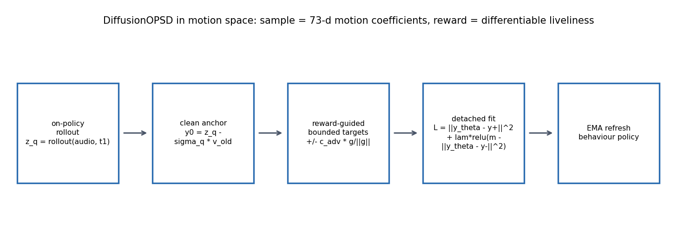

### 2.1 Settings, DiffusionOPSD versus this project

| setting | DiffusionOPSD, SD3.5-M | this project, JoyVASA motion |
|---|---|---|
| LoRA | PEFT | r = 8, alpha = 8, about 179K trainable parameters |
| c_adv, target radius | 5, rho = 0.10 | 3.0 |
| optimizer | AdamW | AdamW, lr 1e-4, weight decay 0 |
| batch | 48 prompt groups | 8 windows of 4 seconds |
| EMA refresh | every outer update | every 10 steps, decay 0.5 |
| rollout | 10 step, CFG free | 50 step, cfg scale 2.0 |
| gradient clipping | not reported | norm 1.0 |
| learning rate schedule | constant | linear warmup 200 steps then cosine to 0.1x |

## 3. System, what is frozen and what is trained

| component | model | status |
|---|---|---|
| audio to motion | JoyVASA, motion_generator_hubert_chinese | frozen, LoRA on its DiT |
| renderer | LivePortrait, implicit keypoint warping | frozen, never trained |
| audio features | HuBERT chinese | frozen |
| face analysis | InsightFace buffalo_l, MediaPipe face landmarker | frozen, used for measurement |

### 3.1 The 73 dimensional motion coefficient layout

| dims | meaning |
|---|---|
| 0 to 62 | expression, 21 implicit keypoints times xyz |
| 63 | head scale |
| 64 to 66 | translation |
| 67 to 69 | pitch, yaw, roll |

Two facts about this parameterisation matter for every number in this report.

17 of the 63 expression dimensions are degenerate, their standard deviation is below
1e-4, so they carry no signal and must be excluded from losses and metrics.

The renderer uses relative expression, delta_new = exp_s + exp_d_i - exp_d_0, while
lip keypoints use absolute expression. Gaze variation therefore transfers from the
driving source, which is why a frontal gate exists.

---

## 4. Measuring real human behaviour before training anything

Nothing in the reward is hand tuned. Every target is measured on real public footage
with the same filter the reward itself uses, so the numbers plug directly into the
reward.

| industry | footage proxy | low band amplitude, 0.3 to 3 Hz | high band jitter, 6 to 12.5 Hz | blinks per minute | clips |
|---|---|---|---|---|---|
| finance | HDTF news anchors | 1.384 degrees | 0.094 degrees | 18.1 | 25 |
| real estate | CelebV-HQ mid amplitude | 1.257 degrees | 0.118 degrees | 20.3 | 16 |
| short video | CelebV-HQ high amplitude | 3.039 degrees | 0.349 degrees | 22.6 | 16 |

Short video head motion is 2.2 times finance. The industry difference is real and
measured, not asserted. A quality gate, frontal pose, amplitude at most 8 degrees,
jitter at most 1 degree, blink at most 60 per minute, removes pose estimation noise.
Without it CelebV-HQ reports 37 degree head motion and the band would be defined by
a measurement failure.

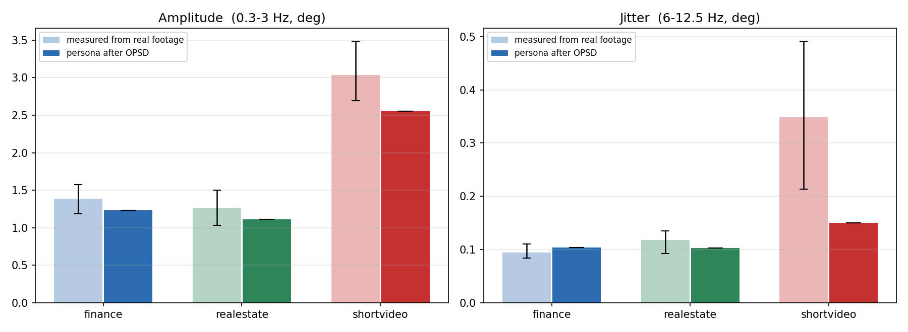

## 5. Training data

### 5.1 Audio only channel

AISHELL-1, Apache 2.0, 75 speaker archives, 60 train speakers and 15 evaluation
speakers with disjoint identity, 2000 training segments of 8 to 15 seconds at 16 kHz
mono, giving 14260 four second windows. No images and no video frames enter this
channel.

### 5.2 Real video channel, behaviour cloning

Public talking head clips are run through LivePortrait's own motion extractor and
cropper to obtain 73 dimensional coefficients, paired with that clip's own audio and
cut into aligned four second windows. Each window is a pair of audio and real human
motion.

| stage | value |
|---|---|
| candidate clips | 1323 public clips, CelebV-HQ plus HDTF |
| clips kept after filtering | 684 |
| windows written | 1753 |
| filters | luminance, speech not singing via voiced run and harmonic ratio, English by whisper transcription, face found by the cropper, head scale stabilised |

The behaviour cloning loss ignores dimensions 63 to 66, scale and translation,
because those are identity specific, and it ignores the 17 degenerate expression
dimensions.

| loss | definition |
|---|---|
| OPSD | contrastive distillation on reward guided bounded targets |
| behaviour cloning | mean squared error between predicted motion and real human motion, masked |

Steps alternate. With bc_frac = 0.5, half the optimisation steps imitate real human
motion and half run the OPSD loop.

## 6. Reward

The reward is differentiable and operates only on the predicted clean motion.

| term | form | role |
|---|---|---|
| amp | Gaussian peaked at the measured industry band | liveliness, penalises both under and over shoot |
| jitter | penalty above a jitter cap | smoothness |
| blink | target blink peak | eye behaviour |
| gaze | gaze variation | not staring |
| couple | correlation of speech envelope and head speed | listening micro motion |
| ood | deviation from the portrait's neutral state | keeps the face near the source identity |
| expr | expression dynamics band | non lip facial motion |

The amplitude term is the main result of an earlier round. v3 used a monotone
tanh which saturates and drives amplitude to 2.4 to 2.7 times real. v4 replaced it
with a Gaussian peaked at the measured human band, which is what removed the
overshoot.

---

## 7. Experiments

### 7.1 Three industry personas, held out speakers

Twelve clips, zero speaker overlap with training. Only four numbers differ between
the three runs: amp_target_deg, amp_tol_deg, jitter_cap_deg, blink_target_mean.
Reward weights, formula, LoRA config, learning rate, rounds and seed are identical,
so any difference is attributable to the target band alone.

| variant | amplitude | versus its target | versus base | jitter |
|---|---|---|---|---|
| base, untrained | 0.890 degrees | reference | 1.00 times | 0.119 degrees |
| finance | 1.162 degrees | 0.84 times | 1.31 times | 0.120 degrees |
| real estate | 1.134 degrees | 0.90 times | 1.27 times | 0.112 degrees |
| short video | 2.699 degrees | 0.89 times | 3.03 times | 0.156 degrees |

No overshoot anywhere. All three land at 0.84 to 0.90 times their measured target,
and the 2.4 to 2.7 times overshoot of v2 and v3 does not recur. Finance and real
estate are close, 1.16 versus 1.13 degrees, and that is the honest answer because
their measured bands are close too, 1.38 versus 1.26 degrees. Short video is 3.0
times base while the real footage ratio is 2.2 times, so the industry difference is
reproduced in the right direction and roughly the right size.

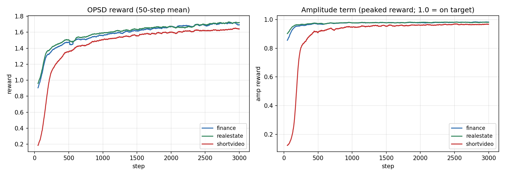

A blink bug was found and fixed in this round. The first render came out with half
closed eyes. Two causes, both measured: the blink target was too high at 0.15 to
0.21, which parks the expression coefficients near the closed state, and some source
portraits have small eyes to begin with. Fix was blink target 0.12, overshoot
penalty 4 to 8, and portraits gated on measured eye openness. Median eye aspect
ratio over rendered frames went from 0.102 back to 0.348, equal to base.

### 7.2 Finance smoke run, audio only with reward

600 steps on 2000 AISHELL windows, finance band, learning rate 1e-4, 200 step warmup.

| metric | step 1 | step 600 |
|---|---|---|
| reward | 1.647 | 2.057 |
| amplitude | 0.869 degrees | 0.963 degrees, target 1.384 degrees |
| learning rate | 5e-7 | 1e-5, cosine end |

### 7.3 Real video run, behaviour cloning plus OPSD

600 steps, 305 behaviour cloning steps and 295 OPSD steps, 1753 real video windows,
same finance band.

| metric | first | last |
|---|---|---|
| behaviour cloning rmse | 0.338 | 0.304, minimum 0.156 at step 420 |
| OPSD reward | 1.695 | 1.837 |
| amplitude | 0.840 degrees | 0.873 degrees |
| base versus trained coefficient difference | 0.540, zero would mean the LoRA did not apply | measured |

The behaviour cloning loss reaches its minimum around step 420 and then rises. That
is an open problem, not a result, and it is the main target of the next run.

## 8. Qualitative results, ordered by evidential weight

Every demo below is rendered from the same portrait, the same audio and the same
seed on both sides. Only the checkpoint differs.

### Primary, V8, trained on real video

The newest result and the one to look at first. Real video behaviour cloning plus
OPSD, 600 steps.

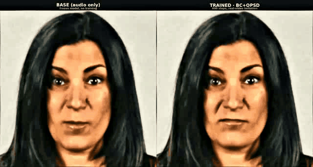

Left, base, frozen model, no training. Right, trained, 600 steps of real video
imitation plus OPSD. Full resolution mp4, 1080 lines:
bc_v1_base_vs_trained_1080.mp4

### Primary, V1, three industry personas, two people each

The trained personas from section 7.1, two different people per industry so
generalisability is visible alongside the style difference.

| industry | animation | full video |
|---|---|---|
| finance | 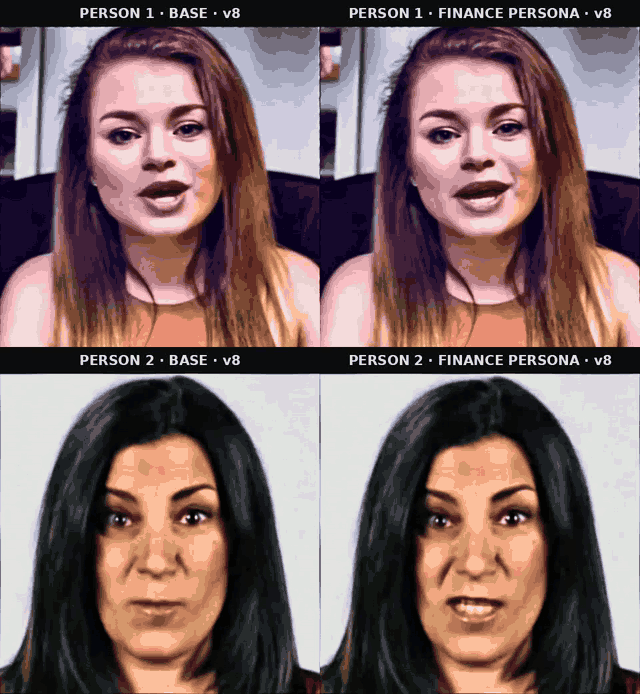 | finance_two_people_v8.mp4 |
| real estate | 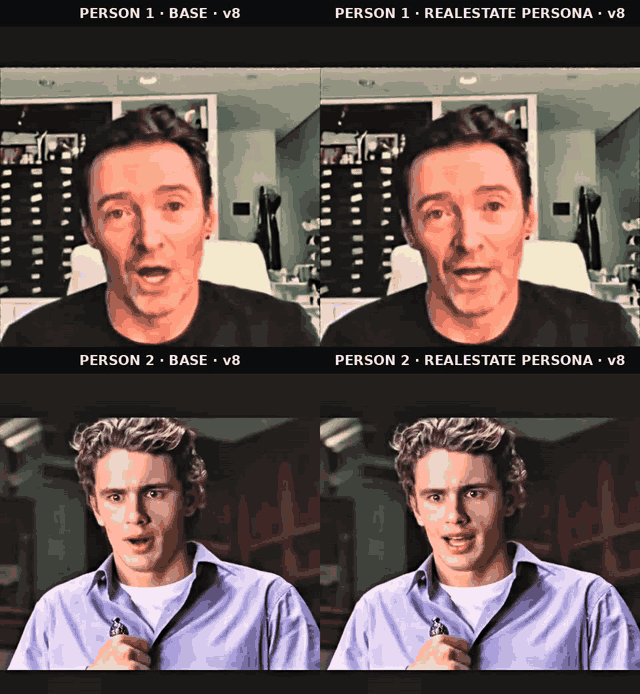 | realestate_two_people_v8.mp4 |
| short video | 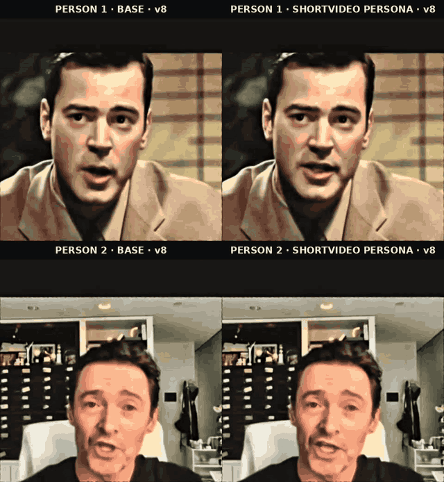 | shortvideo_two_people_v8.mp4 |

### Reference, V2, real human coefficients transferred

Not a model output. The right side is a real person's motion coefficients copied onto
the same face. It is the target the trained model is trying to approach, and it
naturally looks the most natural because it is literally real human motion.

| industry | animation | full video |
|---|---|---|
| finance | 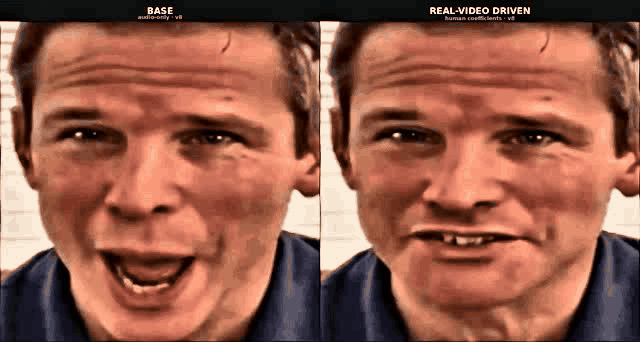 | finance_v8_base_vs_real_1080.mp4 |
| real estate | 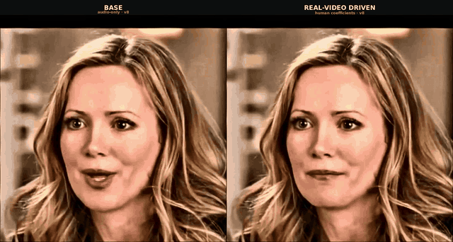 | realestate_v8_base_vs_real_1080.mp4 |
| short video | 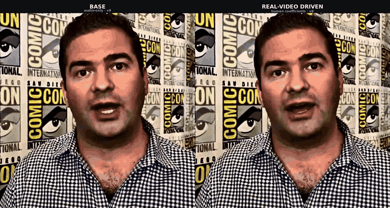 | shortvideo_v8_base_vs_real_1080.mp4 |

### Control, V3, same face across three industries

Identical portrait, identical audio, three personas. Any behavioural difference can
only come from the persona.

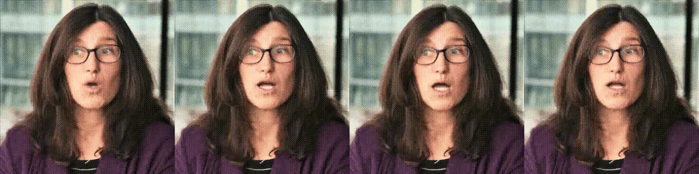

Order left to right, base, finance, real estate, short video.

### Archive, earlier renders, kept on disk, not shown

These are superseded by V1 and V8 and are listed as directories only, to keep the
front page readable.

- industry_gifs_v3, single person base versus persona, same renders as V1 with older grading
- demo_gifs_frontal, base versus v3, v3 overshoots amplitude 2.4 times real
- demo_gifs_v4, base versus v4, the calibrated reward
- industry_demo_v3, the source mp4 files for V1 and the archive above

## 9. Video quality pipeline, deliberately separate from training

Training changes motion. It cannot change skin texture, saturation or exposure,
because no pixel is ever generated. All of the following runs after rendering and is
fully independent of the checkpoint.

| step | purpose |
|---|---|
| luminance stretch | fixes dark or flat clips |
| CLAHE, local contrast | shadow detail, the light feel |
| gamma solved to a measured target mean | brightness |
| highlight rolloff above 200 | stops blowouts |
| clarity, large radius micro contrast | depth without crunchy edges |
| skin only smoothing | the beauty pass, and the cause of waxy skin when set too high |
| unsharp | sharpening, lowered in v8 |
| lanczos upscale | reaches 1080 lines |

Measured on the current renders, mean luma 108, p98 227, clipped pixels 0.0 percent,
saturation 86, warmth R minus B plus 25.

Two known causes of the artefacts often attributed to training:

Waxy or plastic skin comes from the skin only smoothing pass, currently 0.35.

Oil painting flat colour patches come from GIF quantisation at 64 colours with
dithering disabled, plus stacked local contrast operators.

## 10. Limitations

- Only one 600 step real video run exists. The behaviour cloning loss rises after step 420.
- 1753 real video windows is small next to 14260 audio windows.
- Public datasets used here, CelebV-HQ and HDTF, are research licensed. Commercial
  deployment of anything trained on them needs a licensing decision first.
- Lip sync is unmeasured. SyncNet or LSE-C was not run.
- Source portraits come from compressed video frames, HDTF mirror is 512 by 512,
  CelebV-HQ median 828 by 828, which caps output face detail.
- The trained LoRA is tied to LivePortrait's 73 dimensional parameterisation and does
  not transfer to a different renderer.

## 11. Next steps, in order

1. Grow the real video dataset to 5000 windows and prefer high resolution news anchor
   sources for portraits.
2. Lower the learning rate to 5e-5, raise warmup to 300, run 3000 steps with a
   checkpoint every 500 steps.
3. Register the stopping rules before the run, amplitude within 0.8 to 1.1 times the
   measured band, jitter at most 1.3 times real, behaviour cloning loss monotonically
   decreasing, and a human look at a two second render every 500 steps with an
   immediate stop on visual collapse.
4. Render a three way comparison, base, real human coefficients, trained, so the
   remaining gap is visible.
5. Fix image quality separately, reduce skin smoothing, raise GIF colour count,
   consider GFPGAN or CodeFormer face restoration after warping.

## 12. Reproduction

```bash
bash scripts/h20_render_setup.sh                    # environment, about 2.5 GB of weights
python scripts/build_audio_segments.py --n-train 2000 --n-eval 100
python scripts/fetch_public_data.py --skip-aishell --celebv 1500
python scripts/calibrate_industry_bands.py          # the measured target bands
python scripts/build_video_motion_dataset.py --gpu 0 # audio and real motion pairs

CUDA_VISIBLE_DEVICES=0 python src/opsd_train_motion_v5.py \
  --out outputs/opsd_bc_v1 --data-dir data/audio_public/train \
  --bc-dir data/motion_ds --bc-frac 0.5 --rounds 600 --lr 1e-4 --warmup 200 \
  --amp-target-deg 1.384 --amp-tol-deg 1.0 --jitter-cap-deg 0.188 --blink-target-mean 0.12

python scripts/render_bc_demo.py --portrait data/portraits_picked/p03_0tx4o3yXM64_12.png \
  --audio data/audio_picked/p03_0tx4o3yXM64_12.wav --lora outputs/opsd_bc_v1/lora.pt --tag bc1

python scripts/postprocess_video.py outputs/bc_demo/bc1__base.mp4 \
  outputs/bc_demo/bc1__base_hq.mp4 --sr none
python scripts/build_demo_sbs.py --tag bc1 --industry bc_v1 \
  --base outputs/bc_demo/bc1__base_hq.mp4 --real outputs/bc_demo/bc1__trained_hq.mp4 \
  --label-base "BASE (audio only)" --label-real "TRAINED · BC+OPSD"
```
