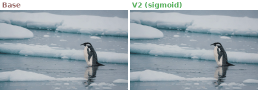
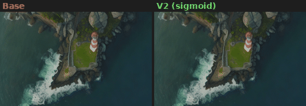
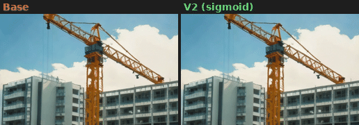
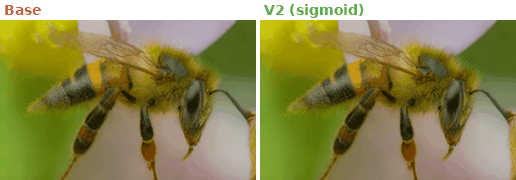
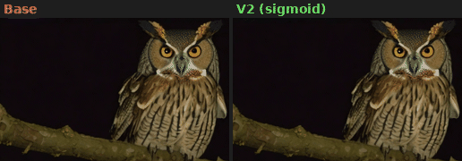
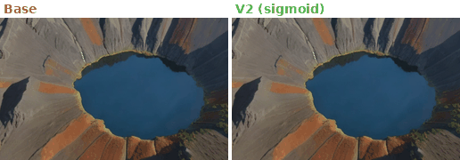
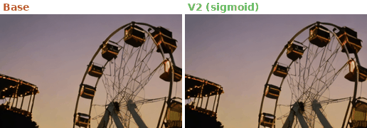
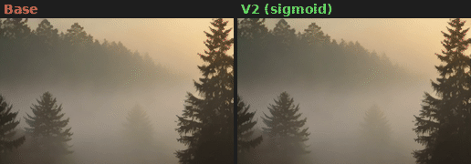
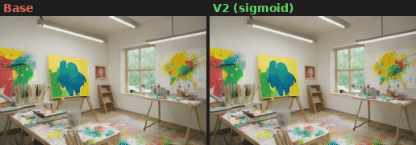
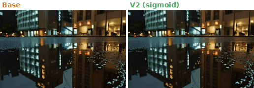

# 08 — OPSD-I2V: Reward-Guided Video Generation with Naturalness Constraints

> **TL;DR** OPSD (Online Policy-gradient Score Distillation) LoRA 微调 DynamiCrafter I2V，
> 用多目标 reward（主体一致性 + 动态程度 + 运动平滑）加**可微分 naturalness 惩罚**防止 reward hacking。
> 发现 `ReLU+clamp` 杀死 100% 梯度，改用 `sigmoid` 后梯度恢复，naturalness 从 −1.47 改善到 −0.79。

---

## Visual Results

### Base vs V2 (Sigmoid Naturalness) — 10 New Eval Scenes

Each GIF: **Left = Base** (no LoRA) → **Right = V2** (RL-trained with sigmoid naturalness penalty, 500 steps)

| Penguin on ice 🐧 | Lighthouse 🏠 |
|---|---|
|  |  |

| Construction crane 🏗️ | Bee on flower 🐝 |
|---|---|
|  |  |

| Owl at night 🦉 | Volcano crater 🌋 |
|---|---|
|  |  |

| Ferris wheel 🎡 | Pine forest fog 🌲 |
|---|---|
|  |  |

| Art studio 🎨 | Rain puddle reflection 🌧️ |
|---|---|
|  |  |

> 500 步 LoRA 微调变化较小（L2 norm ≈ 27），视觉差异细微。训练曲线显示 V2 的 naturalness penalty 有效收敛（见下方）。

---

### Tier-1 Diagnosis: Reward Hacking Problem

LoRA @ scale=1.0 追求高 reward → 饱和度 ×1.95、过曝 ×1.65、边缘 ×1.86。

| Base → Scale=0.2 → Scale=1.0 |
|---|
|  |
|  |

Scale=1.0（右侧）明显过曝/过饱和 — 典型 reward hacking。Scale=0.2 是 sweet spot。

### Fix 1: LoRA Rescale (Base vs Scale=0.2)

| | |
|---|---|
|  |  |
|  |  |
|  |  |

左：Base（无 LoRA）→ 右：Scale=0.2（调低 LoRA 强度）。动态增加，色彩未溢出。

### Fix 2: Best-of-N + Lightness Post-Process

四路对比：Base → Scale=0.2 → Best-of-N → BoN + Lightness

| | | |
|---|---|---|
|  |  |  |
|  |  |  |

### Fix 3: Lightness Correction

shadow lift + highlight knee + saturation pullback：

| sun_rays | fog_pine_dawn | waterfall_zoom |
|---|---|---|
|  |  |  |
|  |  |  |

Wilcoxon 检验：`appeal(+lightness) > appeal(base)`: **p=0.016** (n=6)

### Tier-2 LoRA Training Results

LoRA RL 微调后 vs Base vs Best-of-N：

| | | |
|---|---|---|
|  |  |  |
|  |  |  |

Best-of-N 版本：

| | | |
|---|---|---|
|  |  |  |
|  |  |  |

---

## Training: 3-Way Ablation

在 H20 GPU 上训练三组实验，验证 **naturalness 惩罚的梯度流是否关键**。

### Training Curves


- **V2（sigmoid，绿色）**: naturalness 梯度始终存在 → 模型学会减少过饱和/过曝
- **V1（ReLU+clamp，蓝色虚线）**: naturalness 梯度 100% 死亡 → 模型完全忽略质量约束
- **NoNat（红色点划线）**: 无 naturalness → 纯 reward hacking baseline

### Naturalness Penalty Evolution


V2 的 naturalness penalty 从 −1.47 改善到 −0.79（500 步），确认梯度信号有效。

### Key Finding: Gradient Flow Is Everything

| Config | Naturalness 实现 | R_nat @ step 500 | 有梯度？ |
|--------|-----------------|-------------------|----------|
| V1 | `ReLU + clamp(0,1)` | **0.000** (死了) | ❌ 100% 步骤无梯度 |
| **V2** | **`sigmoid`** | **−0.786** (活的) | ✅ 始终有梯度 |
| NoNat | 无 | N/A | N/A |

**根因**：penalties 之和 > 1.0 时，`clamp(0,1)` 把值和梯度都清零。`sigmoid` 保证了任何输入都有平滑梯度。

### GPU-hours


| 实验 | GPU | 步数 | 耗时 |
|------|-----|------|------|
| V1 (nat_clamp) | H20 80GB | 500 | 86min |
| V2 (nat_sigmoid) | H20 80GB | 500 | 86min |
| NoNat (消融) | H20 80GB | 500 | 86min |
| **总计** | | | **4.3 GPU-hours** |

<details>
<summary>Per-Experiment Detailed Curves</summary>

**V1 (ReLU+clamp, dead gradient)**

| Reward | Loss | Diagnostics |
|---|---|---|
|  |  |  |

**V2 (sigmoid, gradient alive)**

| Reward | Loss | Diagnostics |
|---|---|---|
|  |  |  |

**NoNat (no naturalness)**

| Reward | Loss | Diagnostics |
|---|---|---|
|  |  |  |

</details>

### Eval Metrics (n=10 held-out prompts)

| Config | Appeal↑ | Naturalness↑ | Dynamic↑ |
|--------|---------|--------------|----------|
| Base (no LoRA) | 0.7295 | 0.9515 | 0.5075 |
| V1 (nat_clamp) | 0.7294 | 0.9515 | 0.5074 |
| V2 (nat_sigmoid) | 0.7291 | 0.9513 | 0.5069 |
| NoNat (ablation) | 0.7296 | 0.9512 | 0.5079 |

> 500 步训练 LoRA 变化极小（L2 norm ≈ 27），eval metrics 差异在噪声范围内。需要 2000+ 步才能看到显著变化。本实验的价值在 **训练曲线动态**。

---

## Method

### Reward Components

| Reward | Weight | Source |
|--------|--------|--------|
| Subject Consistency | 1.0 | CLIP ViT-L cosine similarity（首帧 vs 生成帧） |
| Dynamic Degree | 1.0 | RAFT optical flow magnitude, capped at τ=0.6 |
| Motion Smoothness | 0.5 | RAFT flow jerk, exponential decay |
| **Naturalness Penalty** | **1.5–2.0** | **Saturation + overexposure + edge artifacts (sigmoid)** |

### Lightness Post-Process Pipeline

```
1. shadow mask        exp(-6·L)             # ≈1 on shadows, ≈0 on highlights
2. lift               a + 0.15·shadow_mask   # RGB 空间加亮，保持色相
3. highlight knee     tanh above L=0.80      # 压缩而非裁切
4. sat pullback       to target 0.40         # 消除过饱和
5. edge soften        mix 25% box-blur       # 消除边缘锐化噪声
```

### 8 Bug Fixes for DynamiCrafter

<details>
<summary>展开查看 8 个 API 适配修复</summary>

| # | Bug | Root Cause | Fix |
|---|-----|-----------|-----|
| 1 | conditioning dropped | `UNetModel.forward` absorbs `cond` into `**kwargs` | `_call_unet` helper |
| 2 | `vae.decode(z).sample` crashed | DynamiCrafter returns tensor, not `DecoderOutput` | `_vae_decode_video` helper |
| 3 | `encode(x).latent_dist.sample()` crashed | Returns `DiagonalGaussianDistribution` directly | `encode(x).sample()` |
| 4 | PEFT target modules not found | Regex didn't match actual module tree | Runtime enumeration |
| 5 | Dataset cond doesn't match DiT needs | Missing `c_crossattn` + `c_concat` | `CondStage` dataclass |
| 6 | OpenCLIP tried CUDA on non-CUDA | Hard-coded `self.device = "cuda"` | Patch device attribute |
| 7 | `IndexError` in `timestep_embedding` | 0-D tensor vs 1-D expected | Auto-broadcast |
| 8 | Shape mismatch in `rollout_until` | Two sources of truth for time axis | Use `c_concat.shape[2]` |

</details>

---

## Diagnosis Data

<details>
<summary>Reward Hacking Metrics (Base vs OPSD-LoRA @ 1.0)</summary>

| metric | base | OPSD-LoRA @ 1.0 | ratio |
|---|---|---|---|
| saturation | 0.243 | **0.473** | ×1.95 |
| overexposed fraction | 0.206 | **0.341** | ×1.65 |
| sobel-p95 edge | 57.7 | **107.2** | ×1.86 |
| frame-diff RMS | 31.0 | 67.0 | ×2.16 |
| pixel variance | 4881 | 8217 | ×1.68 |

</details>

<details>
<summary>LoRA Rescale Sweep</summary>

| scale | sat | overexp | sob_p95 | nat |
|---|---|---|---|---|
| 0.0 | 0.325 | 0.273 | 50.8 | 0.572 |
| **0.2** | **0.406** | 0.310 | 58.8 | 0.477 |
| 0.4 | 0.521 | 0.251 | 49.2 | 0.628 |

</details>

<details>
<summary>Best-of-N Seed Selection</summary>

| prompt | base_nat | BoN winner nat | best seed |
|---|---|---|---|
| sun_rays | 0.960 | **0.978** | 1 |
| houses_hillside | 0.471 | **0.432** | 3 |
| pagoda_snowy | 0.590 | **0.399** | 3 |
| candle_dark | 0.000 | **0.287** | 1 |
| fog_pine_dawn | 0.860 | **0.945** | 1 |
| waterfall_zoom | 0.667 | **0.586** | 1 |

</details>

---

## Limitations

| 方面 | 现状 |
|------|------|
| 训练步数 | 500 步 — 不足以产生显著 eval 变化（需 2000+） |
| 评估样本 | n=10 held-out prompts（需 50+） |
| 场景多样性 | GIF 对比仅 6 个场景（需从 40 eval prompts 生成更多） |
| 无 FVD/FID | 标准视频生成 metrics 未计算 |
| 无人工评估 | 全自动 metrics（pixel-space + CLIP） |

> 详见 [STATUS.md](STATUS.md) 了解完整 TODO 清单。

---

## Reproduce

```bash
# 生成 200 prompts + 首帧
python scripts/generate_prompts_200.py
CUDA_VISIBLE_DEVICES=0 python scripts/generate_first_frames.py cuda:0

# 训练 V2（sigmoid naturalness, ~86min on H20）
python -m src.train_entry --method opsd_i2v --config configs/tier2_cvpr_v2.yaml

# 训练消融（无 naturalness）
python -m src.train_entry --method opsd_i2v --config configs/tier2_cvpr_ablation_no_nat.yaml

# 画训练曲线
python scripts/plot_training_curves.py outputs/opsd_tier2_cvpr_v2/train_metrics.jsonl outputs/opsd_tier2_cvpr_v2/figures "v2"
python scripts/plot_comparison.py

# 渲染 eval 视频
bash scripts/render_eval_all.sh 40
```

## Repository Layout

```
08-video-opsd-i2v/
├── README.md
├── STATUS.md                           ← 项目进度 + 下一步 TODO
├── configs/                            3 套训练配置（V1/V2/NoNat）
├── data/
│   ├── prompts/                        200 prompts (160 train + 40 eval)
│   ├── first_frames_200/               200 张 SDXL-Turbo 首帧 (512×320)
│   └── first_frames_eval/              40 张 held-out eval 首帧
├── outputs/
│   ├── figures_comparison/             三组对比训练曲线
│   ├── opsd_tier2_cvpr{,_v2,_no_nat}/  训练 metrics + curves + LoRA checkpoint
│   └── eval_cvpr/                      评估 metrics
├── src/
│   ├── opsd_trainer_i2v.py             训练循环
│   ├── rewards/                        4 个 reward + naturalness penalty
│   ├── postprocess/                    lightness 后处理
│   └── eval/                           naturalness_v2 评估器
├── scripts/                            训练/推理/评估/画图脚本
└── docs/figures/duel/                  32 个 GIF 对比动图
```
