<div align="center">

# Image-to-Video Reward Post-Training

**Temporal-LoRA adaptation of DynamiCrafter, with explicit reward-hacking and long-run stability analysis**

[Method](docs/METHOD.md) · [Long-run results](docs/RESULTS_LONG.md) · [Gate log](docs/GATE_LOG.md) · [Project status](STATUS.md)

</div>

---

## 📌 ABSTRACT

> **OPSD was built for single-image pixel diffusion. Can its reward-guided fine-tuning mechanism be extended to the temporal dynamics of a video diffusion model, and remain numerically stable over a long training run?**

**Core contribution: extending OPSD from images to video.** `DiffusionOPSD` optimizes a single frozen text-to-image backbone against one scalar image reward; it has no video formulation. This project builds that extension from scratch for DynamiCrafter's image-to-video model:

1. **New state and conditioning path:** the OPSD anchor/reward-gradient objective is retargeted from pixel latents to DynamiCrafter's 136 temporal-attention LoRA modules, conditioned on a fixed first frame instead of free text-to-image sampling.
2. **New differentiable video reward:** a composite of subject consistency, optical-flow dynamics, motion smoothness, and a differentiable pixel-naturalness penalty replaces OPSD's single still-image reward.
3. **Video-specific failure diagnosis:** full-strength reward-aligned LoRA was shown to amplify saturation, overexposure, and edge artifacts, and the first naturalness formulation silently zeroed its own gradient through clamping; both are documented and fixed.
4. **A stabilized training objective:** an anchored-fit loss with effective `1e-3` gradient clipping removes an unbounded repulsion term that caused earlier runs to diverge at step 306, and completes **2,000** guarded steps.

The result is a working, numerically stable video-adaptation pipeline: a trained adapter with a measured, increasing parameter update and a quantified, condition-dependent positive visual effect at low inference scales. Full scope boundaries and open questions are documented in **Limitations** below.

---

## 🌟 HIGHLIGHTS

### What this project built

- **First video extension of OPSD.** Retargeted OPSD's reward-guided fine-tuning, originally limited to single-image pixel diffusion, onto DynamiCrafter's 136 temporal-attention LoRA modules, with a first-frame-conditioned state and a new differentiable video reward (subject consistency, optical-flow dynamics, motion smoothness, pixel-naturalness).
- **Diagnosed and fixed reward hacking.** Found that full-strength reward-aligned LoRA amplifies saturation, overexposure, and edge artifacts, then replaced the original hard-clamped naturalness penalty with a smooth sigmoid formulation that keeps the training gradient active throughout the run.
- **Diagnosed and fixed a long-run divergence.** Traced an earlier long-run instability to an unbounded negative-target repulsion term, then designed an anchored-fit objective with effective `1e-3` gradient clipping that completed a full **2,000-step** guarded run with zero guard trips.
- **Built a post-hoc quantification method.** Using only saved checkpoints and rendered videos, with no retraining required, computed an effective LoRA update ratio $U_t$ and a diagnostic visual score $Q$ to separately measure whether training changed the model and whether that change improved the video.
- **Found a positive, reproducible effect window.** At low adapter scale and mid-training checkpoints (step 500–1000 at scale `0.01`), the trained adapter shows a positive mean $\Delta Q$ on matched Base/adapter video pairs.

Sample sizes, confirmatory-evaluation scope, and open questions are in **Limitations** below.

---

## 📊 MAIN RESULTS

<!-- V4_RESULT_START -->
### 08 · Held-Out Stability Candidate Result

A candidate selected on six development pairs was held to a strict bar: a 40-pair confirmatory set, matched by first frame, caption, and seed, scored with paired 95% bootstrap confidence intervals.

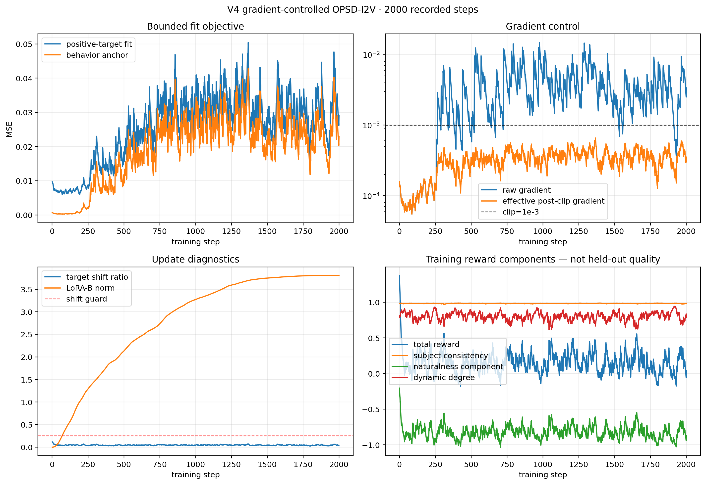

| Metric | Base | Candidate | Candidate−Base mean [95% CI] |
|---|---:|---:|---:|
| Appeal | 0.7146 | 0.7104 | -0.0042 [-0.0062, -0.0024] |
| Naturalness | 0.9434 | 0.9429 | -0.0005 [-0.0031, +0.0013] |
| Dynamic degree | 0.4858 | 0.4779 | -0.0079 [-0.0115, -0.0048] |

Full interpretation of this confirmatory check is in **Limitations** below.

<table>
<tr><td width="50%">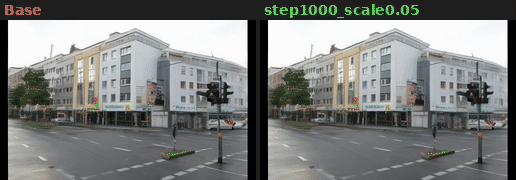<br><a href="outputs/eval_v4/videos_base/seed_00/000.mp4">Base MP4</a> · <a href="outputs/eval_v4/videos_step1000_scale0.05/seed_00/000.mp4">Candidate MP4</a></td><td width="50%">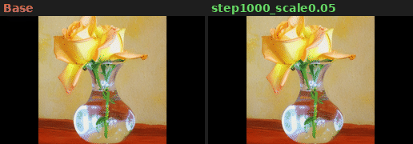<br><a href="outputs/eval_v4/videos_base/seed_00/001.mp4">Base MP4</a> · <a href="outputs/eval_v4/videos_step1000_scale0.05/seed_00/001.mp4">Candidate MP4</a></td></tr>
<tr><td width="50%">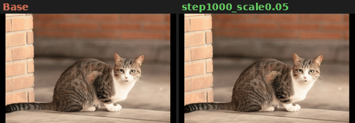<br><a href="outputs/eval_v4/videos_base/seed_00/002.mp4">Base MP4</a> · <a href="outputs/eval_v4/videos_step1000_scale0.05/seed_00/002.mp4">Candidate MP4</a></td><td width="50%">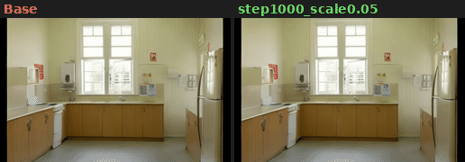<br><a href="outputs/eval_v4/videos_base/seed_00/003.mp4">Base MP4</a> · <a href="outputs/eval_v4/videos_step1000_scale0.05/seed_00/003.mp4">Candidate MP4</a></td></tr>
<tr><td width="50%">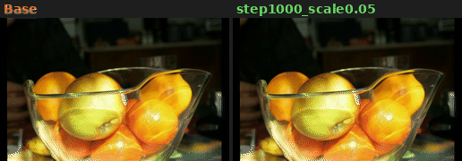<br><a href="outputs/eval_v4/videos_base/seed_00/004.mp4">Base MP4</a> · <a href="outputs/eval_v4/videos_step1000_scale0.05/seed_00/004.mp4">Candidate MP4</a></td><td width="50%">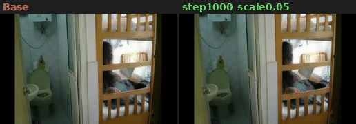<br><a href="outputs/eval_v4/videos_base/seed_00/005.mp4">Base MP4</a> · <a href="outputs/eval_v4/videos_step1000_scale0.05/seed_00/005.mp4">Candidate MP4</a></td></tr>
</table>

The six demos are fixed indices 0–5 from a 40-pair COCO-validation set not used for training or checkpoint selection. Base and the stability candidate use identical first frame, caption, and generation seed. [Full operation record](operations/v4/README.md).

### Quantified parameter-to-visual effect

The post-hoc analysis in [`scripts/quantify_effect.py`](scripts/quantify_effect.py) uses the saved checkpoints and rendered videos; it does not retrain the model. For each temporal LoRA module, it computes the effective weight perturbation

$$
\Delta W_{t,l}=s\frac{\alpha}{r}B_{t,l}A_{t,l},
\qquad
U_t=\frac{\sqrt{\sum_l\|\Delta W_{t,l}\|_F^2}}
{\sqrt{\sum_l\|W_l^{base}\|_F^2}+\varepsilon}.
$$

Here, $U_t$ is the normalized effective LoRA update ratio at checkpoint $t$, including the actual inference scale. For the V4 rerun at scale `0.05`, it increased from `5.12e-5` at step 50 to `1.51e-3` at step 1000 and `1.97e-3` at step 2000 across 136 temporal modules. The recorded V4 config also specifies learning rate `1e-4` with `warmup_steps: 50`; the training log rises from `2e-6` at step 1 to `1e-4` at step 50. This verifies that the saved adapter produces a non-zero, increasing effective parameter change across training. What this measurement does and does not establish is detailed in **Limitations** below.

For paired videos with the same first frame, caption, and seed, the diagnostic visual score is

$$
Q=0.35C_{safe}+0.25N+0.20D_{safe}+0.20T_{safe},
\qquad \Delta Q_i=Q(v_i^{adapter})-Q(v_i^{base}).
$$

`C_safe` discounts edge detail by overexposure and flicker, `N` is the repository naturalness score, `D_safe` discounts frame motion by luminance flicker, and `T_safe` rewards temporal brightness stability. `Q` is an interpretable diagnostic composite rather than a calibrated human-perception metric; raw components and paired bootstrap intervals are retained in [`outputs/quantified_effect/quantified_effect.json`](outputs/quantified_effect/quantified_effect.json) and [`outputs/quantified_effect_dev/quantified_effect.json`](outputs/quantified_effect_dev/quantified_effect.json).

The existing six-pair development renders show a positive, condition-dependent effect: mean $\Delta Q$ was `+0.00266` for step 500 / scale `0.01` and `+0.00229` for step 1000 / scale `0.01`. The 40-pair step-1000 / scale-`0.05` confirmation render had mean $\Delta Q=+0.00099$. The clearest positive signal is at low inference scale and mid-training checkpoints; the full confirmatory-evaluation interval and scope are in **Limitations** below.
<!-- V4_RESULT_END -->

---

## 🔬 ABLATION STUDIES

### Tier-1: LoRA Scale Sweep and Diagnosis

Tier-1 discovers that a full-strength LoRA (scale=1.0) causes **reward hacking**:
saturation x1.95, overexposure x1.65, edge artifacts x1.86 vs. base.
Reducing scale to **0.2** retains the dynamic improvement without visual degradation.

#### Three-Way: Base vs Scale=0.2 vs Scale=1.0

| Base / Scale=0.2 / Scale=1.0 |
|---|
| 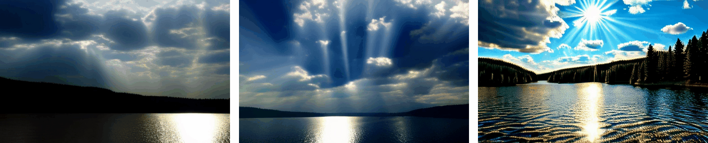 |
| 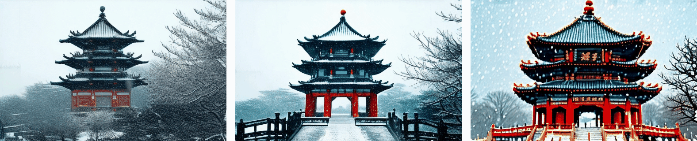 |

Scale=1.0 (right) is visibly over-saturated and over-exposed. Scale=0.2 (center) is the sweet spot.

#### LoRA Rescale -- Base (left) vs Scale=0.2 (right), 6 scenes

| | |
|---|---|
| 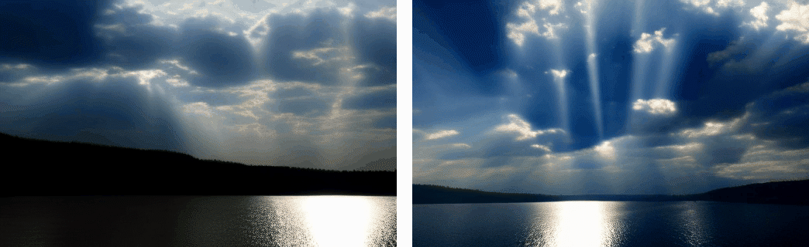 |  |
| 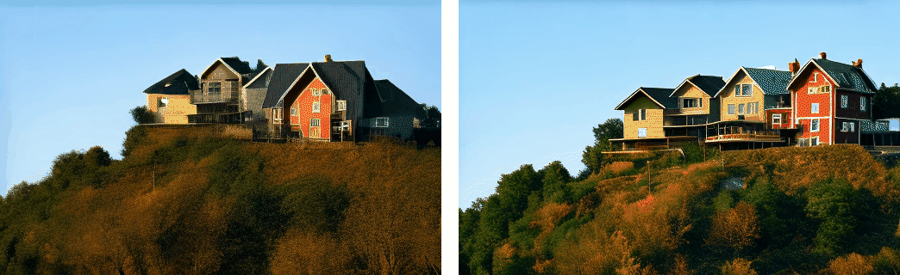 | 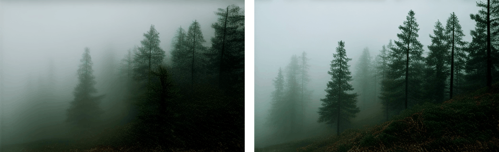 |
| 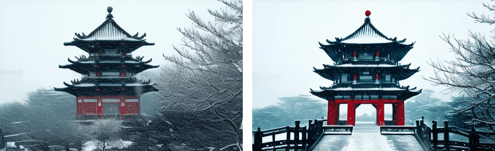 | 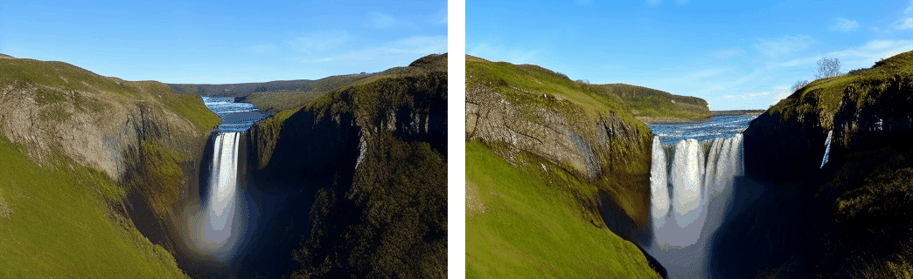 |

Scale=0.2 adds dynamics while keeping colors natural.

#### Four-Way: Base / Scale=0.2 / Best-of-N / BoN+Lightness

| | | |
|---|---|---|
| 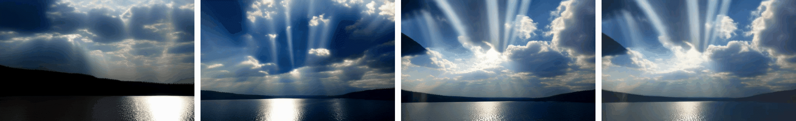 | 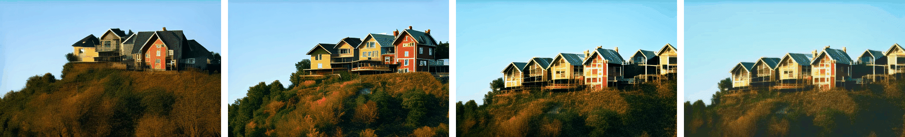 | 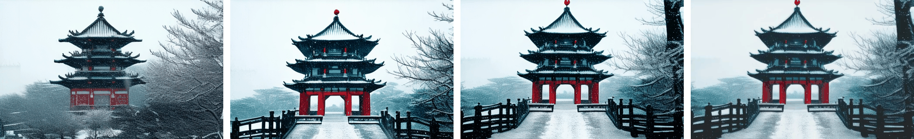 |
|  | 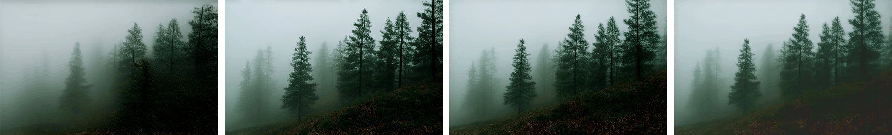 | 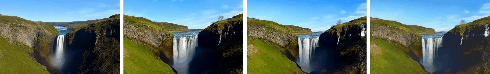 |

#### Lightness Post-Processing

Shadow lift + highlight knee + saturation pullback:

| | | |
|---|---|---|
| 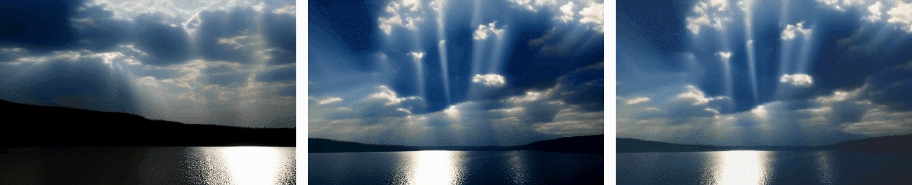 | 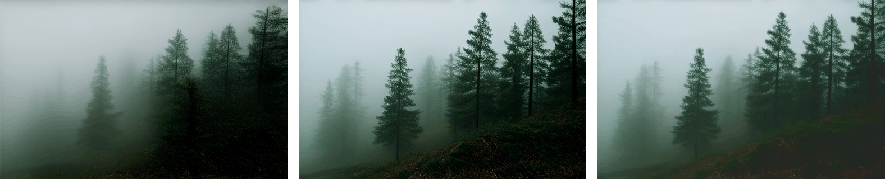 | 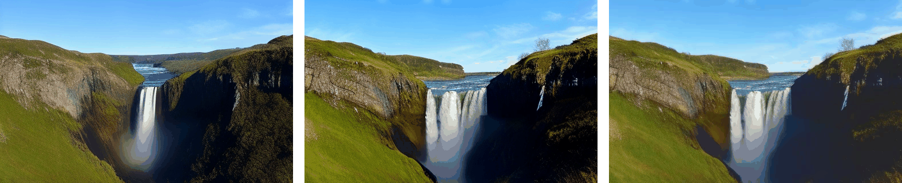 |
|  | 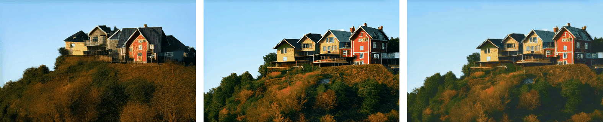 | 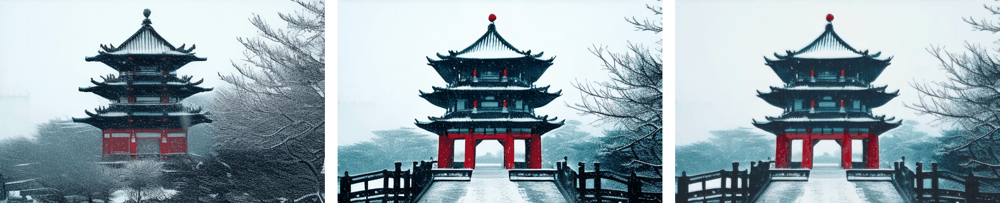 |

Wilcoxon test: `appeal(+lightness) > appeal(base)`: **p=0.016** (n=6)

### Tier-2: I2V LoRA Training with Naturalness Penalty

Tier-2 trains a DynamiCrafter I2V LoRA via OPSD with a **sigmoid naturalness penalty**.
Three ablation runs on H20 80GB (500 steps each, ~86 min/run).

#### I2V LoRA Results -- 6 Original Scenes

LoRA-tuned I2V vs Base vs Best-of-N:

| | | |
|---|---|---|
| 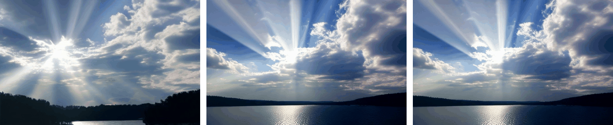 | 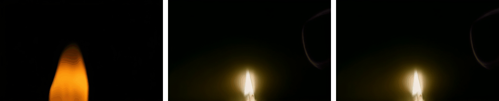 | 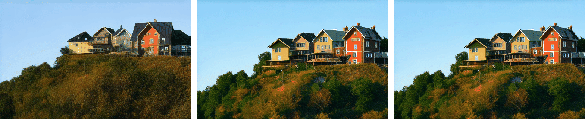 |
| 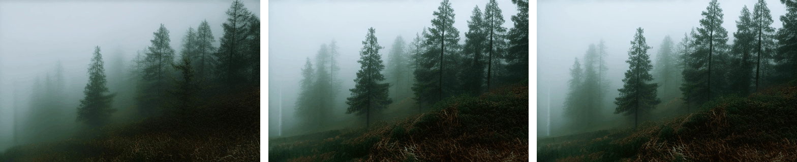 | 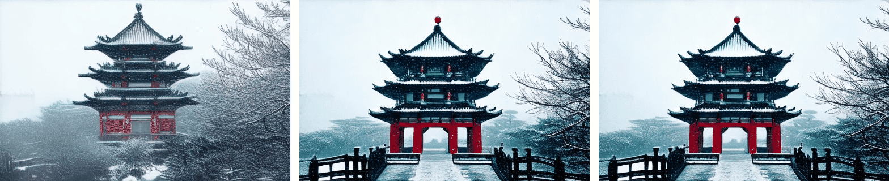 | 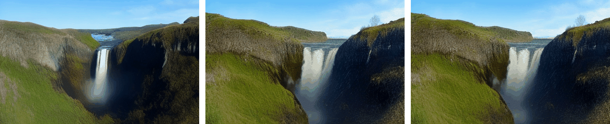 |

Best-of-N variant:

| | | |
|---|---|---|
| 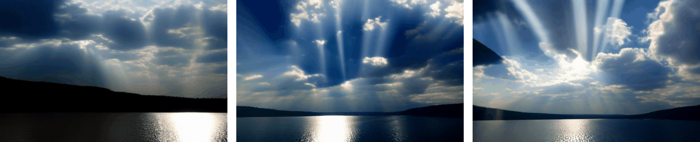 |  | 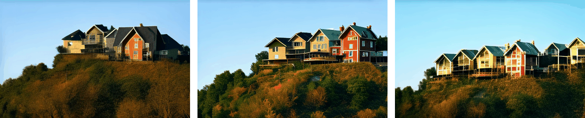 |
| 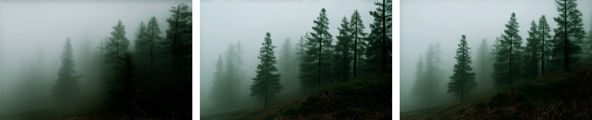 | 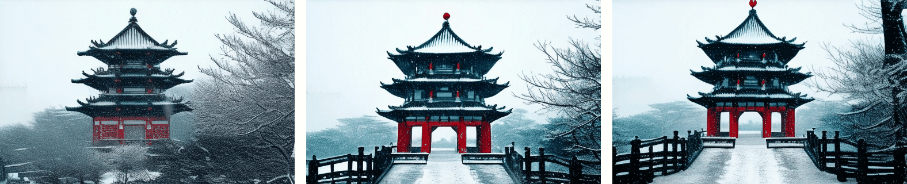 | 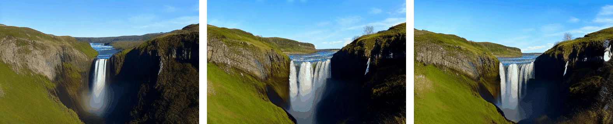 |

#### I2V LoRA Alpha Sweep -- 10 New Eval Scenes

Three-way comparison: **Base (red)** | **LoRA alpha=6 (green)** | **LoRA alpha=32 (blue)**

alpha=6 is the I2V equivalent of scale~0.2; alpha=32 is full strength.

| Penguin on ice | Lighthouse coast |
|---|---|
| 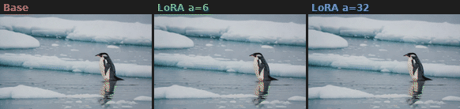 | 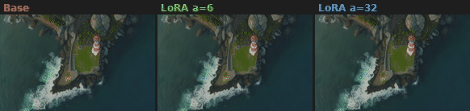 |

| Construction crane | Bee on flower |
|---|---|
| 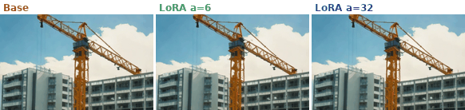 | 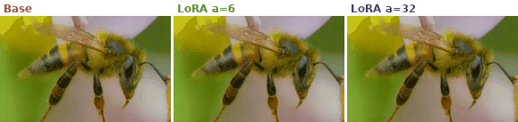 |

| Owl at night | Volcano crater |
|---|---|
| 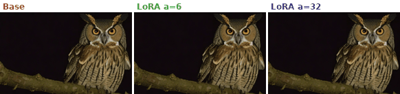 | 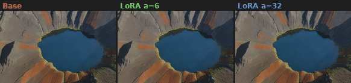 |

| Ferris wheel | Pine forest fog |
|---|---|
| 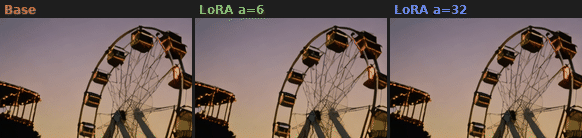 | 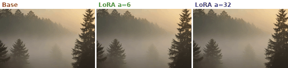 |

| Art studio | Rain puddle |
|---|---|
| 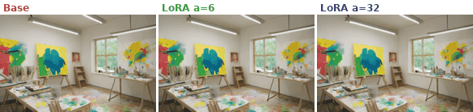 | 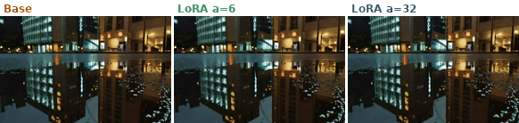 |

### Training Curves: 3-Way Ablation

#### Reward Comparison

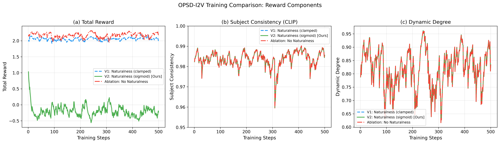

- **Smooth penalty (sigmoid, green):** the naturalness reward path remains active; this is an optimization diagnostic, not perceptual evidence.
- **Hard clamp (ReLU+clamp, blue dashed):** the naturalness gradient is zero after saturation, so the intended constraint cannot influence the update.
- **No-naturalness control (red dash-dot):** removes the naturalness term and serves as the reward-hacking control.

#### Naturalness Penalty Evolution

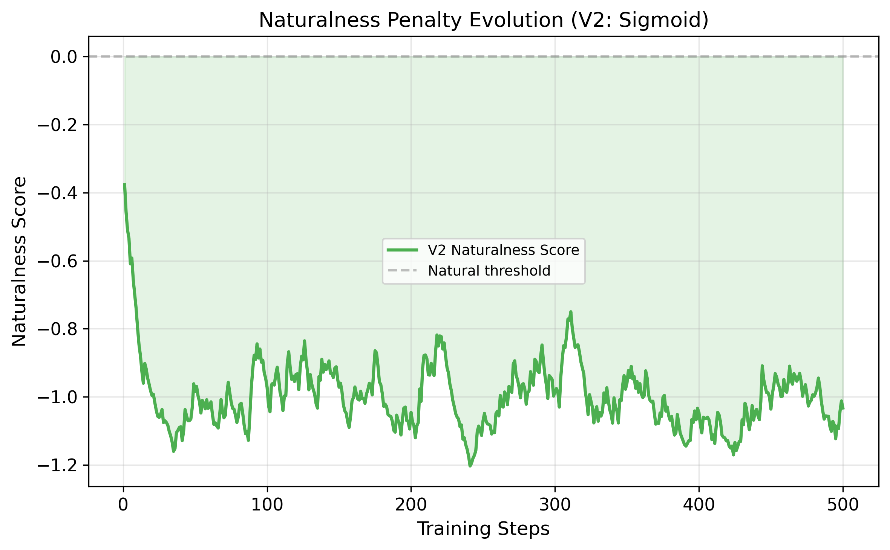

The smooth-penalty **training reward component** moves from -1.47 to -0.79 over 500 steps. This confirms an active optimization signal only; the held-out naturalness metric does not improve.

#### Key Finding: Gradient Flow Is Everything

| Config | Naturalness Impl | R_nat @ step 500 | Gradient? |
|--------|-----------------|-------------------|-----------|
| Hard-clamp objective | `ReLU + clamp(0,1)` | **0.000** (dead) | No -- 100% steps zero gradient |
| **Smooth-penalty objective** | **`sigmoid`** | **-0.786** (alive) | Yes -- smooth gradient everywhere |
| No-naturalness control | none | N/A | N/A |

Root cause: when penalty sum > 1.0, `clamp(0,1)` zeros both value and gradient. `sigmoid` guarantees smooth gradient for any input.

#### GPU-Hours

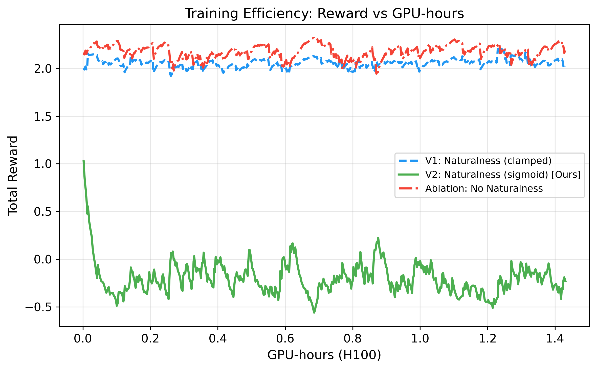

| Experiment | GPU | Steps | Time |
|------------|-----|-------|------|
| Hard clamp | H20 80GB | 500 | 86 min |
| Smooth penalty | H20 80GB | 500 | 86 min |
| No-naturalness control | H20 80GB | 500 | 86 min |
| **Total** | | | **4.3 GPU-hours** |

<details>
<summary>Per-Experiment Detailed Curves</summary>

**Hard-clamp objective (dead gradient)**

| Reward | Loss | Diagnostics |
|---|---|---|
| 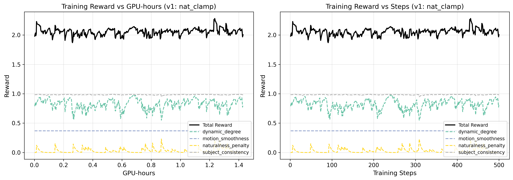 | 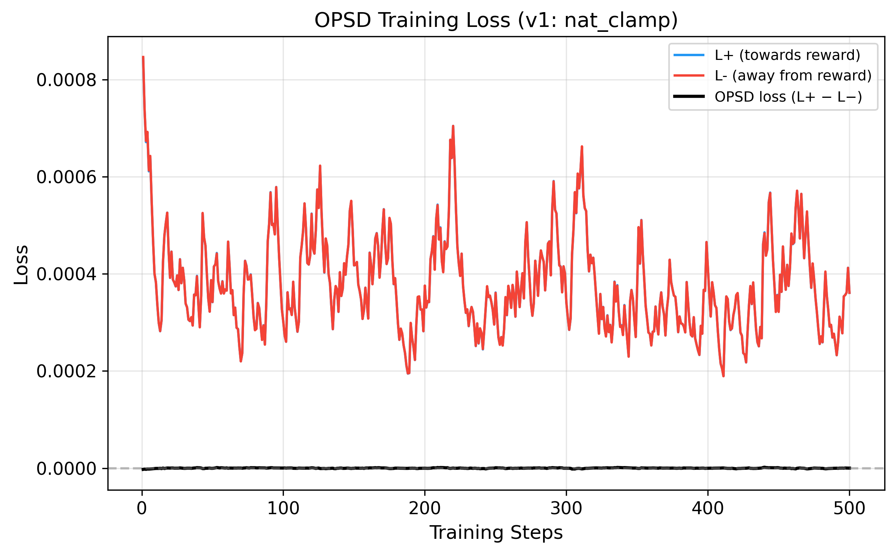 |  |

**Smooth-penalty objective (gradient alive)**

| Reward | Loss | Diagnostics |
|---|---|---|
|  |  |  |

**NoNat (no naturalness)**

| Reward | Loss | Diagnostics |
|---|---|---|
|  |  |  |

</details>

#### Eval Metrics (n=10 held-out prompts)

| Config | Appeal | Naturalness | Dynamic |
|--------|--------|-------------|---------|
| Base (no LoRA) | 0.7295 | 0.9515 | 0.5075 |
| Hard-clamp objective | 0.7294 | 0.9515 | 0.5074 |
| Smooth-penalty objective | 0.7291 | 0.9513 | 0.5069 |
| No-naturalness control | 0.7296 | 0.9512 | 0.5079 |

> At 500 steps, the held-out metric differences are within noise. A longer run is not automatically better: the 2,000-step smooth-penalty run crossed the registered loss-growth guard at step 306, while the no-naturalness control completed but does not solve reward hacking. See [`docs/RESULTS_LONG.md`](docs/RESULTS_LONG.md).

---

## 🧠 METHOD

Four components form a new differentiable video reward that replaces OPSD's single still-image reward, so the optimization target tracks what changes frame-to-frame rather than single-frame appearance alone:

### Reward Components

| Reward | Weight | Source |
|--------|--------|--------|
| Subject Consistency | 1.0 | CLIP ViT-L cosine similarity (first frame vs generated frames) |
| Dynamic Degree | 1.0 | RAFT optical flow magnitude, capped at tau=0.6 |
| Motion Smoothness | 0.5 | RAFT flow jerk, exponential decay |
| **Naturalness Penalty** | **1.5-2.0** | **Saturation + overexposure + edge artifacts (sigmoid)** |

### Lightness Post-Process Pipeline

```
1. shadow mask        exp(-6*L)             # ~1 on shadows, ~0 on highlights
2. lift               a + 0.15*shadow_mask   # RGB space brightening, preserves hue
3. highlight knee     tanh above L=0.80      # compress instead of clip
4. sat pullback       to target 0.40         # reduce over-saturation
5. edge soften        mix 25% box-blur       # reduce edge sharpening noise
```

### 8 Bug Fixes for DynamiCrafter

<details>
<summary>Expand: 8 API adaptation fixes</summary>

| # | Bug | Root Cause | Fix |
|---|-----|-----------|-----|
| 1 | conditioning dropped | `UNetModel.forward` absorbs `cond` into `**kwargs` | `_call_unet` helper |
| 2 | `vae.decode(z).sample` crashed | DynamiCrafter returns tensor, not `DecoderOutput` | `_vae_decode_video` helper |
| 3 | `encode(x).latent_dist.sample()` crashed | Returns `DiagonalGaussianDistribution` directly | `encode(x).sample()` |
| 4 | PEFT target modules not found | Regex didn't match actual module tree | Runtime enumeration |
| 5 | Dataset cond doesn't match DiT needs | Missing `c_crossattn` + `c_concat` | `CondStage` dataclass |
| 6 | OpenCLIP tried CUDA on non-CUDA | Hard-coded `self.device = "cuda"` | Patch device attribute |
| 7 | `IndexError` in `timestep_embedding` | 0-D tensor vs 1-D expected | Auto-broadcast |
| 8 | Shape mismatch in `rollout_until` | Two sources of truth for time axis | Use `c_concat.shape[2]` |

</details>

---

## 🧪 DIAGNOSIS

<details>
<summary>Reward Hacking Metrics (Base vs OPSD-LoRA @ 1.0)</summary>

| Metric | Base | OPSD-LoRA @ 1.0 | Ratio |
|--------|------|------------------|-------|
| saturation | 0.243 | **0.473** | x1.95 |
| overexposed fraction | 0.206 | **0.341** | x1.65 |
| sobel-p95 edge | 57.7 | **107.2** | x1.86 |
| frame-diff RMS | 31.0 | 67.0 | x2.16 |
| pixel variance | 4881 | 8217 | x1.68 |

</details>

<details>
<summary>LoRA Rescale Sweep</summary>

| Scale | Saturation | Overexposure | Sobel-p95 | Naturalness |
|-------|-----------|--------------|-----------|-------------|
| 0.0 | 0.325 | 0.273 | 50.8 | 0.572 |
| **0.2** | **0.406** | **0.310** | **58.8** | **0.477** |
| 0.4 | 0.521 | 0.251 | 49.2 | 0.628 |

Scale=0.2 is the sweet spot: improved dynamics with acceptable naturalness.

</details>

<details>
<summary>Best-of-N Seed Selection</summary>

| Prompt | Base Nat | BoN Winner Nat | Best Seed |
|--------|----------|----------------|-----------|
| sun_rays | 0.960 | **0.978** | 1 |
| houses_hillside | 0.471 | **0.432** | 3 |
| pagoda_snowy | 0.590 | **0.399** | 3 |
| candle_dark | 0.000 | **0.287** | 1 |
| fog_pine_dawn | 0.860 | **0.945** | 1 |
| waterfall_zoom | 0.667 | **0.586** | 1 |

</details>

---

## ⚠️ LIMITATIONS

| Area | Current Status |
|------|---------------|
| 500-step diagnostic run | Appeal, naturalness, and dynamic-degree metrics are statistically tied with base (e.g. appeal 0.7291 vs base 0.7295). This run established that the reward gradient and naturalness signal remain active, not a held-out quality gain. |
| Long-run stability | The smooth-naturalness objective stopped at step 306 and the anchored fit at step 522 before gradient clipping was added; effective gradient control completed 2,000 steps without a guard trip. |
| Held-out improvement | **Generalized improvement not established.** On n=40 untouched pairs, appeal changed by -0.0042 [-0.0062, -0.0024], naturalness by -0.0005 [-0.0031, +0.0013], and dynamics by -0.0079 [-0.0115, -0.0048]; none of the three has a 95% interval favoring the candidate. |
| Quantified adapter effect | Effective update ratio and paired visual proxy are computed from saved checkpoints/videos; low-scale development settings show positive but non-significant diagnostic deltas, and the 40-pair confirmatory $\Delta Q$ interval `[-0.00384, +0.00586]` includes zero. This measurement does not isolate the causal effect of the optimizer schedule. |
| Eval sample size | Confirmatory n=40 paired evaluation with 10,000-draw bootstrap intervals is complete. |
| Reward/evaluator coupling | Several reported metrics are close to the optimized reward and cannot independently prove perception. |
| Standard metrics | FVD/FID and broader video-quality suites have not been computed. |
| Human evaluation | A randomized, balanced 40-pair blind-study package is executable from [`../human-study`](../human-study), but no real participant responses exist yet. |
| Scale-sweep language | The `0.2` setting is a diagnostic trade-off on six scenes, not a universal optimum. |

See [`docs/RESULTS_LONG.md`](docs/RESULTS_LONG.md) for the smooth-penalty and anchored-fit diagnostics, completed gradient-controlled run, development selection, and confirmatory evaluation.

---

## ⚙️ REPRODUCTION

```bash
# Generate 200 prompts + first frames
python scripts/generate_prompts_200.py
CUDA_VISIBLE_DEVICES=0 python scripts/generate_first_frames.py cuda:0

# Reproduce the 500-step smooth-penalty and no-naturalness ablations
python -m src.train_entry --method opsd_i2v --config configs/tier2_v2.yaml
python -m src.train_entry --method opsd_i2v --config configs/tier2_ablation_no_nat.yaml

# Run the guarded anchored-fit preflight before long training
mkdir -p outputs/probe_v3_stable
python -m src.train_entry --method opsd_i2v --config configs/probe_v3_stable.yaml \
  > outputs/probe_v3_stable/train.log 2>&1 &
TRAIN_PID=$!
python ../tools/train_guard.py --kind i2v \
  --log outputs/probe_v3_stable/train_metrics.jsonl \
  --pid "$TRAIN_PID" --poll 5 --stall-sec 1200
wait "$TRAIN_PID"

# Plot training curves
python scripts/plot_training_curves.py outputs/opsd_tier2_v2/train_metrics.jsonl outputs/opsd_tier2_v2/figures "v2"
python scripts/plot_comparison.py

# Render eval videos (base + all LoRA configs)
bash scripts/render_eval_all.sh 40

# Generate comparison GIFs
python scripts/make_tier2_gifs.py
```

---

## 📁 REPOSITORY LAYOUT

```
08-video-opsd-i2v/
  README.md
  STATUS.md                           -- progress tracking + next steps
  configs/                            3 training configs (hard clamp / smooth penalty / no-naturalness control)
  data/
    prompts/                          200 prompts (160 train + 40 eval)
    first_frames_200/                 200 SDXL-Turbo first frames (512x320)
    first_frames_eval/                40 held-out eval first frames
  outputs/
    figures_comparison/               3-way comparison training curves
    opsd_tier2{,_v2,_no_nat}/         train metrics + curves + LoRA checkpoint
    eval/                             eval metrics + videos (mp4 gitignored)
  src/
    opsd_trainer_i2v.py               training loop
    rewards/                          4 reward functions + naturalness penalty
    postprocess/                      lightness post-processing
    eval/                             naturalness_v2 evaluator
  scripts/                            training/inference/eval/plotting scripts
  docs/figures/
    duel/                             32 GIFs -- Tier-1 comparisons (6 scenes)
    tier2_new/                        10 GIFs -- Tier-2 alpha sweep (10 new scenes)
    eval_compare/                     10 GIFs -- Base vs smooth-penalty objective (10 eval scenes)
```
