# 08 -- OPSD-I2V: Reward-Guided Video Generation with Naturalness Constraints

> **TL;DR** OPSD (Online Policy-gradient Score Distillation) LoRA fine-tunes DynamiCrafter I2V
> with multi-objective reward (subject consistency + dynamic degree + motion smoothness)
> plus a **differentiable naturalness penalty** to prevent reward hacking.
> Key finding: `ReLU+clamp` kills 100% of gradients; switching to `sigmoid` restores
> gradient flow and improves naturalness from -1.47 to -0.79.

---

## Tier-1: LoRA Scale Sweep and Diagnosis

Tier-1 discovers that a full-strength LoRA (scale=1.0) causes **reward hacking**:
saturation x1.95, overexposure x1.65, edge artifacts x1.86 vs. base.
Reducing scale to **0.2** retains the dynamic improvement without visual degradation.

### Three-Way: Base vs Scale=0.2 vs Scale=1.0

| Base / Scale=0.2 / Scale=1.0 |
|---|
| 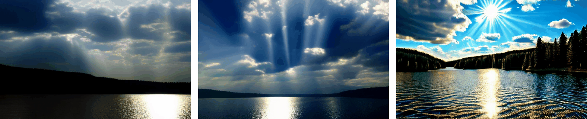 |
| 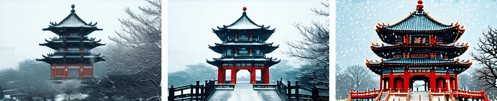 |

Scale=1.0 (right) is visibly over-saturated and over-exposed. Scale=0.2 (center) is the sweet spot.

### LoRA Rescale -- Base (left) vs Scale=0.2 (right), 6 scenes

| | |
|---|---|
| 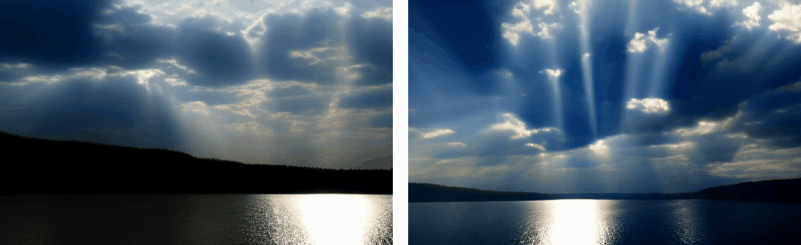 |  |
| 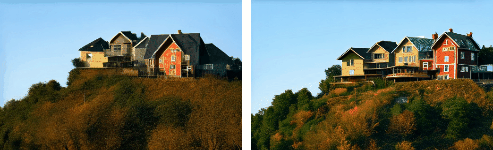 | 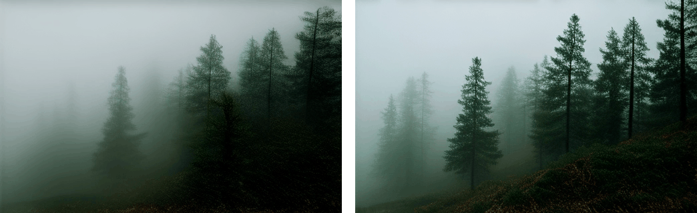 |
| 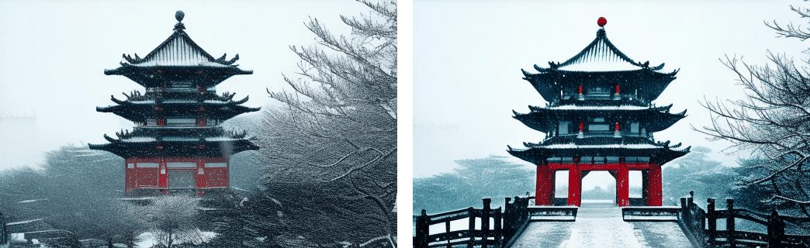 | 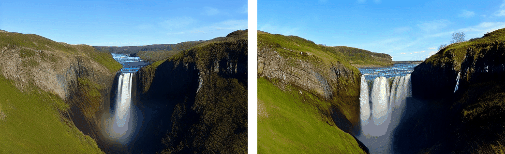 |

Scale=0.2 adds dynamics while keeping colors natural.

### Four-Way: Base / Scale=0.2 / Best-of-N / BoN+Lightness

| | | |
|---|---|---|
| 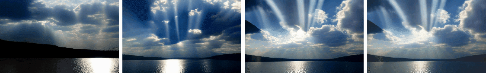 | 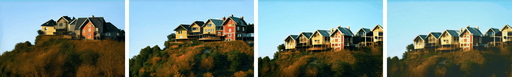 | 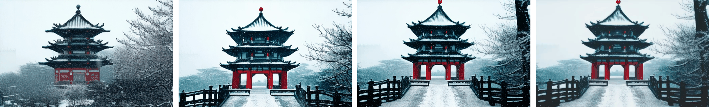 |
|  | 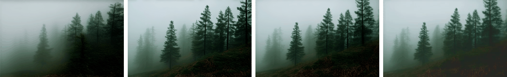 | 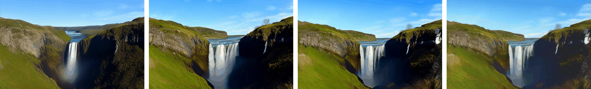 |

### Lightness Post-Processing

Shadow lift + highlight knee + saturation pullback:

| | | |
|---|---|---|
| 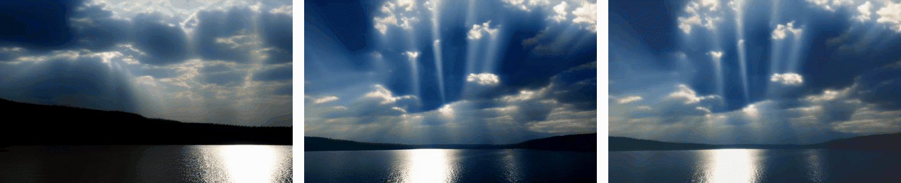 | 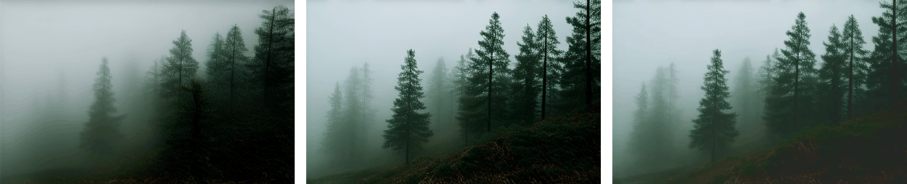 | 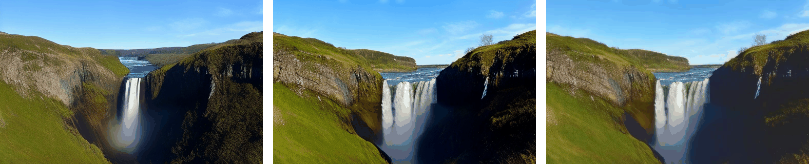 |
|  | 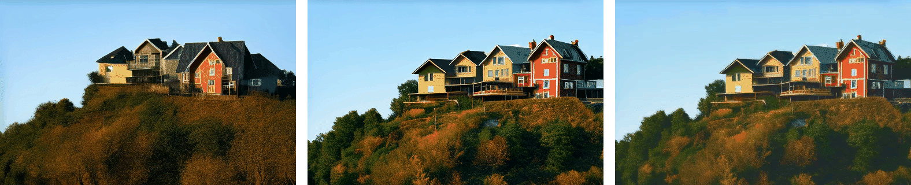 | 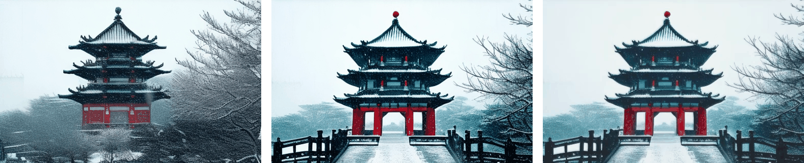 |

Wilcoxon test: `appeal(+lightness) > appeal(base)`: **p=0.016** (n=6)

---

## Tier-2: I2V LoRA Training with Naturalness Penalty

Tier-2 trains a DynamiCrafter I2V LoRA via OPSD with a **sigmoid naturalness penalty**.
Three ablation runs on H20 80GB (500 steps each, ~86 min/run).

### I2V LoRA Results -- 6 Original Scenes

LoRA-tuned I2V vs Base vs Best-of-N:

| | | |
|---|---|---|
| 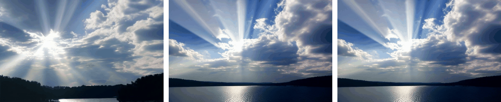 | 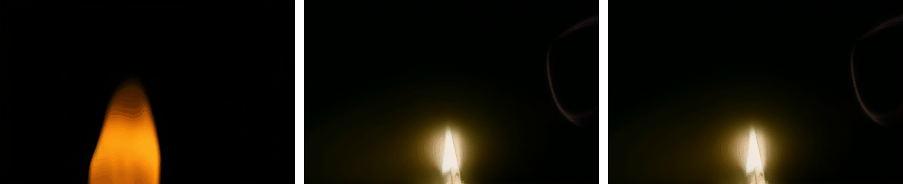 | 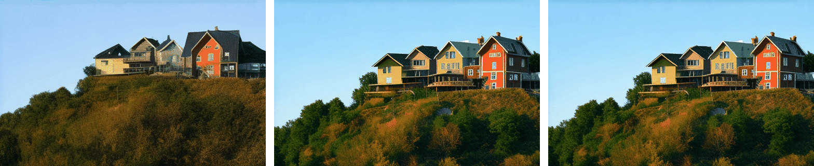 |
| 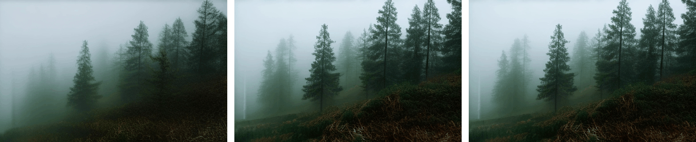 | 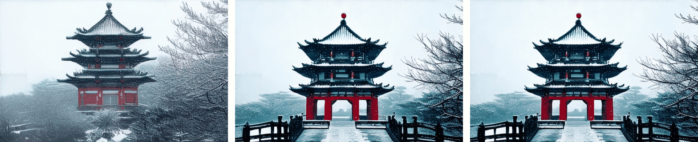 | 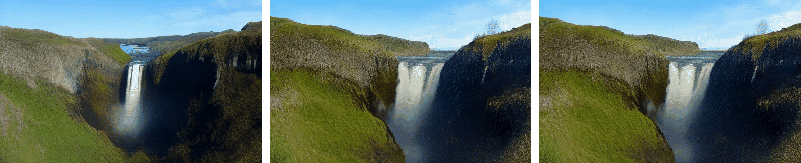 |

Best-of-N variant:

| | | |
|---|---|---|
| 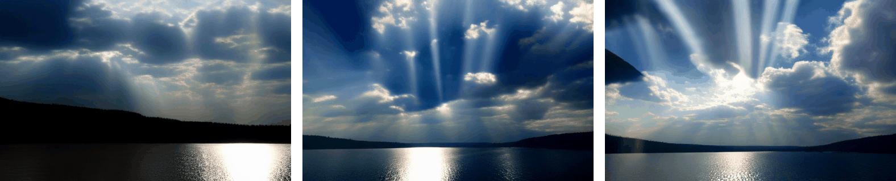 |  | 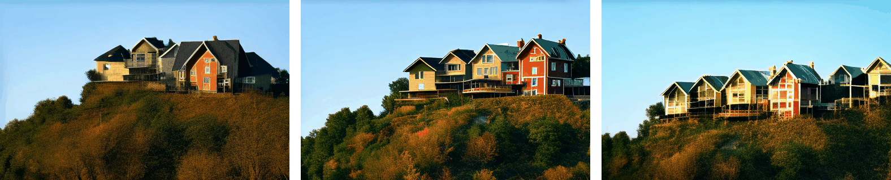 |
| 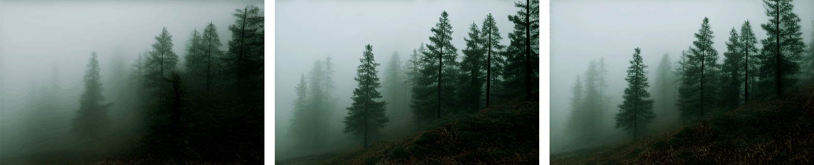 | 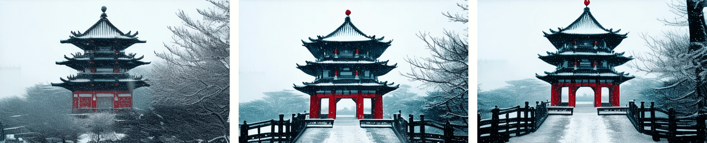 | 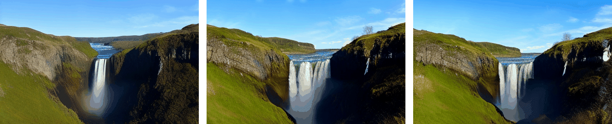 |

### I2V LoRA Alpha Sweep -- 10 New Eval Scenes

Three-way comparison: **Base (red)** | **LoRA alpha=6 (green)** | **LoRA alpha=32 (blue)**

alpha=6 is the I2V equivalent of scale~0.2; alpha=32 is full strength.

| Penguin on ice | Lighthouse coast |
|---|---|
| 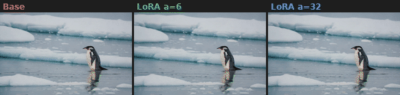 | 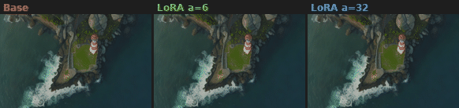 |

| Construction crane | Bee on flower |
|---|---|
| 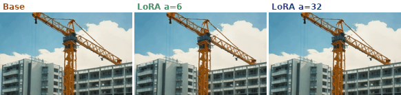 | 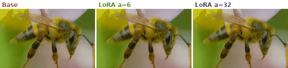 |

| Owl at night | Volcano crater |
|---|---|
| 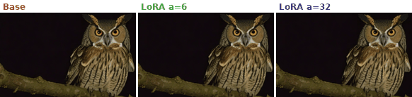 | 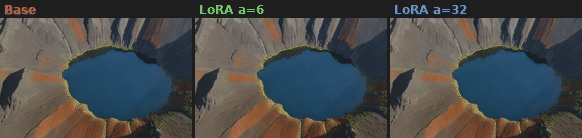 |

| Ferris wheel | Pine forest fog |
|---|---|
| 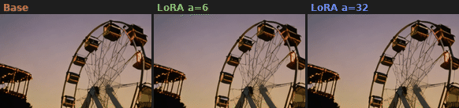 | 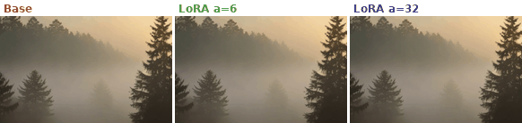 |

| Art studio | Rain puddle |
|---|---|
| 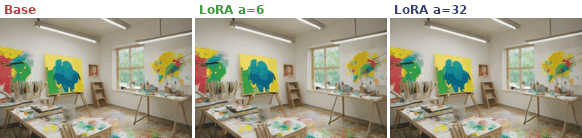 | 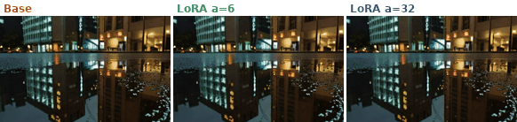 |

---

## Training Curves: 3-Way Ablation

### Reward Comparison

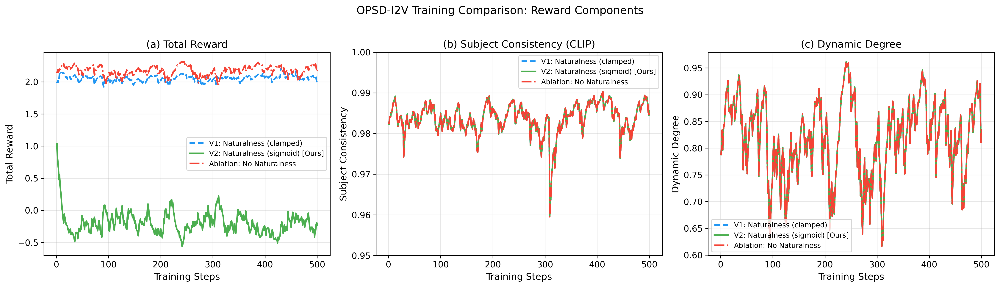

- **V2 (sigmoid, green)**: naturalness gradient always present -- model learns to reduce over-saturation/overexposure
- **V1 (ReLU+clamp, blue dashed)**: naturalness gradient 100% dead -- model ignores quality constraint
- **NoNat (red dash-dot)**: no naturalness -- pure reward hacking baseline

### Naturalness Penalty Evolution

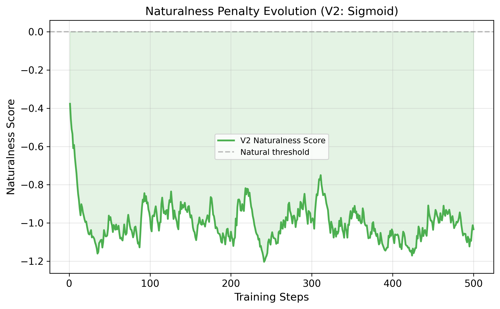

V2 naturalness penalty improves from -1.47 to -0.79 over 500 steps, confirming the gradient signal works.

### Key Finding: Gradient Flow Is Everything

| Config | Naturalness Impl | R_nat @ step 500 | Gradient? |
|--------|-----------------|-------------------|-----------|
| V1 | `ReLU + clamp(0,1)` | **0.000** (dead) | No -- 100% steps zero gradient |
| **V2** | **`sigmoid`** | **-0.786** (alive) | Yes -- smooth gradient everywhere |
| NoNat | none | N/A | N/A |

Root cause: when penalty sum > 1.0, `clamp(0,1)` zeros both value and gradient. `sigmoid` guarantees smooth gradient for any input.

### GPU-Hours

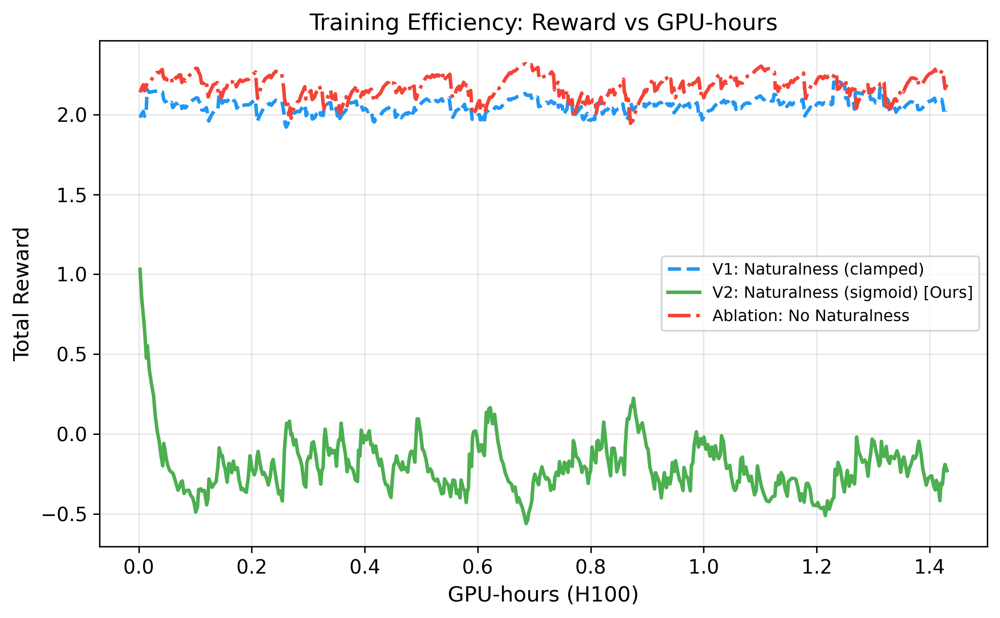

| Experiment | GPU | Steps | Time |
|------------|-----|-------|------|
| V1 (nat_clamp) | H20 80GB | 500 | 86 min |
| V2 (nat_sigmoid) | H20 80GB | 500 | 86 min |
| NoNat (ablation) | H20 80GB | 500 | 86 min |
| **Total** | | | **4.3 GPU-hours** |

<details>
<summary>Per-Experiment Detailed Curves</summary>

**V1 (ReLU+clamp, dead gradient)**

| Reward | Loss | Diagnostics |
|---|---|---|
| 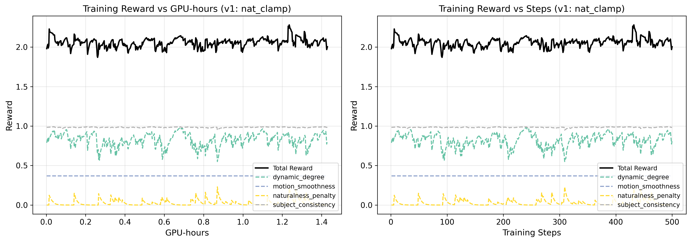 |  |  |

**V2 (sigmoid, gradient alive)**

| Reward | Loss | Diagnostics |
|---|---|---|
| 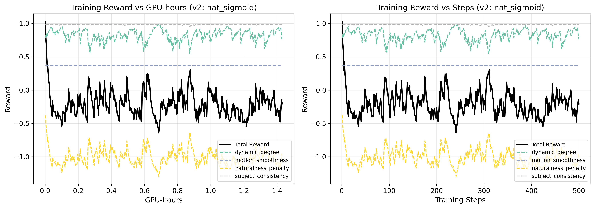 |  | 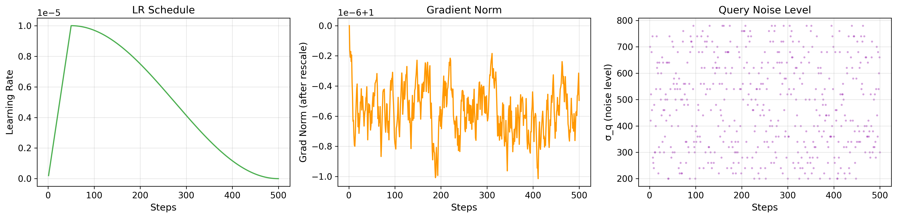 |

**NoNat (no naturalness)**

| Reward | Loss | Diagnostics |
|---|---|---|
|  |  | 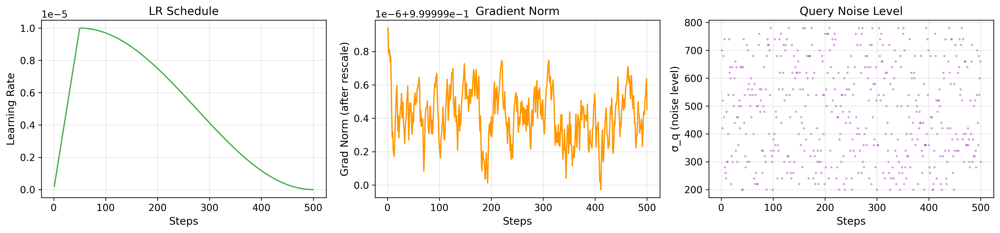 |

</details>

### Eval Metrics (n=10 held-out prompts)

| Config | Appeal | Naturalness | Dynamic |
|--------|--------|-------------|---------|
| Base (no LoRA) | 0.7295 | 0.9515 | 0.5075 |
| V1 (nat_clamp) | 0.7294 | 0.9515 | 0.5074 |
| V2 (nat_sigmoid) | 0.7291 | 0.9513 | 0.5069 |
| NoNat (ablation) | 0.7296 | 0.9512 | 0.5079 |

> At 500 steps, LoRA weight changes are minimal (L2 norm ~ 27). Eval metric differences are within noise.
> The value of this experiment is in the **training dynamics** -- see curves above. 2000+ steps needed for visible eval improvement.

---

## Method

### Reward Components

| Reward | Weight | Source |
|--------|--------|--------|
| Subject Consistency | 1.0 | CLIP ViT-L cosine similarity (first frame vs generated frames) |
| Dynamic Degree | 1.0 | RAFT optical flow magnitude, capped at tau=0.6 |
| Motion Smoothness | 0.5 | RAFT flow jerk, exponential decay |
| **Naturalness Penalty** | **1.5-2.0** | **Saturation + overexposure + edge artifacts (sigmoid)** |

### Lightness Post-Process Pipeline

```
1. shadow mask        exp(-6*L)             # ~1 on shadows, ~0 on highlights
2. lift               a + 0.15*shadow_mask   # RGB space brightening, preserves hue
3. highlight knee     tanh above L=0.80      # compress instead of clip
4. sat pullback       to target 0.40         # reduce over-saturation
5. edge soften        mix 25% box-blur       # reduce edge sharpening noise
```

### 8 Bug Fixes for DynamiCrafter

<details>
<summary>Expand: 8 API adaptation fixes</summary>

| # | Bug | Root Cause | Fix |
|---|-----|-----------|-----|
| 1 | conditioning dropped | `UNetModel.forward` absorbs `cond` into `**kwargs` | `_call_unet` helper |
| 2 | `vae.decode(z).sample` crashed | DynamiCrafter returns tensor, not `DecoderOutput` | `_vae_decode_video` helper |
| 3 | `encode(x).latent_dist.sample()` crashed | Returns `DiagonalGaussianDistribution` directly | `encode(x).sample()` |
| 4 | PEFT target modules not found | Regex didn't match actual module tree | Runtime enumeration |
| 5 | Dataset cond doesn't match DiT needs | Missing `c_crossattn` + `c_concat` | `CondStage` dataclass |
| 6 | OpenCLIP tried CUDA on non-CUDA | Hard-coded `self.device = "cuda"` | Patch device attribute |
| 7 | `IndexError` in `timestep_embedding` | 0-D tensor vs 1-D expected | Auto-broadcast |
| 8 | Shape mismatch in `rollout_until` | Two sources of truth for time axis | Use `c_concat.shape[2]` |

</details>

---

## Diagnosis Data

<details>
<summary>Reward Hacking Metrics (Base vs OPSD-LoRA @ 1.0)</summary>

| Metric | Base | OPSD-LoRA @ 1.0 | Ratio |
|--------|------|------------------|-------|
| saturation | 0.243 | **0.473** | x1.95 |
| overexposed fraction | 0.206 | **0.341** | x1.65 |
| sobel-p95 edge | 57.7 | **107.2** | x1.86 |
| frame-diff RMS | 31.0 | 67.0 | x2.16 |
| pixel variance | 4881 | 8217 | x1.68 |

</details>

<details>
<summary>LoRA Rescale Sweep</summary>

| Scale | Saturation | Overexposure | Sobel-p95 | Naturalness |
|-------|-----------|--------------|-----------|-------------|
| 0.0 | 0.325 | 0.273 | 50.8 | 0.572 |
| **0.2** | **0.406** | **0.310** | **58.8** | **0.477** |
| 0.4 | 0.521 | 0.251 | 49.2 | 0.628 |

Scale=0.2 is the sweet spot: improved dynamics with acceptable naturalness.

</details>

<details>
<summary>Best-of-N Seed Selection</summary>

| Prompt | Base Nat | BoN Winner Nat | Best Seed |
|--------|----------|----------------|-----------|
| sun_rays | 0.960 | **0.978** | 1 |
| houses_hillside | 0.471 | **0.432** | 3 |
| pagoda_snowy | 0.590 | **0.399** | 3 |
| candle_dark | 0.000 | **0.287** | 1 |
| fog_pine_dawn | 0.860 | **0.945** | 1 |
| waterfall_zoom | 0.667 | **0.586** | 1 |

</details>

---

## Limitations

| Area | Current Status |
|------|---------------|
| Training steps | 500 -- insufficient for significant eval change (need 2000+) |
| Eval sample size | n=10 held-out prompts (need 50+) |
| Tier-1 scene diversity | 6 scenes for T2I scale sweep; 10 new scenes for I2V alpha sweep |
| No FVD/FID | Standard video generation metrics not computed |
| No human evaluation | All automated metrics (pixel-space + CLIP) |

> See [STATUS.md](STATUS.md) for the complete TODO list and next steps.

---

## Reproduce

```bash
# Generate 200 prompts + first frames
python scripts/generate_prompts_200.py
CUDA_VISIBLE_DEVICES=0 python scripts/generate_first_frames.py cuda:0

# Train V2 (sigmoid naturalness, ~86min on H20)
python -m src.train_entry --method opsd_i2v --config configs/tier2_v2.yaml

# Train ablation (no naturalness)
python -m src.train_entry --method opsd_i2v --config configs/tier2_ablation_no_nat.yaml

# Plot training curves
python scripts/plot_training_curves.py outputs/opsd_tier2_v2/train_metrics.jsonl outputs/opsd_tier2_v2/figures "v2"
python scripts/plot_comparison.py

# Render eval videos (base + all LoRA configs)
bash scripts/render_eval_all.sh 40

# Generate comparison GIFs
python scripts/make_tier2_gifs.py
```

## Repository Layout

```
08-video-opsd-i2v/
  README.md
  STATUS.md                           -- progress tracking + next steps
  configs/                            3 training configs (V1/V2/NoNat)
  data/
    prompts/                          200 prompts (160 train + 40 eval)
    first_frames_200/                 200 SDXL-Turbo first frames (512x320)
    first_frames_eval/                40 held-out eval first frames
  outputs/
    figures_comparison/               3-way comparison training curves
    opsd_tier2{,_v2,_no_nat}/         train metrics + curves + LoRA checkpoint
    eval/                             eval metrics + videos (mp4 gitignored)
  src/
    opsd_trainer_i2v.py               training loop
    rewards/                          4 reward functions + naturalness penalty
    postprocess/                      lightness post-processing
    eval/                             naturalness_v2 evaluator
  scripts/                            training/inference/eval/plotting scripts
  docs/figures/
    duel/                             32 GIFs -- Tier-1 comparisons (6 scenes)
    tier2_new/                        10 GIFs -- Tier-2 alpha sweep (10 new scenes)
    eval_compare/                     10 GIFs -- Base vs V2 (10 eval scenes)
```
