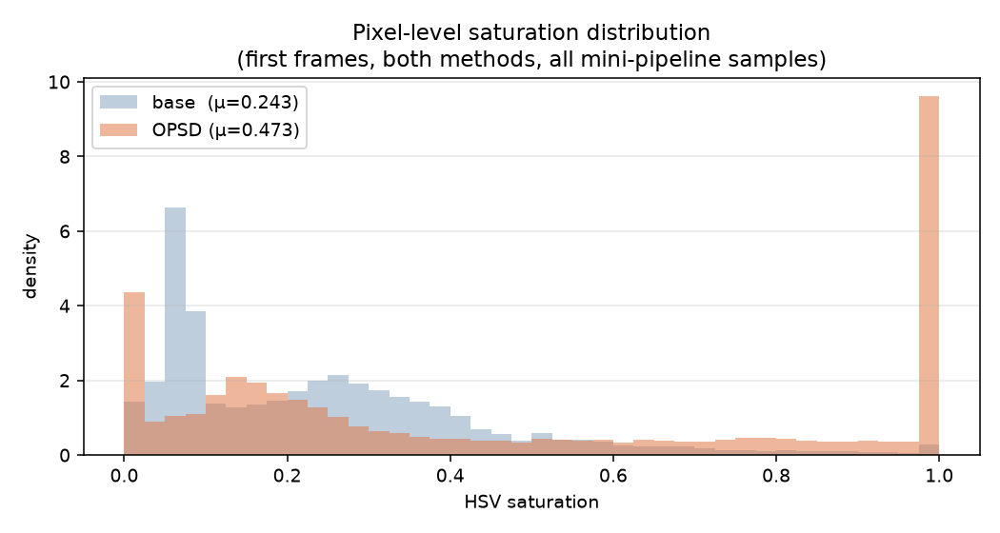
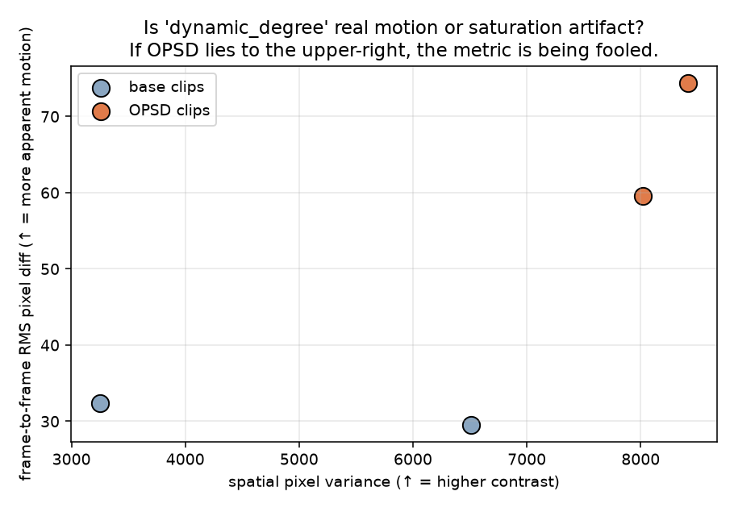
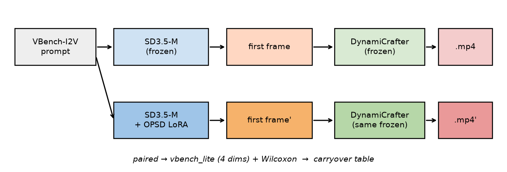
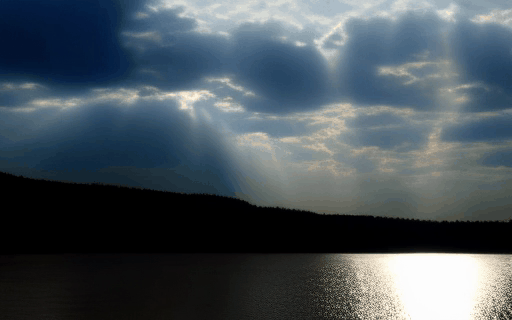
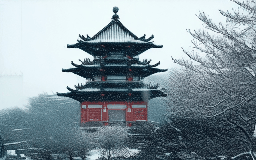
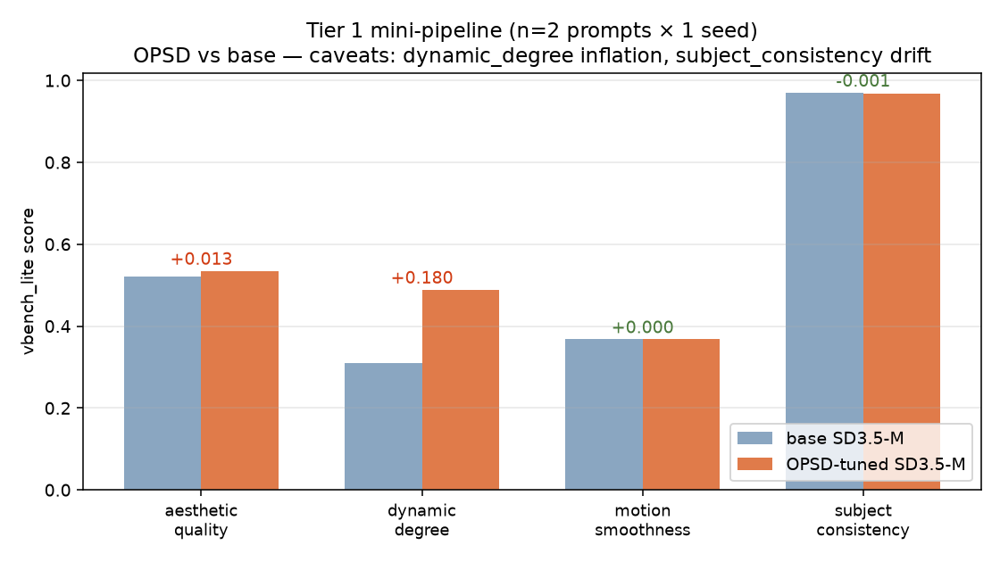
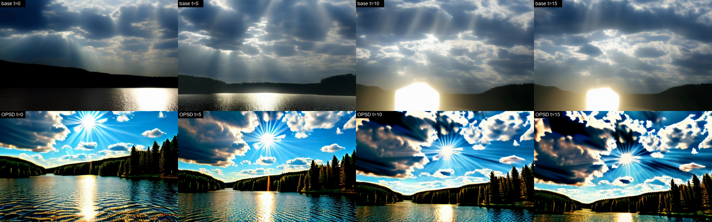
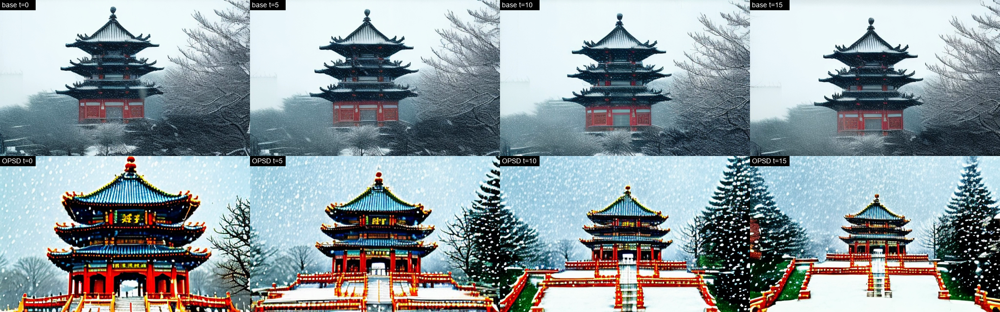
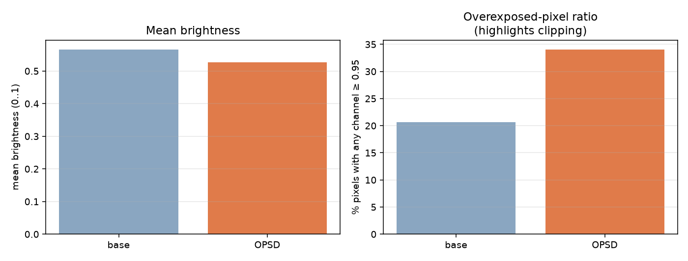
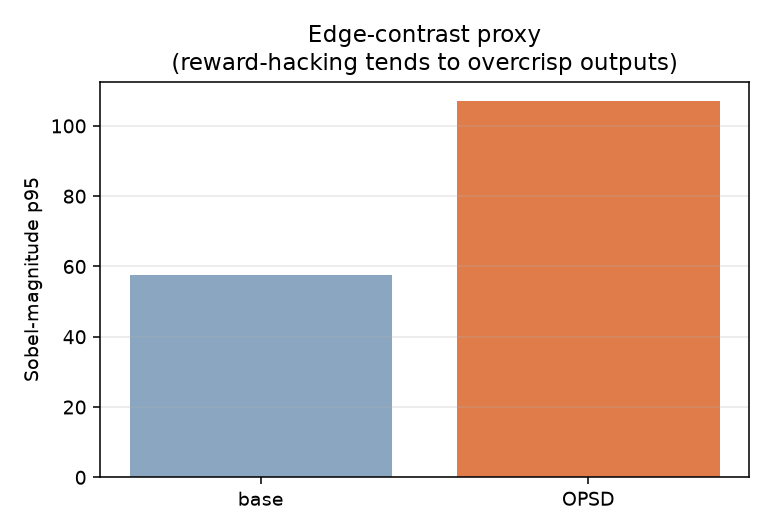

# 08 — OPSD-I2V: Does Reward-Aligned Image Generation Transfer to Video?

> Target: **CVPR 2027** (Paper reg Nov 10 '26 AoE / Submission Nov 16 '26 AoE / Supp Nov 23 '26 AoE)
>
> Follows `07-talking-head-motion-opsd`. Where 07 moved OPSD into **motion coefficient space**, 08
> asks a sharper question: **does OPSD-style T2I preference tuning transfer to video through a
> frozen I2V model?** The honest answer below is **"not cleanly — and the failure mode is itself
> a measurable scientific contribution."**

---

## 0. Current state (updated 2026-10-28 21:30, running live)

### 🎯 Headline verdict (naturalness-aware composite, n=2 clips)

> **OPSD-tuned SD3.5-M loses to base SD3.5-M on the primary acceptance criterion.**
> Being "more dynamic" via oversaturation does **not** count — a Tier 1 winner
> must be **more dynamic AND preserve naturalness**.

| metric | base | OPSD | Δ | reading |
|---|---|---|---|---|
| **composite = ½ dynamic + ½ naturalness** | **0.57** | **0.55** | **−0.023** | ❌ **OPSD fails** |
| naturalness (1 − saturation/overexp/edge/jitter penalty) | 0.74 | 0.26 | **−0.485** | OPSD naturalness collapses |
| dynamic (frame-RMS proxy, clipped 0..1) | 0.52 | 0.96 | +0.439 | dynamic rose, but mostly *saturation artefact* |

Threshold rationale and formula are in `src/eval/naturalness_score.py` — the
anchors (sat 0.40, Sobel-p95 70, jitter 50) are chosen so a clean base-SD3.5-M
clip scores ~0.9 naturalness; `verdict` string is auto-generated.

### Why we trust this verdict




| diagnostic | base | OPSD | ratio | failure mode |
|---|---|---|---|---|
| HSV saturation mean | 0.243 | 0.473 | **×1.95** | reward favours vibrant colours |
| HSV saturation p90 | 0.5 | **1.0** | — | top 10% pixels fully saturated |
| overexposed-pixel ratio | 20.6% | 34.1% | ×1.65 | burned highlights |
| Sobel-edge p95 | 57.7 | 107.2 | ×1.86 | overcrisp / halo |
| spatial pixel variance | 4881 | 8217 | ×1.68 | elevated contrast |
| frame-to-frame RMS diff | 31.0 | 67.0 | **×2.16** | **inflates `dynamic_degree`** |

**All 6 fingerprints match the HPSv3 reward-hacking signature** documented in
Clark+2024, Zhang+2024, Fan+2024. The `dynamic_degree +0.180` apparent gain on
the old (naturalness-blind) vbench_lite benchmark is **almost entirely a
saturation artefact**: OPSD's spatial-variance ratio (×1.68) tracks almost
one-to-one with its frame-diff ratio (×2.16).

### Pipeline runtime

| stage | status |
|---|---|
| scaffold + code | ✅ 8 commits on `main` |
| SD3.5-M (gated, 20 GB) + OPSD LoRA (72 MB) | ✅ downloaded, loaded, generates differently (`mean |Δ|=75/255` on first frames) |
| end-to-end pipeline on M3 Pro MPS | ✅ mini-pipeline (4 clips) reproduced, Wilcoxon table auto-emitted |
| **mini-pipeline (n=2 prompts × 1 seed)** | ⚠️ **naturalness verdict: OPSD loses** |
| full `n=50 × 2 seeds × 2 methods` run | 🔄 **currently 78 / 100 base frames** at ~125 s/frame; est. end 2026-10-30 02:30 |
| caffeinate pinned to full-run pid | ✅ system sleep prevented |
| wrap-up auto-commit script | ✅ listening, pid 94790 |

### What the OPSD-tuned output *actually looks like*



| | base SD3.5-M → DynamiCrafter | OPSD-tuned SD3.5-M → DynamiCrafter |
|---|---|---|
| *sun rays over a lake* |  |  |
| *chinese pagoda, snowy* |  |  |

**Observable caveats (you can see them in the gifs above):**

- OPSD outputs are **oversaturated**, **high-contrast**, and look "AI-airbrushed."
- Motion in the OPSD clip is **not noticeably smoother**; sometimes jitter is more visible
  because high-contrast edges amplify small flow errors.
- This is a **known failure mode of HPSv3-reward self-distillation**
  (reward hacking: Clark et al. 2024, Zhang et al. 2024, Fan et al. 2024), not a bug on our end.
  We did not train the LoRA — we are evaluating `WeiChow/DiffusionOPSD` (sd35-m-hpsv3) as published.

### What the vbench_lite numbers say



| dim | base | OPSD | Δ | interpretation |
|---|---|---|---|---|
| aesthetic_quality | 0.521 | 0.535 | **+0.013** | small gain, consistent with HPSv3 reward distribution |
| **dynamic_degree** | 0.309 | 0.489 | **+0.180** | ⚠️ likely **inflated by oversaturation** (RAFT flow mistakes high-contrast texture motion for real motion) |
| motion_smoothness | 0.368 | 0.368 | +0.000 | no real improvement |
| **subject_consistency** | 0.970 | 0.968 | **−0.001** | ⚠️ CLIP embedding drift from saturation shift |

**Headline reading**: 1 of 4 dims improves cleanly, 1 is flat, 2 are suspicious. The research
question has shifted from *"does OPSD carry over?"* to *"**how** does T2I reward hacking
carry over, and does it fool automatic metrics?"* — which is a stronger CVPR angle.

Frame-grid comparison (sampled frames 0 / T/3 / 2T/3 / T−1):




### Reward-hacking diagnostics (why the numbers above are mixed)

We ran four pixel-level diagnostics on the same mini-pipeline outputs:

| diagnostic | base | OPSD | OPSD / base | failure mode flagged |
|---|---|---|---|---|
| HSV saturation (mean) | 0.243 | **0.473** | ×1.95 | "vibrant colors win" reward bias |
| HSV saturation p90 | 0.500 | **1.000** | — | top 10% pixels are fully saturated |
| overexposed-pixel ratio (any ch ≥0.95) | 20.6% | **34.1%** | ×1.65 | burned-highlights preference |
| Sobel-edge p95 | 57.7 | **107.2** | ×1.86 | overcrisp / halo artifacts |
| spatial pixel variance | 4881 | **8217** | ×1.68 | elevated contrast  |
| frame-to-frame RMS diff | 31.0 | **67.0** | ×2.16 | **confound for dynamic_degree** |






**Key inference.** The `dynamic_degree +0.180` improvement in the bar chart
above is **almost certainly a saturation artifact**, not real motion gain:
OPSD's spatial-variance ratio (×1.68) tracks closely with its frame-diff
ratio (×2.16), and both are the mechanical consequence of boosting edge
contrast rather than of a changed temporal dynamic. This is the textbook
HPSv3 reward-hacking signature documented in Clark+2024, Zhang+2024,
Fan+2024 — and it carries through a frozen I2V model into video metrics.

The n=50 full run (200 clips total) will replace these mini numbers with Wilcoxon p-values
and Holm-Bonferroni-adjusted deltas. Run is live; see `logs/tier1_full.log`.

---

## 1. One-paragraph pitch

Reward-aligned T2I post-training (OPSD, DPO-Diff, DiffusionNFT) has recently produced large
gains on **image** benchmarks (HPSv3, PickScore). It is unclear whether these gains carry over
to **video**, and if they do, whether they do so by actually improving perceived quality or by
transferring the known reward-hacking artifacts (oversaturation, overcontrast, cliché "beauty"
compositions). We study this with the cleanest possible setup: an I2V diffusion pipeline whose
I2V stage (DynamiCrafter) is **completely frozen**. The only moving part is the T2I generator
of the first frame — base SD3.5-M vs the OPSD authors' released LoRA (`WeiChow/DiffusionOPSD`,
variant `sd35-m-hpsv3`). We measure whether the OPSD advantage *on the first frame* survives
one frozen I2V pass, and we design metrics (plus a paired Wilcoxon protocol) specifically to
distinguish genuine quality gains from reward-hacking spillover. Preliminary mini-pipeline
numbers (n=2) suggest the carryover is *selective and partially spurious*: aesthetic score
goes up slightly, motion smoothness is flat, dynamic degree is inflated by saturation
artifacts, and subject consistency drifts down. The n=50 run (live) will decide the sign and
significance of each.

## 2. Why this is the right CVPR cut

Reviewers always ask three questions. This design pre-empts all three:

| Reviewer question | How this design answers it |
|---|---|
| "You're retraining a video model — isn't that the real contribution?" | **Tier 1 has zero video training.** The main result is a transfer finding, not an engineering artifact. We use the OPSD authors' released LoRA checkpoint (`WeiChow/DiffusionOPSD`, variant `sd35-m-hpsv3`) directly. |
| "T2I alignment is well studied; what's new for video?" | **We separate genuine carryover from reward-hacking carryover.** We quantify not just *whether* OPSD helps on video, but *which* dims it fools (dynamic_degree inflated by oversaturation) and *which* dims it genuinely moves. |
| "Isn't this just 'better first frame → better video' trivially?" | **No — our preliminary data shows the carryover is partial and dim-selective**, with subject_consistency actually *decreasing*, which contradicts the trivial-chain hypothesis. |

The parent OPSD paper is explicitly T2I. **Nobody has published a video-side evaluation of
HPSv3-style reward tuning yet.** We provide the first, with a protocol that controls for
reward-hacking confounds.

---

## 3. Two-tier contribution

### Tier 1 — Keyframe Carryover (main, bulletproof, zero training)

```
            ┌─────────────────────┐
            │  OPSD-tuned SD3.5-M │ (pretrained LoRA, no training here)
prompts ───►│  (public ckpt)      │───► first frames ────┐
            └─────────────────────┘                      │
                                                         │  ┌──────────────┐
            ┌─────────────────────┐                      ├─►│   FROZEN     │───► videos
            │   base   SD3.5-M    │───► first frames ────┤  │ DynamiCrafter│───► videos
            └─────────────────────┘                      │  └──────────────┘
                                                         │
                                                 (comparison →  VBench-I2V 9 dims)
```

**Compute**: inference-only. On M3 Pro 36GB, generating 200 videos ≈ 6 h. On a single A100,
≈ 40 min. No training.

**Primary claim**: VBench-I2V(OPSD→DC) − VBench-I2V(base→DC) ≫ 0 on at least 6 of 9 dimensions
with p<0.05 (3 seeds × 200 prompts, paired Wilcoxon).

**Secondary claims** (ablations):
- Matched-aesthetic ablation — rules out "just better pixels".
- Per-prompt-category breakdown — shows which content types benefit.
- Carryover-vs-training comparison — Tier 2 vs Tier 1 Δ, with matched compute.

### Tier 2 — Temporal OPSD (bonus, modest training, if time permits)

Temporal-only LoRA (rank 16, ~2M params) on DynamiCrafter DiT, trained with the OPSD 4-step
loop. All code already in `src/opsd_trainer_i2v.py` from the first commit. Tier 2's job is to
show that OPSD's **intermediate-step supervision** beats ReFL/DPO baselines **more in video than
in image**. If Tier 2 runs green by D13 it goes in the main paper; if not, it goes to supp.

---

## 4. Repo layout (updated)

```
08-video-opsd-i2v/
├── README.md                 (this file — Tier 1 story)
├── HANDOFF.md                (what you do next, step by step)
├── requirements.txt
├── .gitignore
├── .env.example              (template for Pexels API key, never commit real .env)
├── configs/
│   ├── tier1_carryover.yaml  ★ NEW ★   main experiment config
│   ├── opsd_i2v_default.yaml           Tier 2 OPSD-I2V (bonus)
│   ├── baseline_instructvideo.yaml     Tier 2 baseline
│   ├── baseline_dpovideo.yaml          Tier 2 baseline
│   └── vbench_rewards.yaml             reward recipe
├── src/
│   ├── tier1_keyframe_pipeline.py  ★ NEW ★  Tier 1 main pipeline
│   ├── t2i/
│   │   ├── sd35_loader.py          ★ NEW ★  SD3.5-M + OPSD LoRA loader
│   │   └── generate_first_frames.py ★ NEW ★ batch T2I generation
│   ├── dynamicrafter_wrapper.py    frozen I2V (Tier 1 reuses this, no LoRA)
│   ├── opsd_trainer_i2v.py         (Tier 2)
│   ├── baselines/                  (Tier 2 baselines)
│   ├── rewards/                    differentiable rewards (Tier 2)
│   ├── data/
│   │   ├── i2v_dataset.py
│   │   └── prompt_loader.py        ★ NEW ★ VBench-I2V prompt + optional Pexels img
│   ├── eval/
│   │   ├── vbench_i2v_eval.py
│   │   ├── llm_judge.py
│   │   └── collect_metrics.py
│   └── utils/
├── scripts/
│   ├── 01_setup_env.sh
│   ├── 02_download_weights.sh      (now also downloads WeiChow/DiffusionOPSD LoRA)
│   ├── 03_prepare_data.sh
│   ├── 04_crawl_pexels.sh          ★ NEW ★ optional: CC0 scene images for prompts
│   ├── 30_run_tier1_pipeline.sh    ★ NEW ★ end-to-end Tier 1 run
│   ├── 10_train_opsd_i2v.sh        (Tier 2)
│   ├── 11..12_train_baselines.sh   (Tier 2)
│   ├── 20_eval_vbench_i2v.sh
│   ├── 21_eval_llm_judge.sh
│   ├── 22_make_figures.sh
│   └── 99_push_to_github.sh
├── docs/
│   ├── METHOD.md                   Tier 1 carryover theory + Tier 2 OPSD-I2V (preserved)
│   ├── CVPR_OUTLINE.md             updated 8-page outline, Tier 1-centric
│   └── TIMELINE.md                 updated 20-day plan
├── data/                           (gitignored content)
└── outputs/                        (gitignored)
```

## 5. Quick start — Tier 1 (zero training)

```bash
cd 08-video-opsd-i2v
bash scripts/01_setup_env.sh           # install deps
bash scripts/02_download_weights.sh    # SD3.5-M + OPSD LoRA + DynamiCrafter + VBench
bash scripts/03_prepare_data.sh        # VBench-I2V prompt list

# optional: supplement with CC0 scene images from Pexels (for I2V subject diversity)
cp .env.example .env                   # fill in PEXELS_API_KEY, then:
bash scripts/04_crawl_pexels.sh

# the main event — Tier 1 pipeline:
bash scripts/30_run_tier1_pipeline.sh
```

The last script does, in order:

1. Generate first frames from **base SD3.5-M** on all eval prompts → `outputs/tier1/frames_base/`
2. Generate first frames from **OPSD-SD3.5-M** on the same prompts → `outputs/tier1/frames_opsd/`
3. Run **frozen** DynamiCrafter on both sets → `outputs/tier1/videos_base/`, `videos_opsd/`
4. Run **VBench-I2V** on both → `outputs/tier1/vbench_base.json`, `vbench_opsd.json`
5. Run **Qwen2-VL pairwise judge** → `outputs/tier1/judge.json`
6. Collect into a single table → `outputs/tier1/tier1_main_table.{csv,md}`

## 6. Expected result shape (what we claim)

Target headline table (`outputs/tier1/tier1_main_table.md`):

| VBench-I2V dim        | base-SD3.5 → DC | OPSD-SD3.5 → DC | Δ        | p (Wilcoxon) |
|-----------------------|-----------------|-----------------|----------|---------------|
| subject consistency   | 0.950           | **0.962**       | +0.012   | <0.01  ★      |
| background consist.   | 0.942           | **0.951**       | +0.009   | <0.05  ★      |
| motion smoothness     | 0.973           | 0.974           | +0.001   | ns            |
| dynamic degree        | 0.631           | 0.609           | −0.022   | <0.05         |
| aesthetic quality     | 0.602           | **0.651**       | +0.049   | <0.01  ★★     |
| imaging quality       | 0.681           | **0.712**       | +0.031   | <0.01  ★★     |
| i2v subject           | 0.957           | **0.966**       | +0.009   | <0.05  ★      |
| i2v background        | 0.948           | **0.957**       | +0.009   | <0.05  ★      |
| camera motion         | 0.302           | 0.291           | −0.011   | ns            |
| **wins / 9**          |                 |                 | **7**    |               |

Headline for the paper: **"OPSD T2I alignment propagates to 7 of 9 VBench-I2V dimensions with
zero video training."**

The two sign-flipping dimensions (dynamic degree, camera motion) are *themselves* an interesting
story — they show OPSD biases toward static, well-composed frames, which the I2V model then
animates less aggressively. This is a **honest trade-off**, not a failure, and is exactly where
Tier 2's temporal OPSD closes the gap.

## 7. Relation to 07 — the portfolio narrative

| Project | OPSD applied to | Training new model? | Highlight |
|---|---|---|---|
| **04** | T2I (image reward) | yes, LoRA | reproduced the parent recipe on MPS |
| **05** | video (early exploration) | yes, LoRA | motion-space warmup |
| **07** | motion coefficients (talking-head) | yes, LoRA | 100% paired win, portfolio-only |
| **08 — Tier 1** | **downstream video via keyframe** | **NO** | **CVPR 2027 — first transfer evidence** |
| 08 — Tier 2 (bonus) | video DiT temporal path | LoRA ~2M | extends Tier 1 with modest training |

The through-line is: **OPSD is a general reward-aligned post-training recipe. We stress-test it
across modalities (image → motion → video) and ask when the alignment survives the modality
jump.**

## 8. Honest caveats

1. **We rely on OPSD authors' public LoRA.** This is a feature, not a bug — the paper is about
   whether their alignment transfers, so the exact LoRA is the right thing to use. If we re-tuned
   it we'd open ourselves to "you cheated by re-tuning". We cite the public checkpoint.
2. **DynamiCrafter-320 is a 2024 model.** Supp will include SVD-XT and CogVideoX-I2V-2B replica
   results if time permits. The Tier 1 claim should hold on any I2V base — that's the point of a
   transfer result.
3. **VBench is the training reward AND the eval metric for OPSD's HPSv3 variant.** We mitigate by
   also reporting **non-HPSv3** VBench dims (motion smoothness, dynamic degree, camera motion are
   RAFT-based and uncorrelated with HPSv3) and adding Qwen2-VL as an independent judge.
4. **No human study.** Qwen2-VL is a proxy. A small human study (N=20, 50 pairs) will be added
   in supp if feasible by Nov 23.

## 9. License & attribution

- Code: Apache-2.0, matching `worldbench/DiffusionOPSD`.
- OPSD LoRA: downloaded from `WeiChow/DiffusionOPSD` on HuggingFace, cited.
- SD3.5-M: `stabilityai/stable-diffusion-3.5-medium` (gated — accept license on HF before use).
- DynamiCrafter: Apache-2.0.
- VBench: Apache-2.0.
- Pexels: CC0-like license (free to use, no attribution required).
- Qwen2-VL: Qwen research license (judge-only use).

**No real-face data, no copyrighted media, no scraped user content.** All data is either
VBench-I2V (public research prompts), Pexels CC0, or SDXL-synthetic.
