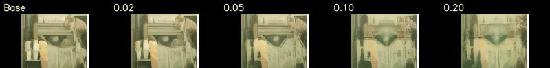

# Long-run training record

**Status:** V2 stopped by guard; NoNat control completed; V3 stabilization preflight pending.

## Research question

The project does not ask only whether a differentiable reward can be optimized. It asks:

> Can temporal-LoRA post-training improve held-out I2V motion while preserving subject identity and pixel naturalness, and can that optimization remain stable beyond a short probe?

A training reward increase is insufficient. A successful run must pass numerical-stability, held-out automatic, and human-perception gates.

## Fixed evaluation hierarchy

1. **Optimization signal:** finite reward gradients and non-zero LoRA updates.
2. **Numerical stability:** no loss/gradient/shift guard violation over the full run.
3. **Held-out metrics:** evaluation prompts and first frames are disjoint from training.
4. **Perceptual evidence:** matched-seed blind preference, reported separately from reward metrics.

Only levels 1–2 have partial positive evidence. Current artifacts do not establish a held-out quality improvement.

## 500-step ablation result

| Configuration | Appeal | Naturalness | Dynamic | Decision |
|---|---:|---:|---:|---|
| Base | 0.7295 | 0.9515 | 0.5075 | Reference |
| V1 hard clamp | 0.7294 | 0.9515 | 0.5074 | Dead naturalness gradient |
| V2 sigmoid | 0.7291 | 0.9513 | 0.5069 | Gradient repaired; no held-out gain |
| NoNat | 0.7296 | 0.9512 | 0.5079 | No meaningful held-out gain |

The reported V2 naturalness change from -1.47 to -0.79 is a **training reward component**, not an external naturalness improvement.

## 2,000-step NoNat control

Artifact: `outputs/opsd_long_no_nat/train_metrics.jsonl`.

- Completed all 2,000 steps and wrote the final checkpoint.
- Mean `loss_plus` was 0.00660 over the first 20 steps and 0.00640 over the final 20.
- Mean shift ratio moved from 0.0463 to 0.0415.
- LoRA-B norm reached 0.9875.
- The run demonstrates numerical stability without the naturalness component; it does not demonstrate perceptual quality and remains vulnerable to reward hacking.

## 2,000-step V2 attempt

Artifacts:

- `outputs/opsd_long_v2/train_metrics.jsonl`
- `outputs/opsd_long_v2/GUARD_STOP.json`

The run stopped at step 306 under the pre-registered guard. The 20-step mean of `loss_plus` increased from 0.00660 initially to 0.10858 before termination; the guard recorded a 10.95× increase over its baseline window. LoRA-B norm reached 2.13 and the naturalness component remained active, but this cannot be interpreted as successful learning because the finite-step fit had already destabilized.

### Diagnosis

The historical objective was

\[
\lVert\hat y-y^+\rVert_2^2-\lVert\hat y-y^-\rVert_2^2.
\]

The subtraction of two quadratic distances is not lower-bounded as a function of \(\hat y\). During a long run it can continue rewarding motion away from the negative target without an explicit behavior anchor. The V2 reward path also mapped decoded pixels through a hard clamp before computing naturalness, giving zero pixel-mapping derivatives outside the display range.

These are algorithmic stability problems, not evidence that 2,000 steps merely need to be rerun unchanged.

## V3 stabilization intervention

V3 keeps the V2 dataset, LoRA, learning rate, `c_adv`, EMA schedule, and reward weights fixed. It changes two diagnosed mechanisms:

1. **Bounded anchored fitting**

\[
\mathcal L_{\mathrm{V3}}
=\lVert\hat y-y^+\rVert_2^2
+\lambda_{\mathrm{anchor}}\lVert\hat y-y_0\rVert_2^2,
\qquad \lambda_{\mathrm{anchor}}=0.25.
\]

The negative target is retained as a diagnostic but is no longer an unbounded repulsive objective.

2. **Smooth pixel mapping**

The naturalness reward uses `(tanh(video) + 1) / 2` rather than a hard `[-1,1]` clamp so extreme decoded pixels retain a gradient.

Configurations:

- `configs/probe_v3_stable.yaml`: 100-step preflight.
- `configs/long_v3_stable.yaml`: 2,000-step run, launched only after the preflight passes.

## V3 100-step preflight result

Artifacts: `outputs/probe_v3_stable/train_metrics.jsonl`, `train.log`, `guard.log`, and checkpoints at steps 50/100.

The production-resolution preflight completed 100 steps in 1,219 seconds without a guard trip.

| Metric | First 20-step mean | Last 20-step mean | Observed maximum |
|---|---:|---:|---:|
| `loss_plus` | 0.00660 | 0.00681 | 0.01035 |
| `loss_anchor` | 0.000299 | 0.000351 | 0.001179 |
| `param_grad_norm` | 5.79e-5 | 8.22e-5 | 2.38e-4 |
| `shift_ratio` | 0.0463 | 0.0494 | 0.1378 |
| Naturalness reward component | -0.8954 | -0.7820 | 0.2537 |
| Subject consistency | 0.9857 | 0.9826 | 0.9954 |

Checkpoints at steps 50 and 100 are present. This passes the preflight stability gate and permits the pre-registered 2,000-step run; it is not a quality result.

## V3 2,000-step attempt: failed at step 522

Artifact: `outputs/opsd_long_v3_stable/GUARD_STOP.json`.

The long run did not reproduce the apparent 100-step safety because the probe's cosine schedule had already decayed its learning rate to zero at step 100, while the 2,000-step run still used approximately `1e-4`. The guard stopped V3 at step 522 when the rolling pre-clip parameter-gradient norm reached `0.00246`, more than 20× its `0.00007` initial baseline.

| Window | `loss_plus` mean | Pre-clip parameter-gradient mean | LoRA-B norm mean |
|---|---:|---:|---:|
| 1–50 | 0.00666 | 6.52e-5 | 0.0731 |
| 201–300 | 0.01082 | 3.20e-4 | 1.3384 |
| 401–450 | 0.01330 | 8.14e-4 | 1.8551 |
| 501–522 | 0.02131 | 5.09e-3 | 2.1266 |

Subject consistency and target displacement had not collapsed, but the progressively increasing fit loss and gradient spikes are genuine optimization drift rather than a guard false positive. V3 therefore fails the registered long-run stability gate.

## V4 pre-registration: effective gradient control

V3 configured `grad_clip: 1.0`, roughly four orders of magnitude above its initial parameter-gradient norm; even its largest observed single-step spike, about 0.09, was not clipped. V4 changes exactly one optimization hyperparameter:

- `grad_clip`: `1.0` → `1e-3`.

The trainer now records both `raw_param_grad_norm` and the post-clip effective `param_grad_norm`. Existing fit, displacement, identity, reward, and naturalness guards stay fixed. An additional diagnostic guard stops if the 50-step mean raw norm exceeds 0.1. The run uses `configs/long_v4_gradclip.yaml`; step 600 is the first promotion checkpoint because it lies beyond the V3 failure point, but the same run continues to step 2,000 if all guards pass.

This is a stabilization hypothesis only. Completion still cannot establish quality without the registered held-out and human gates.

The first V4 process reached step 1038 without an algorithmic guard trip, then a concurrently launched development renderer exhausted GPU memory and RAFT raised CUDA OOM. That process is invalid as a completion attempt; the exact configuration is restarted from step 0 in `outputs/opsd_long_v4_gradclip_rerun`, with no concurrent GPU work permitted.

A step-1000 full-strength development smoke produced severe green/overexposed output despite the training guard remaining healthy. This confirms that numerical stability is not perceptual quality and that unit-scale LoRA is not a viable release candidate.



The displayed input is development-only. Before viewing the disjoint confirmatory split, the completion route was frozen as follows:

1. compare checkpoints 500/1000/1500/2000 at scales 0.01/0.02/0.05 on six development pairs;
2. require Δnaturalness ≥ -0.02 and Δappeal ≥ -0.02;
3. maximize `Δappeal + 0.5·Δnaturalness + 0.5·Δdynamic`, with deterministic tie breaks;
4. evaluate the single selected candidate on a disjoint 40-pair COCO-validation split.

`scripts/select_v4_candidate.py` implements development selection and `scripts/eval_candidate.py` performs the confirmatory render. A metric can be described as improved only when the paired-bootstrap 95% interval for candidate-minus-base lies entirely above zero.

## V3 pre-registered gates

| Gate | Threshold | Action on failure |
|---|---|---|
| Finite metrics | No NaN/Inf in loss, reward, gradient, shift, or LoRA norm | Stop |
| Positive-fit growth | Rolling `loss_plus` mean ≤10× initial baseline | Stop |
| Parameter gradient | Rolling `param_grad_norm` mean ≤20× initial baseline | Stop |
| Target displacement | Rolling `shift_ratio` mean ≤0.25 | Stop |
| Checkpointing | Steps 50 and 100 present in preflight | Do not promote |
| Long-run completion | Step 2,000 checkpoint and metrics present | Otherwise report incomplete |
| Held-out quality | Confidence interval over held-out prompts excludes zero in the favorable direction | Otherwise no quality claim |
| Human preference | Blind matched-seed preference exceeds chance with uncertainty interval | Otherwise no perceptual claim |

## Exact launch commands

```bash
cd 08-video-opsd-i2v
source .venv/bin/activate
export PYTHONPATH="$PWD"

mkdir -p outputs/probe_v3_stable
python -m src.train_entry --method opsd_i2v --config configs/probe_v3_stable.yaml \
  > outputs/probe_v3_stable/train.log 2>&1 &
TRAIN_PID=$!
python ../tools/train_guard.py \
  --kind i2v \
  --log outputs/probe_v3_stable/train_metrics.jsonl \
  --pid "$TRAIN_PID" \
  --poll 5 \
  --stall-sec 1200
wait "$TRAIN_PID"
```

The command, exit state, guard record, metric summary, and checkpoint inventory must be appended here before V3 is described as completed.

## Claim boundary

At present the project establishes a working I2V reward-gradient path, diagnoses dead gradients and reward hacking, and records a genuine long-run instability. It does **not** yet establish superior I2V generation quality.

<!-- V4_RESULT_START -->
## V4 final result

V4 training and the frozen dev/confirmatory evaluation route are active. This block is replaced by `scripts/publish_v4_result.py` after the run terminates.
<!-- V4_RESULT_END -->
