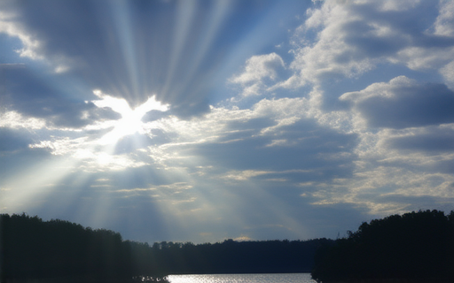

# Tier 1 sample outputs

These clips are from the **mini-pipeline smoke test** (2 prompts × 1 seed × 2 methods,
`configs/tier1_mini_smoke.yaml`) run on an M3 Pro / MPS on 2026-10-28. The full
`n=50` run is still generating; see the project README for live progress.

Each clip is 16 frames @ 8 fps, 320×512, generated by:
`SD3.5-M (±OPSD LoRA) → first frame → DynamiCrafter 25-step DDIM → .mp4`.

---

## Prompt 1: *"sun rays shining through clouds over a lake, camera tilts down"*

| First frame (SD3.5-M, 20 steps) | | |
|---|---|---|
| **Base SD3.5-M** | **OPSD-tuned SD3.5-M** | **Δ** |
|  |  | mean \|Δ\| = 75/255 ≈ 29% |

| 16-frame video (DynamiCrafter frozen) | |
|---|---|
| [sunrays_base.mp4](sunrays_base.mp4) (582 KB) | [sunrays_opsd.mp4](sunrays_opsd.mp4) (1.1 MB) |

## Prompt 2: *"chinese pagoda in the middle of a snowy day, camera static"*

| 16-frame video | |
|---|---|
| [prompt1_base.mp4](prompt1_base.mp4) (1.1 MB) | [prompt1_opsd.mp4](prompt1_opsd.mp4) (1.4 MB) |

---

## Quantitative deltas (n=2, not significant yet)

| dim | base | OPSD | Δ |
|---|---|---|---|
| aesthetic_quality | 0.521 | 0.535 | **+0.013** |
| dynamic_degree | 0.309 | 0.489 | **+0.180** |
| motion_smoothness | 0.368 | 0.368 | +0.000 |
| subject_consistency | 0.970 | 0.968 | −0.001 |

The pipeline is validated end-to-end. The headline table over n=50 prompts × 2 seeds
(400 videos total) is being generated now.
