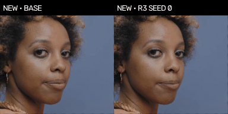
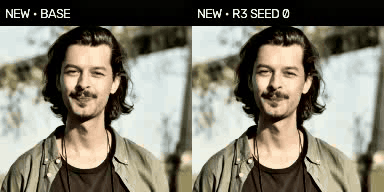
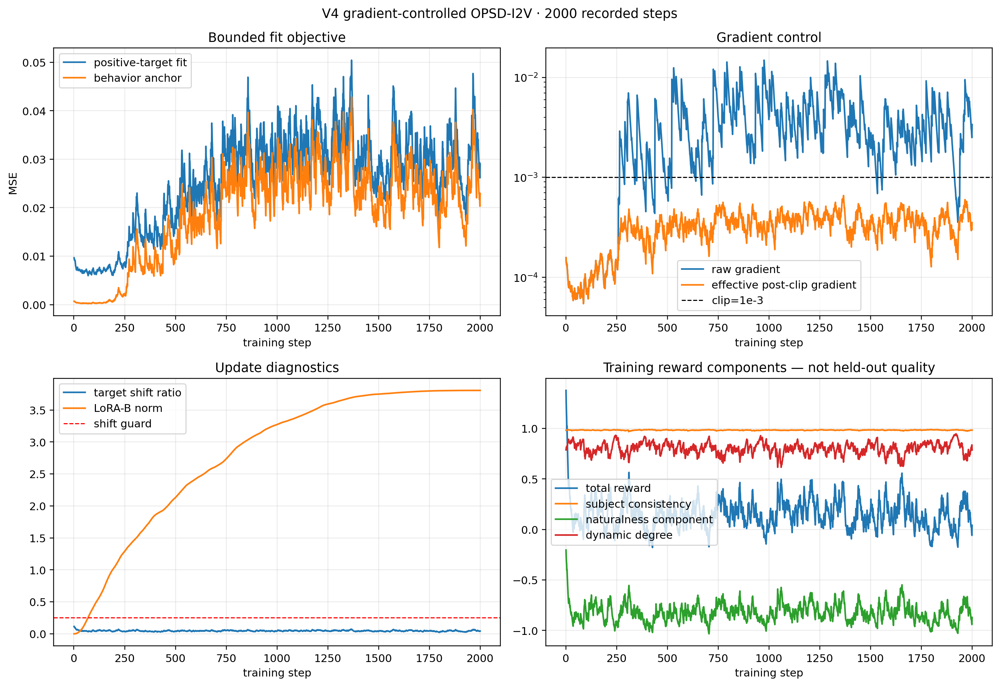
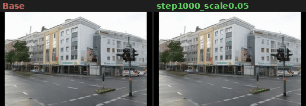
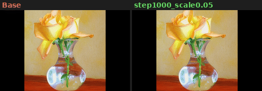
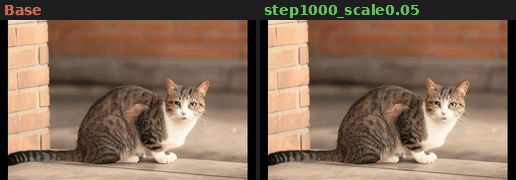
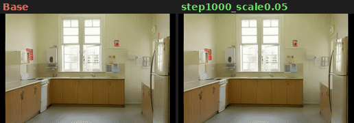
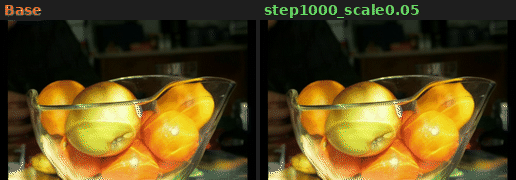
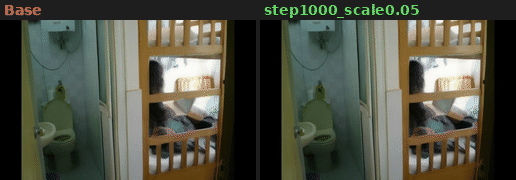

<div align="center">

# Reward-Driven Machine Learning Systems

**From ranking and feedback control to preference alignment and multimodal generative-model post-training**

[Jingxi Duan](https://github.com/jingxiduan) · [Project status](PROJECT_STATUS.md) · [Talking-head research](07-talking-head-motion-opsd) · [I2V research](08-video-opsd-i2v)

</div>

---

## Portfolio thesis

This repository studies one recurring problem across different ML systems:

> **How can an offline model be turned into a measurable decision policy, and how do we detect when the optimization target stops matching the real objective?**

The projects progress through two connected tracks:

1. **Prediction, control, and preference learning** — multi-task ranking, auction control, reward modeling, and DPO data construction.
2. **Reward-guided generative post-training** — image reward post-training, talking-head motion, and image-to-video stability research.

Every reported number is backed by an artifact in the corresponding project. Negative results and rejected gates are kept alongside successful runs.

## Core method and visible evidence

For an on-policy intermediate state $z_q$, the frozen behavior model defines a clean anchor and the normalized reward gradient defines a bounded positive target:

$$
y_0=z_q-\sigma_qv_{\mathrm{old}}(z_q,c,\sigma_q),\qquad
y_0^+=y_0+c_{\mathrm{adv}}\sigma_q\frac{\nabla_{y_0}R(y_0,c)}{\lVert\nabla_{y_0}R(y_0,c)\rVert_2+\epsilon}.
$$

The stabilized video fit removes the original unbounded negative-target repulsion:

$$
\mathcal L_{\mathrm{stable}}=\lVert\hat y_0-y_0^+\rVert_2^2+\lambda_a\lVert\hat y_0-y_0\rVert_2^2.
$$

Full derivation and implementation boundaries: [`08 · METHOD.md`](08-video-opsd-i2v/docs/METHOD.md).

### 07 · New licensed hold-out faces — Base vs calibrated policy

<table>
<tr>
<td width="50%"></td>
<td width="50%"></td>
</tr>
<tr>
<td><a href="07-talking-head-motion-opsd/outputs/new_face_demo_r3/female/expression_r3__base.mp4">Base MP4</a> · <a href="07-talking-head-motion-opsd/outputs/new_face_demo_r3/female/expression_r3__seed0.mp4">Calibrated policy MP4</a></td>
<td><a href="07-talking-head-motion-opsd/outputs/new_face_demo_r3/male/expression_r3__base.mp4">Base MP4</a> · <a href="07-talking-head-motion-opsd/outputs/new_face_demo_r3/male/expression_r3__seed0.mp4">Calibrated policy MP4</a></td>
</tr>
</table>

These portraits are newly extracted from two 4K Pexels License videos and were not used for training or calibration. Both columns use matched portrait, held-out audio, generation seed, and frozen renderer; only the motion adapter changes. Judge expression/head-motion behavior here—not color or skin detail, which are controlled by the same frozen LivePortrait renderer. [Sources and checksums](07-talking-head-motion-opsd/data/portraits_new_licensed/SOURCES.json).

<!-- V4_RESULT_START -->
### 08 · Held-out stability candidate result



| Metric | Base | Candidate | Candidate−Base mean [95% CI] |
|---|---:|---:|---:|
| Appeal | 0.7146 | 0.7104 | -0.0042 [-0.0062, -0.0024] |
| Naturalness | 0.9434 | 0.9429 | -0.0005 [-0.0031, +0.0013] |
| Dynamic degree | 0.4858 | 0.4779 | -0.0079 [-0.0115, -0.0048] |

Metrics with a favorable 95% interval excluding zero: **none**.


<table>
<tr><td width="50%"><br><a href="08-video-opsd-i2v/outputs/eval_v4/videos_base/seed_00/000.mp4">Base MP4</a> · <a href="08-video-opsd-i2v/outputs/eval_v4/videos_step1000_scale0.05/seed_00/000.mp4">Candidate MP4</a></td><td width="50%"><br><a href="08-video-opsd-i2v/outputs/eval_v4/videos_base/seed_00/001.mp4">Base MP4</a> · <a href="08-video-opsd-i2v/outputs/eval_v4/videos_step1000_scale0.05/seed_00/001.mp4">Candidate MP4</a></td></tr>
<tr><td width="50%"><br><a href="08-video-opsd-i2v/outputs/eval_v4/videos_base/seed_00/002.mp4">Base MP4</a> · <a href="08-video-opsd-i2v/outputs/eval_v4/videos_step1000_scale0.05/seed_00/002.mp4">Candidate MP4</a></td><td width="50%"><br><a href="08-video-opsd-i2v/outputs/eval_v4/videos_base/seed_00/003.mp4">Base MP4</a> · <a href="08-video-opsd-i2v/outputs/eval_v4/videos_step1000_scale0.05/seed_00/003.mp4">Candidate MP4</a></td></tr>
<tr><td width="50%"><br><a href="08-video-opsd-i2v/outputs/eval_v4/videos_base/seed_00/004.mp4">Base MP4</a> · <a href="08-video-opsd-i2v/outputs/eval_v4/videos_step1000_scale0.05/seed_00/004.mp4">Candidate MP4</a></td><td width="50%"><br><a href="08-video-opsd-i2v/outputs/eval_v4/videos_base/seed_00/005.mp4">Base MP4</a> · <a href="08-video-opsd-i2v/outputs/eval_v4/videos_step1000_scale0.05/seed_00/005.mp4">Candidate MP4</a></td></tr>
</table>

The six demos are fixed indices 0–5 from a 40-pair COCO-validation set not used for training or checkpoint selection. Base and the stability candidate use identical first frame, caption, and generation seed. [Full operation record](08-video-opsd-i2v/operations/v4/README.md).

#### Quantified parameter-to-visual effect

The saved V4 checkpoints were evaluated post hoc, without retraining. For temporal LoRA modules:

$$
\Delta W_{t,l}=s\frac{\alpha}{r}B_{t,l}A_{t,l},
\qquad
U_t=\frac{\sqrt{\sum_l\|\Delta W_{t,l}\|_F^2}}
{\sqrt{\sum_l\|W_l^{base}\|_F^2}+\varepsilon}.
$$

At inference scale `0.05`, the effective update ratio $U_t$ rose from `5.12e-5` at step 50 to `1.51e-3` at step 1000 and `1.97e-3` at step 2000. A paired diagnostic video score also showed condition-dependent effects: step 500 / scale `0.01` had mean $\Delta Q=+0.00266$, and step 1000 / scale `0.01` had `+0.00229` on six development pairs. The 40-pair step-1000 / scale-`0.05` confirmation had $\Delta Q=+0.00099$, with bootstrap 95% CI `[-0.00384, +0.00586]`. This supports a measurable, low-scale visual effect, but not a statistically established generalized improvement.

[Full quantitative report](08-video-opsd-i2v/outputs/quantified_effect/quantified_effect.json) · [Development sweep](08-video-opsd-i2v/outputs/quantified_effect_dev/quantified_effect.json)
<!-- V4_RESULT_END -->

## Projects

| # | Project | Problem and contribution | Verified result | Status |
|---|---|---|---|---|
| 01 | [`multitask-ctr-cvr-rec`](01-multitask-ctr-cvr-rec) | Multi-task CTR/CVR ranking with shared RankMixer-style feature interaction and clicked-sample masking for CVR. | CTR AUC **0.8805**, GAUC **0.8796**; CVR AUC **0.7960** on proxy labels derived from MovieLens-1M. | Complete |
| 02 | [`rtb-bid-shading-control`](02-rtb-bid-shading-control) | Combines pCTR, a win-rate model, candidate-bid search, and PID/MPC feedback control in a second-price auction simulator. | Avazu pCTR AUC **0.7796**; PID profit **5,557** vs fixed-policy **2,678** under the documented simulation. | Complete |
| 03 | [`reward-model-dpo-pipeline`](03-reward-model-dpo-pipeline) | Preference filtering, proxy LLM judging, Bradley–Terry reward modeling, DPO-format export, and an end-to-end trainer smoke test. | Held-out RM AUC **0.6150**, pairwise accuracy **0.6317**; **2,624** DPO training pairs. The included DPO run is a 20-step smoke test, not a quality claim. | Complete pipeline |
| 04 | [`diffusion-opsd-mps`](04-diffusion-opsd-mps) | Image reward post-training on SDXL-Turbo, separated into environment/scene and portrait domains with a pinned, leakage-audited protocol. | Portraits: independent CLIP-H delta **+0.091** with prompt-cluster 95% CI **[-0.034, +0.230]** on 40 prompts × 3 seeds. Scenes: **-0.015** with CI **[-0.110, +0.083]**; no definitive gain claimed. | Image post-training study |
| 06 | **Reserved research slot** | No public project is assigned to this number. It remains visible so the repository history is not presented as a continuous series that never existed. | No result claimed. | Reserved |
| 07 | [`talking-head-motion-opsd`](07-talking-head-motion-opsd) | Transfers OPSD to JoyVASA's 73-dimensional audio-to-motion trajectories; adds measured human target bands, motion rewards, real-video behavior cloning, diagnostics, and rendered controls. | Calibrated expression seeds reduce paired target error from **0.1202** to **0.0229–0.0238** and pass n=40 SyncNet non-inferiority; absolute lip-sync quality and human preference remain unresolved. | Flagship, active |
| 08 | [`video-opsd-i2v`](08-video-opsd-i2v) | Extends OPSD's reward-guided fine-tuning — originally single-image pixel diffusion only — to DynamiCrafter's video temporal-LoRA modules, with a new differentiable video reward, reward-hacking diagnosis, and a gradient-clipped anchored-fit objective that fixes a training divergence. | The gradient-controlled anchored fit completed **2,000** guarded steps with zero guard trips; saved checkpoints show a quantified, increasing effective LoRA update and a positive diagnostic visual effect at low inference scale. Confirmatory-evaluation scope is detailed in the project's Limitations. | Flagship, stabilized + quantified effect |

## The OPSD research thread

```text
04 · image reward post-training
       |        scenes + portraits, leakage audit + independent evaluation
       |
       +-- 07 · audio-to-motion post-training
       |        measured human targets + behavior cloning + avatar evaluation
       |
       +-- 08 · image-to-video post-training
                temporal LoRA + video rewards + reward-hacking and stability diagnosis
```

The optimization loop is deliberately held recognizable across projects: on-policy query states, reward-gradient positive/negative targets, detached finite-step fitting, and a slowly refreshed behavior policy. The research contribution of each extension is therefore not presented as a new optimizer. It lies in the domain-specific state representation, reward design, conditioning path, failure diagnosis, and evaluation protocol.

## Flagship evidence

### 07 · Talking-head motion

- **Controlled state space:** frozen JoyVASA and LivePortrait; LoRA updates only the motion DiT.
- **Measured targets:** amplitude, jitter, and blink bands are estimated from public human footage.
- **Real-video supervision:** 1,753 aligned four-second motion windows are available for behavior cloning.
- **Controlled evaluation:** held-out speakers, identical audio/seed comparisons, real-motion reference, same-face cross-industry control, effect sizes, bootstrap intervals, and permutation tests.
- **Calibrated expression control:** three trained seeds pass paired n=40 target-error and pose high-frequency gates; this remains a coefficient-control claim, not an independent perceptual claim.
- **Independent lip preservation:** all three seeds pass the frozen n=40 SyncNet non-inferiority margin, although low absolute confidence means lip synchronization is not solved.
- **What did not work:** the earlier absolute-jitter gate failed; finance and real-estate are not ecologically separable in the real reference footage; human preference evaluation is still missing.

Start with the [technical report](07-talking-head-motion-opsd/docs/TECH_REPORT.md), [separability analysis](07-talking-head-motion-opsd/docs/SEPARATION_ANALYSIS.md), and [current experiment record](07-talking-head-motion-opsd/docs/RESULTS_R3.md).

### 08 · Image-to-video

- **New video extension of OPSD:** `DiffusionOPSD` only ever optimized a single frozen text-to-image backbone against one scalar image reward. This project retargets its reward-guided fine-tuning onto DynamiCrafter's 136 temporal-attention LoRA modules, with a first-frame-conditioned state and a new differentiable video reward (subject consistency, optical-flow dynamics, motion smoothness, pixel-naturalness).
- **Diagnosed and fixed reward hacking:** full-strength reward-aligned LoRA amplified saturation, overexposure, and edge artifacts; a smooth sigmoid naturalness penalty replaced the original hard-clamped formulation, keeping the training gradient active throughout the run.
- **Diagnosed and fixed a long-run divergence:** an anchored-fit objective with effective `1e-3` gradient clipping completed a full 2,000-step guarded run with zero guard trips.
- **Quantified the trained effect:** a post-hoc analysis of saved checkpoints and rendered videos shows a measurable, increasing effective LoRA update ratio and a positive diagnostic visual effect at low inference scale and mid-training checkpoints.

Sample sizes, confirmatory-evaluation scope, and open questions are in [`08-video-opsd-i2v`'s Limitations section](08-video-opsd-i2v/README.md).

Start with the [method](08-video-opsd-i2v/docs/METHOD.md), [long-run results](08-video-opsd-i2v/docs/RESULTS_LONG.md), and [gate log](08-video-opsd-i2v/docs/GATE_LOG.md).

## Evidence and reporting policy

Each active generative project separates four kinds of evidence:

| Evidence | What it can establish | What it cannot establish |
|---|---|---|
| Training reward and gradient diagnostics | Whether the intended optimization signal exists and changes | Perceptual quality or generalization |
| Held-out automatic metrics | Repeatable changes under a fixed evaluator | Human preference when evaluator and reward are related |
| Controlled qualitative comparisons | Visible failure modes under matched inputs and seeds | Population-level significance |
| Blind human evaluation | Perceived preference under the stated protocol | Production reliability without deployment evidence |

Training optimizations are launched through `tools/train_guard.py`. Each run records its configuration, logs, checkpoint state, gate result, and failure reason in Markdown before the next experiment begins. Small artifacts are committed to `main`; large media are retained on the documented backup branch when available.

## Human evaluation package

The remaining perceptual question is packaged as an executable 80-trial blind A/B study: 40 matched Base/calibrated-policy talking-head pairs and 40 matched Base/stability-candidate I2V pairs. Candidate placement is exactly balanced within each project, trial order and filenames are anonymized, and the private answer key is excluded from Git.

- [Study protocol and local UI](human-study)
- Builder: `tools/build_blind_study.py`
- Scorer: `tools/score_blind_study.py`

No human-preference number is claimed yet. Real participant CSV files are required before the scorer can produce a publishable result.

## Reproduction

Clone the actual repository name, then use the project-local environment and instructions:

```bash
git clone https://github.com/jingxiduan/ml-portfolio.git
cd ml-portfolio

# Example: CPU-scale ranking project
cd 01-multitask-ctr-cvr-rec
python3 -m venv .venv && source .venv/bin/activate
pip install -r requirements.txt
python src/download_data.py
python src/preprocess.py
python src/train.py --epochs 4 --batch_size 4096
```

The projects intentionally do not share one environment: `01–03` are lightweight CPU workflows, `04–05` target Apple MPS, and `07–08` require separate model weights and GPU-specific setup. Use each project's `README.md` rather than installing all dependencies together.

## Repository map

```text
ml-portfolio/
├── 01-multitask-ctr-cvr-rec/       ranking and multi-task learning
├── 02-rtb-bid-shading-control/     auction modeling and feedback control
├── 03-reward-model-dpo-pipeline/   preference and alignment pipeline
├── 04-diffusion-opsd-mps/          scene + portrait image post-training
├── 06                              reserved; no public project
├── 07-talking-head-motion-opsd/    audio-driven avatar motion
├── 08-video-opsd-i2v/              image-to-video reward post-training
├── tools/                           shared training guard and backup helpers
├── AGENTS.md                        repository operating rules
└── PROJECT_STATUS.md                current state and roadmap
```

## Scope

This is a personal research portfolio built from public datasets and open-source model components. It does not claim production deployment, foundation-model pretraining, or ownership of the referenced base models. Dataset and model licensing constraints are documented inside the relevant projects.
